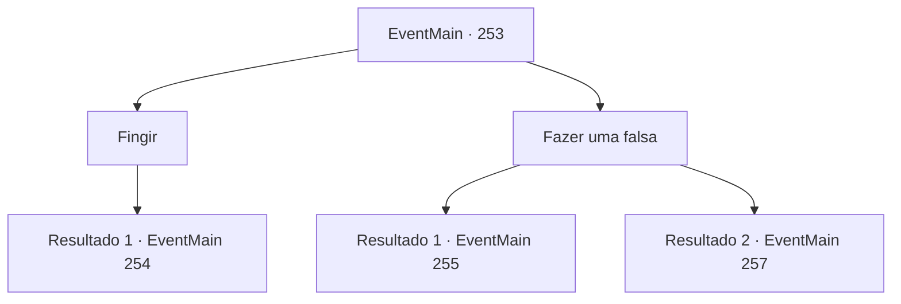

# Eventos principais · 253

[Índice da tabela](index.md) · [Índice geral](../index.md)

ID: `pt:EventMain:253` · Fonte: `EventMain4` · Versão: 1.2.47.

Mapeamento estático dos arquivos; a disponibilidade e a execução dependem do estado da run.

## Texto do evento

*Sem texto no arquivo.*

## Dados de entrada

```json
{
  "id": 253,
  "grade": 1,
  "normalGoal": "",
  "required": ""
}
```

## Mapa das escolhas



## Escolhas e resultados

### Escolha 1

Fingir

Requisitos e outros campos da escolha:

```json
{
  "required": "5_146_0"
}
```

#### Resultado 1.1

Você acha que seria uma boa ideia fazer o Imperador reconhecer suas habilidades. Então você sugere à princesa que você represente derrotando um dragão. Ela cruza os braços em consideração por um momento e abre a boca. 

 "Hmm... suponho que Sua Majestade não terá nada a dizer se vir com seus próprios olhos. Vou perguntar mais uma vez ao Egakin. Você deve imobilizar as balistas nas muralhas do castelo. Parecem novos, acho que foram instalados como arma anti-dragão."

 Depois de terminar, ela vai procurar Egakin imediatamente.

Continuação registrada: [Evento 254](0254.md) na mesma tabela.

```json
{
  "required": "",
  "chance": "1",
  "nextEvent": 254,
  "type": 2,
  "reward": ""
}
```

### Escolha 2

Fazer uma falsa

Requisitos e outros campos da escolha:

```json
{
  "required": ""
}
```

#### Resultado 2.1

Você sugere que eles enganem o Imperador com uma cabeça de dragão falsa. A princesa bate palmas de admiração. 

 "Se você não conhece nenhum ferreiro, sugiro visitar Iron Rise, a famosa comunidade de ferreiros."

 Ela lhe entrega um pouco de ouro, como pagamento pela confecção da cabeça. Você sai do castelo e segue em direção a 'Iron Rise'. 

 À noite, quando o sol está quase se pondo, você chega a uma ferraria de Iron Rise. Você supõe que o trabalho do dia do ferreiro está feito, pois ele está fazendo uma pausa para escovar o suor. Você solicita que uma cabeça de dragão falsa seja feita com aço para o ferreiro. Você também acrescenta que o trabalho deve ser mantido em sigilo. 

 "Huh...? Por que diabos você iria querer forjar uma cabeça de dragão? Já estou sobrecarregado de coisas para fazer..."

 Ele aperta as mãos em rejeição.

Continuação registrada: [Evento 255](0255.md) na mesma tabela.

```json
{
  "required": "",
  "chance": "1",
  "nextEvent": 255,
  "type": 2,
  "reward": "0_4_500"
}
```

#### Resultado 2.2

Você sugere que eles enganem o Imperador com uma cabeça de dragão falsa. A princesa bate palmas de admiração. 

 "Se você não conhece nenhum ferreiro, sugiro visitar Iron Rise, a famosa comunidade de ferreiros."

 Ela lhe entrega um pouco de ouro, como pagamento pela confecção da cabeça. Você sai do castelo e segue em direção a 'Atad Fidette', a cidade dos anões que você visitou da última vez. 

 À noite, quando o sol está quase se pondo, você chega à cidade dos anões. Você encontra 'Brigby' e solicita que uma cabeça de dragão falsa seja forjada. 

 "Ahh, não vejo motivo para rejeitar seu pedido. Deixe-me com isso! Não tenho certeza de qual parede de nobre seria colocada, mas vou torná-la tão real que você ficará surpreso!"

 Brigby gesticula para você esperar no canto.

Continuação registrada: [Evento 257](0257.md) na mesma tabela.

```json
{
  "required": "5_94_5",
  "chance": "1",
  "nextEvent": 257,
  "type": 2,
  "reward": "0_4_500"
}
```

## Referências que chegam a este evento

- [Evento 246 · escolha 1 · resultado 2](0246.md#escolha-1)
- [Evento 259 · escolha 2 · resultado 1](0259.md#escolha-2)
