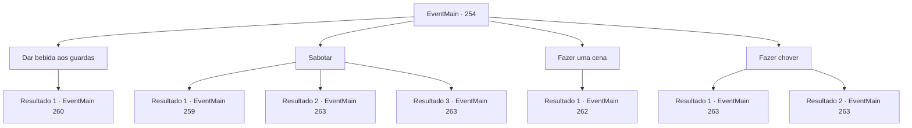

# Eventos principais · 254

[Índice da tabela](index.md) · [Índice geral](../index.md)

ID: `pt:EventMain:254` · Fonte: `EventMain4` · Versão: 1.2.47.

Mapeamento estático dos arquivos; a disponibilidade e a execução dependem do estado da run.

## Texto do evento

*Sem texto no arquivo.*

## Dados de entrada

```json
{
  "id": 254,
  "grade": 1,
  "normalGoal": "",
  "required": ""
}
```

## Mapa das escolhas



## Escolhas e resultados

### Escolha 1

Dar bebida aos guardas

Requisitos e outros campos da escolha:

```json
{
  "required": "5_145_0"
}
```

#### Resultado 1.1

Você acha que seria capaz de distrair os guardas na muralha do castelo se lhes apresentasse uma bebida de alta qualidade que eles nunca teriam a chance de provar. Então você visita a cozinha do palácio real. 

 "Huh? Quem é Você? Esta área é apenas para pessoal autorizado."

 O chef, com uma expressão calorosa e um bigode marrom característico, bloqueia você com os braços cruzados.

Continuação registrada: [Evento 260](0260.md) na mesma tabela.

```json
{
  "required": "",
  "chance": "1",
  "nextEvent": 260,
  "type": 2,
  "reward": ""
}
```

### Escolha 2

Sabotar

Requisitos e outros campos da escolha:

```json
{
  "required": ""
}
```

#### Resultado 2.1

Você se esgueira até a balista na muralha do castelo e os soldados que a guardam. Mas sua habilidade desleixada revela você a eles. 

 "Você aí! Se identifique!"

 Os soldados sacam suas armas em um instante e correm para você.

Continuação registrada: [Evento 259](0259.md) na mesma tabela.

```json
{
  "required": "",
  "chance": "13",
  "nextEvent": 259,
  "type": 1,
  "reward": "6_0_92",
  "place": 7
}
```

#### Resultado 2.2

Você se esgueira até a balista na muralha do castelo e os soldados que a guardam. Eles não têm noção da sua presença e, um por um, você puxa as engrenagens da balista. Então você sai de cena com sucesso, escondido nas sombras. Você espera pela princesa depois de completar sua parte da missão. 

 Após uma curta espera, uma empregada se aproxima de você. Ela diz que a princesa deseja vê-lo e olha para você, como se estivesse sinalizando para você seguir. Você segue a empregada até o quarto da princesa. A empregada então fecha a porta, e apenas você e a princesa ficam no quarto. Ela se aproxima de você e fala baixinho como se estivesse sussurrando. 

 "Pedi a Egakin para me ajudar mais uma vez. Assim que o sol se põe, um dragão voará ao redor da sala do trono do Imperador, e você deve salvar Sua Majestade depois de lutar contra o dragão."

 Um breve silêncio enche o ar depois que ela termina. Ainda falta algum tempo até o pôr do sol. 

Continuação registrada: [Evento 263](0263.md) na mesma tabela.

```json
{
  "required": "",
  "chance": "1|0_6_1",
  "nextEvent": 263,
  "type": 0,
  "reward": ""
}
```

#### Resultado 2.3

Você se esgueira até a balista na muralha do castelo e os soldados que a guardam. Eles não têm noção da sua presença e, um por um, você puxa as engrenagens da balista. Então você sai de cena com sucesso, escondido nas sombras. Depois de terminar sua parte da missão, você visita a biblioteca para esperar pela princesa. 

 Após uma curta espera, uma empregada se aproxima de você. Ela diz que a princesa deseja vê-lo e olha para você, como se estivesse sinalizando para você seguir. Você segue a empregada até o quarto da princesa. A empregada então fecha a porta, e apenas você e a princesa ficam no quarto. Ela se aproxima de você e fala baixinho como se estivesse sussurrando. 

 "Pedi a Egakin para me ajudar mais uma vez. Assim que o sol se põe, um dragão voará ao redor da sala do trono do Imperador, e você deve salvar Sua Majestade depois de lutar contra o dragão."

 Um breve silêncio enche o ar depois que ela termina. Ainda falta algum tempo até o pôr do sol. 

Continuação registrada: [Evento 263](0263.md) na mesma tabela.

```json
{
  "required": "20_5_2",
  "chance": "1|0_6_1",
  "nextEvent": 263,
  "type": 0,
  "reward": ""
}
```

### Escolha 3

Fazer uma cena

Requisitos e outros campos da escolha:

```json
{
  "required": ""
}
```

#### Resultado 3.1

Você se aproxima dos soldados que guardam a muralha do castelo e pede para ver a balista. 

 "Eu não sei quem você é, mas esta área está fora dos limites. Por favor, volte agora."

 Eles realmente não sabem quem você é, mas parecem reconhecer seu rosto como um conhecido do castelo. Eles falam com você com cuidado, provavelmente pensando que você é alguém de alto status. 

Continuação registrada: [Evento 262](0262.md) na mesma tabela.

```json
{
  "required": "",
  "chance": "1",
  "nextEvent": 262,
  "type": 2,
  "reward": ""
}
```

### Escolha 4

Fazer chover

Requisitos e outros campos da escolha:

```json
{
  "required": "1_7_14|20_0_1"
}
```

#### Resultado 4.1

Você usa magia para invocar nuvens negras. Logo uma chuva forte começa a cair, e os soldados desenrolam as cordas da balista e a colocam no depósito. Depois de terminar sua parte da missão, você visita a biblioteca para esperar pela princesa. 

 Após uma curta espera, uma empregada se aproxima de você. Ela diz que a princesa deseja vê-lo e olha para você, como se estivesse sinalizando para você seguir. Você segue a empregada até o quarto da princesa. A empregada então fecha a porta, e apenas você e a princesa ficam no quarto. Ela se aproxima de você e fala baixinho como se estivesse sussurrando. 

 "Pedi a Egakin para me ajudar mais uma vez. Assim que o sol se põe, um dragão voará ao redor da sala do trono do Imperador, e você deve salvar Sua Majestade depois de lutar contra o dragão."

 Um breve silêncio enche o ar depois que ela termina. Ainda falta algum tempo até o pôr do sol. 

Continuação registrada: [Evento 263](0263.md) na mesma tabela.

```json
{
  "required": "",
  "chance": "1",
  "nextEvent": 263,
  "type": 2,
  "reward": ""
}
```

#### Resultado 4.2

Você toca a Flauta Conjuradora da Tempestade e traz nuvens negras. Logo uma chuva forte começa a cair, e os soldados desenrolam as cordas da balista e a colocam no depósito. Depois de terminar sua parte da missão, você visita a biblioteca para esperar pela princesa. 

 Após uma curta espera, uma empregada se aproxima de você. Ela diz que a princesa deseja vê-lo e olha para você, como se estivesse sinalizando para você seguir. Você segue a empregada até o quarto da princesa. A empregada então fecha a porta, e apenas você e a princesa ficam no quarto. Ela se aproxima de você e fala baixinho como se estivesse sussurrando. 

 "Pedi a Egakin para me ajudar mais uma vez. Assim que o sol se põe, um dragão voará ao redor da sala do trono do Imperador, e você deve salvar Sua Majestade depois de lutar contra o dragão."

 Um breve silêncio enche o ar depois que ela termina. Ainda falta algum tempo até o pôr do sol. 

Continuação registrada: [Evento 263](0263.md) na mesma tabela.

```json
{
  "required": "8_90_1",
  "chance": "1",
  "nextEvent": 263,
  "type": 2,
  "reward": ""
}
```

## Referências que chegam a este evento

- [Evento 253 · escolha 1 · resultado 1](0253.md#escolha-1)
- [Evento 261 · escolha 1 · resultado 1](0261.md#escolha-1)
- [Evento 261 · escolha 3 · resultado 1](0261.md#escolha-3)
