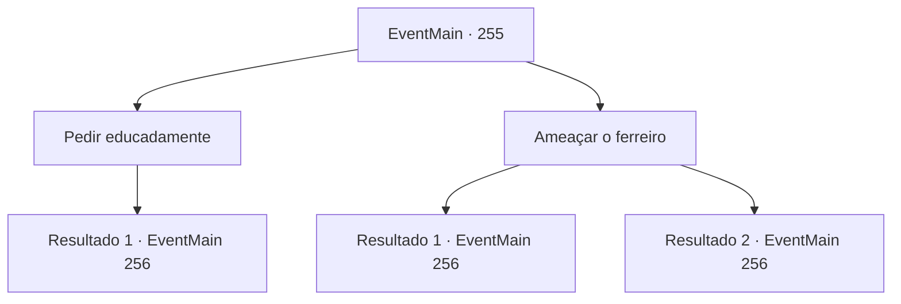

# Eventos principais · 255

[Índice da tabela](index.md) · [Índice geral](../index.md)

ID: `pt:EventMain:255` · Fonte: `EventMain4` · Versão: 1.2.47.

Mapeamento estático dos arquivos; a disponibilidade e a execução dependem do estado da run.

## Texto do evento

*Sem texto no arquivo.*

## Dados de entrada

```json
{
  "id": 255,
  "grade": 1,
  "normalGoal": "",
  "required": ""
}
```

## Mapa das escolhas



## Escolhas e resultados

### Escolha 1

Pedir educadamente

Requisitos e outros campos da escolha:

```json
{
  "required": ""
}
```

#### Resultado 1.1

O ferreiro cruza os braços e balbucia depois de ouvir seu pedido. 

 "Bem, suponho que você me diga como deve ser, vamos ver... com a quantidade de aço que preciso... e o tempo necessário para trabalhar... cerca de... 400 de ouro bastaria."

 Você entrega o ouro. O ferreiro faz algumas perguntas sobre a cabeça do dragão. Então ele diz para você voltar depois de alguns dias e começa a desenhar uma planta em um pergaminho.

Continuação registrada: [Evento 256](0256.md) na mesma tabela.

```json
{
  "required": "",
  "chance": "1",
  "nextEvent": 256,
  "type": 2,
  "reward": "5_144_1|0_4_-400"
}
```

### Escolha 2

Ameaçar o ferreiro

Requisitos e outros campos da escolha:

```json
{
  "required": ""
}
```

#### Resultado 2.1

Você saca sua arma e a empurra para o ferreiro, ameaçando-o. O ferreiro bufa. 

 "Hmph. Mesmo se você perguntasse educadamente, eu teria que considerar aceitar o trabalho... 500 de ouro. É pegar ou largar."

 Você relutantemente entrega 500 ouros e atribui a ele o trabalho. Ele diz para você voltar depois de alguns dias e reacende o fogo em sua fornalha.

Continuação registrada: [Evento 256](0256.md) na mesma tabela.

```json
{
  "required": "",
  "chance": "10",
  "nextEvent": 256,
  "type": 1,
  "reward": "0_4_-500|5_144_2|0_3_-1"
}
```

#### Resultado 2.2

Você saca sua arma e a empurra para o ferreiro, ameaçando-o. O ferreiro recua intimidado e diz. 

 "Calma agora... Eu posso fazer isso para você. Ainda vou precisar de um pouco de ouro para os ingredientes. 200 de ouro seriam suficientes."

 Você entrega 200 de ouro e exige que ele trabalhe. Ele diz para você voltar depois de alguns dias e reacende o fogo em sua fornalha.

Continuação registrada: [Evento 256](0256.md) na mesma tabela.

```json
{
  "required": "",
  "chance": "1|0_12_1",
  "nextEvent": 256,
  "type": 0,
  "reward": "0_4_-200|5_144_3|0_3_-1"
}
```

## Referências que chegam a este evento

- [Evento 247 · escolha 2 · resultado 1](0247.md#escolha-2)
- [Evento 253 · escolha 2 · resultado 1](0253.md#escolha-2)
