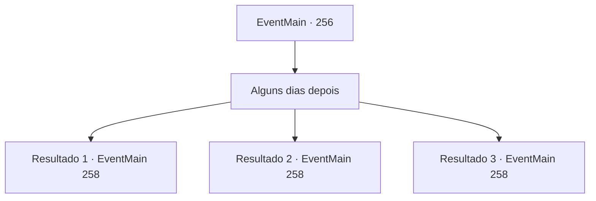

# Eventos principais · 256

[Índice da tabela](index.md) · [Índice geral](../index.md)

ID: `pt:EventMain:256` · Fonte: `EventMain4` · Versão: 1.2.47.

Mapeamento estático dos arquivos; a disponibilidade e a execução dependem do estado da run.

## Texto do evento

*Sem texto no arquivo.*

## Dados de entrada

```json
{
  "id": 256,
  "grade": 1,
  "normalGoal": "",
  "required": ""
}
```

## Mapa das escolhas



## Escolhas e resultados

### Escolha 1

Alguns dias depois

Requisitos e outros campos da escolha:

```json
{
  "required": ""
}
```

#### Resultado 1.1

Alguns dias depois você revisita a ferraria que você atribuiu o trabalho. O ferreiro leva você para uma sala dentro. Então ele lhe apresenta a cabeça de dragão falsa. 

 "Eu me esforcei bastante para criar isso. Não sei em que tipo de parede da nobreza ela será montada, mas pegue-a."

 Você pega a cabeça de dragão de aço falsa elaboradamente feita e siga em direção ao palácio, onde a princesa está esperando. 

 Você pede uma audiência com o Imperador assim que chega ao palácio real. Após uma curta espera, um guarda leva você para a sala de audiência. O Imperador ainda é arrogante como sempre, e olha para você. 

 "Então... você trouxe a cabeça do dragão?"


Continuação registrada: [Evento 258](0258.md) na mesma tabela.

```json
{
  "required": "5_144_1",
  "chance": "1",
  "nextEvent": 258,
  "type": 2,
  "reward": "3_196_1"
}
```

#### Resultado 1.2

Alguns dias depois você revisita a ferraria que você atribuiu o trabalho. O ferreiro leva você para uma sala dentro. Então ele lhe apresenta a cabeça de dragão falsa. Você pega a cabeça falsa do dragão de aço e siga em direção ao palácio, onde a princesa está esperando. 

 Você pede uma audiência com o Imperador assim que chega ao palácio real. Após uma curta espera, um guarda leva você para a sala de audiência. O Imperador ainda é arrogante como sempre, e olha para você. 

 "Então... você trouxe a cabeça do dragão?"


Continuação registrada: [Evento 258](0258.md) na mesma tabela.

```json
{
  "required": "5_144_2",
  "chance": "1",
  "nextEvent": 258,
  "type": 2,
  "reward": "3_195_1"
}
```

#### Resultado 1.3

Alguns dias depois você revisita a ferraria que você atribuiu o trabalho. O ferreiro leva você para uma sala dentro. Então ele lhe apresenta a cabeça de dragão falsa. Você pega a cabeça de dragão de aço falsa elaboradamente feita e siga em direção ao palácio, onde a princesa está esperando. 

 Você pede uma audiência com o Imperador assim que chega ao palácio real. Após uma curta espera, um guarda leva você para a sala de audiência. O Imperador ainda é arrogante como sempre, e olha para você. 

 "Então... você trouxe a cabeça do dragão?"


Continuação registrada: [Evento 258](0258.md) na mesma tabela.

```json
{
  "required": "5_144_3",
  "chance": "1",
  "nextEvent": 258,
  "type": 2,
  "reward": "3_195_1"
}
```

## Referências que chegam a este evento

- [Evento 255 · escolha 1 · resultado 1](0255.md#escolha-1)
- [Evento 255 · escolha 2 · resultado 1](0255.md#escolha-2)
- [Evento 255 · escolha 2 · resultado 2](0255.md#escolha-2)
