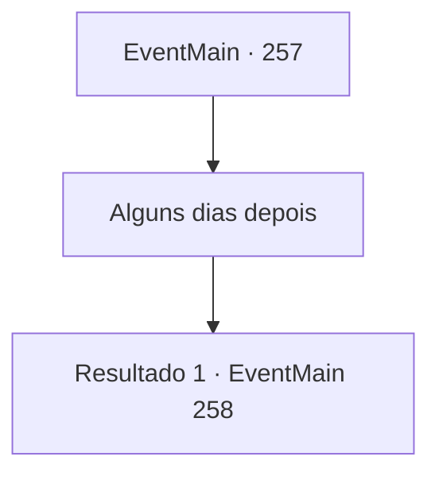

# Eventos principais · 257

[Índice da tabela](index.md) · [Índice geral](../index.md)

ID: `pt:EventMain:257` · Fonte: `EventMain4` · Versão: 1.2.47.

Mapeamento estático dos arquivos; a disponibilidade e a execução dependem do estado da run.

## Texto do evento

*Sem texto no arquivo.*

## Dados de entrada

```json
{
  "id": 257,
  "grade": 1,
  "normalGoal": "",
  "required": ""
}
```

## Mapa das escolhas



## Escolhas e resultados

### Escolha 1

Alguns dias depois

Requisitos e outros campos da escolha:

```json
{
  "required": ""
}
```

#### Resultado 1.1

O conceito de tempo de um anão é um pouco diferente do de um humano, então o que ele quis dizer com 'um tempo' foi na verdade cerca de três dias. Por esse tempo você ficou na casa de Brigby, e ele não deixou sua forja nenhuma vez. Quando você está prestes a se cansar da espera, Brigby vem até você. 

 "Venha. Está acabado agora. Eu vou mostrar para você."

 Ele leva você para a forja e lhe entrega a cabeça de dragão falsa. Parece quase idêntico, o suficiente para enganar o próprio Egakin. Você pega a cabeça do dragão e segue em direção ao palácio, onde a princesa está esperando. 

 Você pede uma audiência com o Imperador assim que chega ao palácio real. Após uma curta espera, um guarda leva você para a sala de audiência. O Imperador ainda é arrogante como sempre, e olha para você. 

 "Então... você trouxe a cabeça do dragão?"


Continuação registrada: [Evento 258](0258.md) na mesma tabela.

```json
{
  "required": "",
  "chance": "1",
  "nextEvent": 258,
  "type": 2,
  "reward": "3_196_1"
}
```

## Referências que chegam a este evento

- [Evento 247 · escolha 2 · resultado 2](0247.md#escolha-2)
- [Evento 253 · escolha 2 · resultado 2](0253.md#escolha-2)
