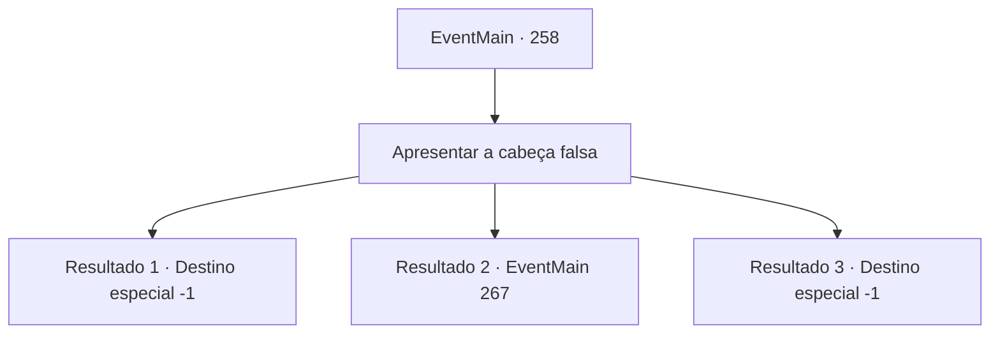

# Eventos principais · 258

[Índice da tabela](index.md) · [Índice geral](../index.md)

ID: `pt:EventMain:258` · Fonte: `EventMain4` · Versão: 1.2.47.

Mapeamento estático dos arquivos; a disponibilidade e a execução dependem do estado da run.

## Texto do evento

*Sem texto no arquivo.*

## Dados de entrada

```json
{
  "id": 258,
  "grade": 1,
  "normalGoal": "",
  "required": ""
}
```

## Mapa das escolhas



## Escolhas e resultados

### Escolha 1

Apresentar a cabeça falsa

Requisitos e outros campos da escolha:

```json
{
  "required": ""
}
```

#### Resultado 1.1

Você tira a cabeça de dragão falsa que você trouxe. Quando eles o veem, todos os membros da corte, e até mesmo o Imperador, percebem que é uma farsa grosseiramente feita. Egakin e a princesa enfrentam a palma da mão, e o Imperador grita furiosamente. <link=shake>

 "Capture essa fraude maldita de uma vez!"

</link> Enquanto o Imperador grita, os guardas correm e o agarram. Eles imediatamente saem da sala de audiência e jogam você em uma cela de prisão, localizada nas masmorras subterrâneas.

Continuação registrada: [Destino especial `-1`](../destinos-especiais.md).

```json
{
  "required": "8_195_1",
  "chance": "1",
  "nextEvent": -1,
  "type": 2,
  "reward": "15_3_5|15_3_1"
}
```

#### Resultado 1.2

Você tira a cabeça de dragão falsa que você trouxe. Ninguém lá esperava que você trouxesse a cabeça de um dragão de verdade, para que seus olhos se arregalem enquanto observam você tirá-lo. O Imperador se aproxima lentamente e chuta a cabeça. Isso fez os globos oculares se moverem, fazendo contato visual com os dele, <link=shake>

 "ARGHH!!!"

</link> que o fazem cair para trás de surpresa, gritando. Com um baque alto ele fica inconsciente, e os membros do palácio ficam ocupados apoiando o imperador. Depois que a série de incidentes - como os guardas que levam o Imperador ao médico - passa,  a princesa se aproxima de você.

Continuação registrada: [Evento 267](0267.md) na mesma tabela.

```json
{
  "required": "8_196_1",
  "chance": "1",
  "nextEvent": 267,
  "type": 2,
  "reward": "15_3_3"
}
```

#### Resultado 1.3

Você não conseguiu trazer a cabeça de dragão falsa. Sem opções, você confessa que não conseguiu trazer a cabeça do dragão. O Imperador franze a testa e fala. 

 "Exatamente como esperado. Embora seja verdade que você trouxe a princesa de volta inteira, vou poupar sua vida. Você aí! Aprisionar este mentiroso!"

 Enquanto ele gesticula, os guardas correm e o agarram. Eles imediatamente saem da sala de audiência e jogam você em uma cela de prisão, localizada nas masmorras subterrâneas.

Continuação registrada: [Destino especial `-1`](../destinos-especiais.md).

```json
{
  "required": "10_195_1|10_196_1",
  "chance": "1",
  "nextEvent": -1,
  "type": 2,
  "reward": "15_3_5|15_3_1"
}
```

## Referências que chegam a este evento

- [Evento 256 · escolha 1 · resultado 1](0256.md#escolha-1)
- [Evento 256 · escolha 1 · resultado 2](0256.md#escolha-1)
- [Evento 256 · escolha 1 · resultado 3](0256.md#escolha-1)
- [Evento 257 · escolha 1 · resultado 1](0257.md#escolha-1)
