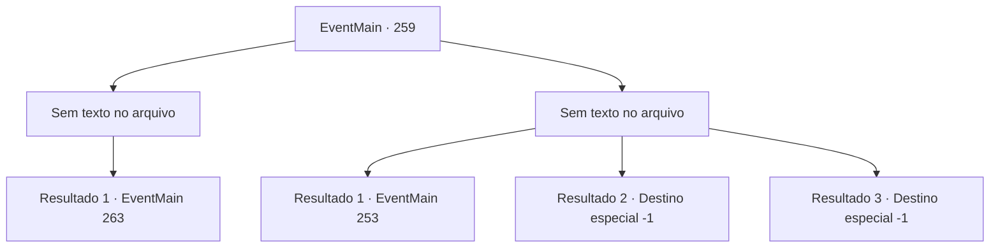

# Eventos principais · 259

[Índice da tabela](index.md) · [Índice geral](../index.md)

ID: `pt:EventMain:259` · Fonte: `EventMain4` · Versão: 1.2.47.

Mapeamento estático dos arquivos; a disponibilidade e a execução dependem do estado da run.

## Texto do evento

*Sem texto no arquivo.*

## Dados de entrada

```json
{
  "id": 259,
  "grade": 1,
  "normalGoal": "",
  "required": ""
}
```

## Mapa das escolhas



## Escolhas e resultados

### Escolha 1

*Sem texto no arquivo; o papel dessa opção depende da interface do jogo.*

Requisitos e outros campos da escolha:

```json
{
  "required": ""
}
```

#### Resultado 1.1

Embora tenha havido um pequeno desentendimento com os guardas, você consegue sabotar a balista. Depois de terminar sua parte da missão, você visita a biblioteca para esperar pela princesa. 

 Após uma curta espera, uma empregada se aproxima de você. Ela diz que a princesa deseja vê-lo e olha para você, como se estivesse sinalizando para você seguir. Você segue a empregada até o quarto da princesa. A empregada então fecha a porta, e apenas você e a princesa ficam no quarto. Ela se aproxima de você e fala baixinho como se estivesse sussurrando. 

 "Pedi a Egakin para me ajudar mais uma vez. Assim que o sol se põe, um dragão voará ao redor da sala do trono do Imperador, e você deve salvar Sua Majestade depois de lutar contra o dragão."

 Um breve silêncio enche o ar depois que ela termina. Ainda falta algum tempo até o pôr do sol. 

Continuação registrada: [Evento 263](0263.md) na mesma tabela.

```json
{
  "required": "",
  "chance": "1",
  "nextEvent": 263,
  "type": 2,
  "reward": ""
}
```

### Escolha 2

*Sem texto no arquivo; o papel dessa opção depende da interface do jogo.*

Requisitos e outros campos da escolha:

```json
{
  "required": ""
}
```

#### Resultado 2.1

Você é pego pelos guardas do castelo. Ao ser derrubado no chão, amarrado com uma corda, você pode ouvir a voz da princesa. 

 "Aguentar. Eu conheço essa pessoa. Deixe ele ir."

 Os guardas pedem desculpas e desamarram você. Você segue a princesa em seu quarto. 

 "...Eu vejo que a opção envolvendo Egakin não vai acontecer. Devemos procurar outro."


Continuação registrada: [Evento 253](0253.md) na mesma tabela.

```json
{
  "required": "1_0_2|1_1_2",
  "chance": "1",
  "nextEvent": 253,
  "type": 2,
  "reward": "0_0_-1|0_1_-1|5_146_1"
}
```

#### Resultado 2.2

Você é nocauteado pela pancada do guarda. Quando você abre os olhos, percebe que está trancado dentro da masmorra subterrânea.

Continuação registrada: [Destino especial `-1`](../destinos-especiais.md).

```json
{
  "required": "2_0_2",
  "chance": "1",
  "nextEvent": -1,
  "type": 2,
  "reward": "0_0_-1|0_1_-1|15_3_5|15_3_1"
}
```

#### Resultado 2.3

Você é nocauteado pela pancada do guarda. Quando você abre os olhos, percebe que está trancado dentro da masmorra subterrânea.

Continuação registrada: [Destino especial `-1`](../destinos-especiais.md).

```json
{
  "required": "2_1_2",
  "chance": "1",
  "nextEvent": -1,
  "type": 2,
  "reward": "0_0_-1|0_1_-1|15_3_5|15_3_1"
}
```

## Referências que chegam a este evento

- [Evento 254 · escolha 2 · resultado 1](0254.md#escolha-2)
