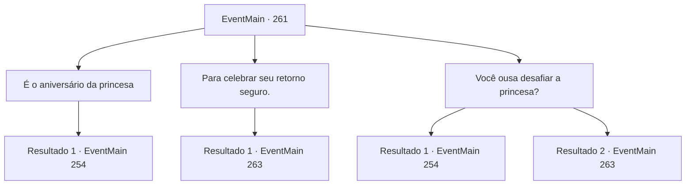

# Eventos principais · 261

[Índice da tabela](index.md) · [Índice geral](../index.md)

ID: `pt:EventMain:261` · Fonte: `EventMain4` · Versão: 1.2.47.

Mapeamento estático dos arquivos; a disponibilidade e a execução dependem do estado da run.

## Texto do evento

*Sem texto no arquivo.*

## Dados de entrada

```json
{
  "id": 261,
  "grade": 1,
  "normalGoal": "",
  "required": ""
}
```

## Mapa das escolhas



## Escolhas e resultados

### Escolha 1

É o aniversário da princesa

Requisitos e outros campos da escolha:

```json
{
  "required": ""
}
```

#### Resultado 1.1

O chef bufa para você. 

 "Hmph. Você espera que eu não saiba o aniversário da princesa? Pare de demorar e se perca antes que eu chame os guardas."

 Ele começa a balançar seus antebraços grossos e evita você. Você relutantemente decide encontrar outras maneiras de imobilizar a balista.

Continuação registrada: [Evento 254](0254.md) na mesma tabela.

```json
{
  "required": "",
  "chance": "1",
  "nextEvent": 254,
  "type": 2,
  "reward": "5_145_1"
}
```

### Escolha 2

Para celebrar seu retorno seguro.

Requisitos e outros campos da escolha:

```json
{
  "required": ""
}
```

#### Resultado 2.1

Você diz que as bebidas estão sendo distribuídas aos soldados para comemorar o retorno seguro da princesa das garras do dragão. O chef concorda com a cabeça e fala. 

 "Ah, entendi! Eu tenho. Aqui, siga-me."

 Ele entrega as bebidas aos guardas do castelo, envolvendo até mesmo outros cozinheiros. Os guardas ficam alegres, dizendo que as bebidas são de alta qualidade concedidas pela família real. Eles gritam 'Saúde!' e engole as bebidas em cima das muralhas do castelo, e logo alguns soldados começam a cambalear e cair, o álcool entrando em ação. Depois de terminar sua parte da missão, você visita a biblioteca para esperar pela princesa. 

 Após uma curta espera, uma empregada se aproxima de você. Ela diz que a princesa deseja vê-lo e olha para você, como se estivesse sinalizando para você seguir. Você segue a empregada até o quarto da princesa. A empregada então fecha a porta, e apenas você e a princesa ficam no quarto. Ela se aproxima de você e fala baixinho como se estivesse sussurrando. 

 "Pedi a Egakin para me ajudar mais uma vez. Assim que o sol se põe, um dragão voará ao redor da sala do trono do Imperador, e você deve salvar Sua Majestade depois de lutar contra o dragão."

 Um breve silêncio enche o ar depois que ela termina. Ainda falta algum tempo até o pôr do sol. 

Continuação registrada: [Evento 263](0263.md) na mesma tabela.

```json
{
  "required": "",
  "chance": "1",
  "nextEvent": 263,
  "type": 2,
  "reward": ""
}
```

### Escolha 3

Você ousa desafiar a princesa?

Requisitos e outros campos da escolha:

```json
{
  "required": ""
}
```

#### Resultado 3.1

Você se enfurece com o chef, perguntando se ele está desafiando a ordem da princesa. Mas isso não acaba bem. Ele balança seus antebraços grossos para você e evita você. Você relutantemente decide encontrar outras maneiras de imobilizar a balista.

Continuação registrada: [Evento 254](0254.md) na mesma tabela.

```json
{
  "required": "",
  "chance": "10",
  "nextEvent": 254,
  "type": 1,
  "reward": "5_145_1"
}
```

#### Resultado 3.2

Você se enfurece com o chef, perguntando se ele está desafiando a ordem da princesa. Ele balança seus antebraços grossos e grita sem sentido. 

 "Brrrrrlrlrr! Não quero dizer nada disso, nada disso!"

 Ele entrega as bebidas aos guardas do castelo, envolvendo até mesmo outros cozinheiros. Os guardas ficam alegres, dizendo que as bebidas são de alta qualidade concedidas pela família real. Eles gritam 'Saúde!' e engole as bebidas em cima das muralhas do castelo, e logo alguns soldados começam a cambalear e cair, o álcool entrando em ação. Depois de terminar sua parte da missão, você visita a biblioteca para esperar pela princesa. 

 Após uma curta espera, uma empregada se aproxima de você. Ela diz que a princesa deseja vê-lo e olha para você, como se estivesse sinalizando para você seguir. Você segue a empregada até o quarto da princesa. A empregada então fecha a porta, e apenas você e a princesa ficam no quarto. Ela se aproxima de você e fala baixinho como se estivesse sussurrando. 

 "Pedi a Egakin para me ajudar mais uma vez. Assim que o sol se põe, um dragão voará ao redor da sala do trono do Imperador, e você deve salvar Sua Majestade depois de lutar contra o dragão."

 Um breve silêncio enche o ar depois que ela termina. Ainda falta algum tempo até o pôr do sol. 

Continuação registrada: [Evento 263](0263.md) na mesma tabela.

```json
{
  "required": "",
  "chance": "1|0_12_1",
  "nextEvent": 263,
  "type": 0,
  "reward": ""
}
```

## Referências que chegam a este evento

- [Evento 260 · escolha 1 · resultado 1](0260.md#escolha-1)
