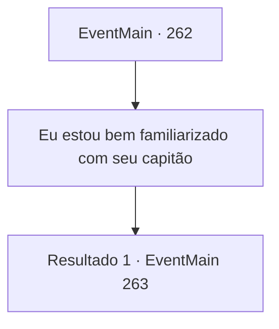

# Eventos principais · 262

[Índice da tabela](index.md) · [Índice geral](../index.md)

ID: `pt:EventMain:262` · Fonte: `EventMain4` · Versão: 1.2.47.

Mapeamento estático dos arquivos; a disponibilidade e a execução dependem do estado da run.

## Texto do evento

*Sem texto no arquivo.*

## Dados de entrada

```json
{
  "id": 262,
  "grade": 1,
  "normalGoal": "",
  "required": ""
}
```

## Mapa das escolhas



## Escolhas e resultados

### Escolha 1

Eu estou bem familiarizado com seu capitão

Requisitos e outros campos da escolha:

```json
{
  "required": ""
}
```

#### Resultado 1.1


 "Olha aqui! Seu maldito capitão Egakin?! Eu estive na casa dele, fui ao balneário com ele e tudo!"

 Você grita que é um amigo próximo do Capitão da Guarda. Os soldados, tomando cuidado extra ao tratá-lo, abaixam a cabeça em desculpas. 

 "Ah... Entendo, senhor. Pedimos desculpas por não reconhecê-lo. Eu sabia que tinha visto seu rosto em algum lugar. Mas e as balistas...?"

 Você faz barulho com a boca, e o soldado se afasta da balista com outro pedido de desculpas. Você toca cada uma das balistas, tirando uma das partes de todas elas. Depois de terminar sua parte da missão, você visita a biblioteca para esperar pela princesa. 

 Após uma curta espera, uma empregada se aproxima de você. Ela diz que a princesa deseja vê-lo e olha para você, como se estivesse sinalizando para você seguir. Você segue a empregada até o quarto da princesa. A empregada então fecha a porta, e apenas você e a princesa ficam no quarto. Ela se aproxima de você e fala baixinho como se estivesse sussurrando. 

 "Pedi a Egakin para me ajudar mais uma vez. Assim que o sol se põe, um dragão voará ao redor da sala do trono do Imperador, e você deve salvar Sua Majestade depois de lutar contra o dragão."

 Um breve silêncio enche o ar depois que ela termina. Ainda falta algum tempo até o pôr do sol. 

Continuação registrada: [Evento 263](0263.md) na mesma tabela.

```json
{
  "required": "",
  "chance": "1",
  "nextEvent": 263,
  "type": 2,
  "reward": ""
}
```

## Referências que chegam a este evento

- [Evento 254 · escolha 3 · resultado 1](0254.md#escolha-3)
