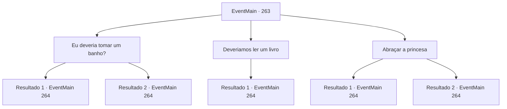

# Eventos principais · 263

[Índice da tabela](index.md) · [Índice geral](../index.md)

ID: `pt:EventMain:263` · Fonte: `EventMain4` · Versão: 1.2.47.

Mapeamento estático dos arquivos; a disponibilidade e a execução dependem do estado da run.

## Texto do evento

*Sem texto no arquivo.*

## Dados de entrada

```json
{
  "id": 263,
  "grade": 1,
  "normalGoal": "",
  "required": ""
}
```

## Mapa das escolhas



## Escolhas e resultados

### Escolha 1

Eu deveria tomar um banho?

Requisitos e outros campos da escolha:

```json
{
  "required": ""
}
```

#### Resultado 1.1

Em resposta à sua pergunta, a princesa responde enquanto abre uma porta de um lado da sala. 

 "Este é o banheiro. Eu estou supondo que você está se sentindo nervoso se preparando para um grande evento? Nada como um bom banho para relaxar."

 Você enche a banheira com água morna e mergulha nela. Então você lava seu corpo como nunca antes. Mas quando você termina de tomar banho e sai do banheiro, Egakin está de pé no quarto da princesa. Ele contrai uma das sobrancelhas, olhando para você saindo do banheiro. Ele pergunta com uma voz afiada. 

 "Huh? Por que estou vendo VOCÊ saindo do banheiro?"

 "Para combater o nervosismo. Foi solicitado um banho."

 A princesa responde sua pergunta, e Egakin assente. 

 "Eu vejo. Peço desculpas. Talvez eu tenha chegado rapidamente à conclusão de... estarei atacando com todas as minhas forças, então tenha em mente a ordem. Quando eu balançar minhas garras, role para a direita, e quando eu cuspir fogo você pulará para cima e atacará."


Continuação registrada: [Evento 264](0264.md) na mesma tabela.

```json
{
  "required": "11_0_0",
  "chance": "1",
  "nextEvent": 264,
  "type": 2,
  "reward": ""
}
```

#### Resultado 1.2

Em resposta à sua pergunta, a princesa responde enquanto abre uma porta de um lado da sala. 

 "Este é o banheiro. Eu estou supondo que você está se sentindo nervoso se preparando para um grande evento? Nada como um bom banho para relaxar."

 Você enche a banheira com água morna e mergulha nela. Quando você termina de tomar banho e sai do banheiro, Egakin está de pé no quarto da princesa. Ele diz que deve haver uma simulação antes de realmente iniciar o plano. 

 "Estarei atacando com todas as minhas forças, então tenha em mente a ordem. Quando eu balançar minhas garras, role para a direita, e quando eu cuspir fogo você pulará para cima e atacará."


Continuação registrada: [Evento 264](0264.md) na mesma tabela.

```json
{
  "required": "11_0_1",
  "chance": "1",
  "nextEvent": 264,
  "type": 2,
  "reward": ""
}
```

### Escolha 2

Deveriamos ler um livro

Requisitos e outros campos da escolha:

```json
{
  "required": ""
}
```

#### Resultado 2.1

Você se lembra dos velhos tempos, quando a princesa ensinava você a ler e escrever, lendo livros juntos. Então você e a princesa se perdem em reminiscências, lendo um livro juntos.
 'Toc toc.'
 Depois de algum tempo, Egakin entra na sala com uma batida.  Ele diz que deve haver uma simulação antes de realmente iniciar o plano. 

 "Estarei atacando com todas as minhas forças, então tenha em mente a ordem. Quando eu balançar minhas garras, role para a direita, e quando eu cuspir fogo você pulará para cima e atacará."


Continuação registrada: [Evento 264](0264.md) na mesma tabela.

```json
{
  "required": "",
  "chance": "1",
  "nextEvent": 264,
  "type": 2,
  "reward": ""
}
```

### Escolha 3

Abraçar a princesa

Requisitos e outros campos da escolha:

```json
{
  "required": ""
}
```

#### Resultado 3.1

Você abre bem os braços e abraça a princesa. Ela retribui o abraço, dando tapinhas nas suas costas. Enquanto vocês dois fazem contato visual e quando as coisas estão prestes a esquentar.. 'Toc toc.'
 Egakin entra na sala com uma batida. A princesa rapidamente se separa de você, agindo como se nada tivesse acontecido. Ele diz que deve haver uma simulação antes de realmente iniciar o plano. 

 "Estarei atacando com todas as minhas forças, então tenha em mente a ordem. Quando eu balançar minhas garras, role para a direita, e quando eu cuspir fogo você pulará para cima e atacará."


Continuação registrada: [Evento 264](0264.md) na mesma tabela.

```json
{
  "required": "11_0_0",
  "chance": "1",
  "nextEvent": 264,
  "type": 2,
  "reward": ""
}
```

#### Resultado 3.2

Você abre bem os braços e abraça a princesa. Ela retribui o abraço, dando tapinhas nas suas costas. 

 "Eu só desejo que este seja o fim deste incidente..."

 Assim que a princesa terminar de falar
 'Toc toc',
 Egakin entra na sala com uma batida. A princesa rapidamente se separa de você, agindo como se nada tivesse acontecido. Ele diz que deve haver uma simulação antes de realmente iniciar o plano. 

 "Estarei atacando com todas as minhas forças, então tenha em mente a ordem. Quando eu balançar minhas garras, role para a direita, e quando eu cuspir fogo você pulará para cima e atacará."


Continuação registrada: [Evento 264](0264.md) na mesma tabela.

```json
{
  "required": "11_0_1",
  "chance": "1",
  "nextEvent": 264,
  "type": 2,
  "reward": ""
}
```

## Referências que chegam a este evento

- [Evento 254 · escolha 2 · resultado 2](0254.md#escolha-2)
- [Evento 254 · escolha 2 · resultado 3](0254.md#escolha-2)
- [Evento 254 · escolha 4 · resultado 1](0254.md#escolha-4)
- [Evento 254 · escolha 4 · resultado 2](0254.md#escolha-4)
- [Evento 259 · escolha 1 · resultado 1](0259.md#escolha-1)
- [Evento 261 · escolha 2 · resultado 1](0261.md#escolha-2)
- [Evento 261 · escolha 3 · resultado 2](0261.md#escolha-3)
- [Evento 262 · escolha 1 · resultado 1](0262.md#escolha-1)
