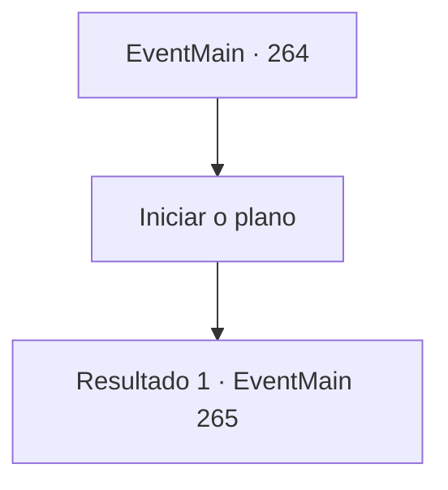

# Eventos principais · 264

[Índice da tabela](index.md) · [Índice geral](../index.md)

ID: `pt:EventMain:264` · Fonte: `EventMain4` · Versão: 1.2.47.

Mapeamento estático dos arquivos; a disponibilidade e a execução dependem do estado da run.

## Texto do evento

*Sem texto no arquivo.*

## Dados de entrada

```json
{
  "id": 264,
  "grade": 1,
  "normalGoal": "",
  "required": ""
}
```

## Mapa das escolhas



## Escolhas e resultados

### Escolha 1

Iniciar o plano

Requisitos e outros campos da escolha:

```json
{
  "required": ""
}
```

#### Resultado 1.1

Egakin enfatiza a ordem mais uma vez e vai para fora. Após uma breve espera, você sente o castelo inteiro tremendo, como se tivesse ocorrido um terremoto.
 'Craque--!!'
 Você e a princesa correm para a sala do trono. Um lado da sala é totalmente destruído, e nele o dragão de aço empurra sua cabeça. <link=shake>

 "Entregue a princesa imediatamente!"

</link> O rugido do dragão enfurece o Imperador. Sua tez fica vermelha como um tomate maduro. Ele grita com seus guardas. <link=shake>

 "Livre-se daquele maldito dragão de uma vez! O que diabos os balistas estão fazendo---!!!"

</link> O Imperador não consegue terminar suas palavras. Ele agarra sua nuca e fica inconsciente. A princesa diz aos guardas para enviarem o Imperador para um lugar seguro. Egakin parece surpreso, mas deve continuar agindo como se estivesse lutando diante dos olhos de muitas testemunhas. Você troca contato visual com ele, e o dragão levanta sua pata direita.

Continuação registrada: [Evento 265](0265.md) na mesma tabela.

```json
{
  "required": "",
  "chance": "1",
  "nextEvent": 265,
  "type": 2,
  "reward": "15_3_3"
}
```

## Referências que chegam a este evento

- [Evento 263 · escolha 1 · resultado 1](0263.md#escolha-1)
- [Evento 263 · escolha 1 · resultado 2](0263.md#escolha-1)
- [Evento 263 · escolha 2 · resultado 1](0263.md#escolha-2)
- [Evento 263 · escolha 3 · resultado 1](0263.md#escolha-3)
- [Evento 263 · escolha 3 · resultado 2](0263.md#escolha-3)
