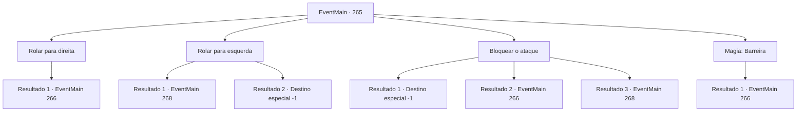

# Eventos principais · 265

[Índice da tabela](index.md) · [Índice geral](../index.md)

ID: `pt:EventMain:265` · Fonte: `EventMain4` · Versão: 1.2.47.

Mapeamento estático dos arquivos; a disponibilidade e a execução dependem do estado da run.

## Texto do evento

*Sem texto no arquivo.*

## Dados de entrada

```json
{
  "id": 265,
  "grade": 1,
  "normalGoal": "",
  "required": ""
}
```

## Mapa das escolhas



## Escolhas e resultados

### Escolha 1

Rolar para direita

Requisitos e outros campos da escolha:

```json
{
  "required": ""
}
```

#### Resultado 1.1

Como prometido, você rola para a direita, e a garra do dragão erra por pouco. Então, o dragão cospe uma bola de fogo em você.

Continuação registrada: [Evento 266](0266.md) na mesma tabela.

```json
{
  "required": "",
  "chance": "1",
  "nextEvent": 266,
  "type": 2,
  "reward": ""
}
```

### Escolha 2

Rolar para esquerda

Requisitos e outros campos da escolha:

```json
{
  "required": ""
}
```

#### Resultado 2.1

Ao contrário do que você prometeu, você rola para a esquerda. A garra gigante do dragão te atinge, e você é jogado na estante na sala do trono. Os guardas atacam o cavaleiro com suas alabardas, e acabar igual a você, esmagado na parede. O dragão solta um suspiro quase inaudível, e coloca um olhar ansioso em seu rosto. Então, a princesa pega uma das alabardas e corre para Egakin. 

 "Já chega!"

 Sua alabarda atinge a cabeça do dragão, e uma enorme iluminação é acompanhada por faíscas. <link=shake>

 "CAAAAARRGGHH!!"

</link> O dragão solta um grito que revigora a cena, balançando a cabeça. Logo, ele voa para longe. 

 "Você está bem?"

 Ela pega sua mão, puxando você para cima da prateleira. Ela então ordena os guardas para ajudá-lo ao médico. Você, agora relaxado, sente seus olhos se fecharem enquanto a fadiga o domina.  

Continuação registrada: [Evento 268](0268.md) na mesma tabela.

```json
{
  "required": "1_0_2",
  "chance": "1",
  "nextEvent": 268,
  "type": 2,
  "reward": "0_0_-1"
}
```

#### Resultado 2.2

Ao contrário do que você prometeu, você rola para a esquerda. A garra gigante do dragão o atinge e você perde a consciência com uma dor de quebrar os ossos.  

Continuação registrada: [Destino especial `-1`](../destinos-especiais.md).

```json
{
  "required": "2_0_2",
  "chance": "1",
  "nextEvent": -1,
  "type": 2,
  "reward": "0_0_-1|15_3_0|25_8_1"
}
```

### Escolha 3

Bloquear o ataque

Requisitos e outros campos da escolha:

```json
{
  "required": "20_9_1"
}
```

#### Resultado 3.1

Ao contrário do que você prometeu, você fica parado e se posiciona na defensiva. A garra gigante do dragão atinge você e você perde a consciência com uma dor de quebrar os ossos.

Continuação registrada: [Destino especial `-1`](../destinos-especiais.md).

```json
{
  "required": "2_0_2",
  "chance": "25",
  "nextEvent": -1,
  "type": 1,
  "reward": "0_0_-1|15_3_0|25_8_1"
}
```

#### Resultado 3.2

Ao contrário do que você prometeu, você fica parado e se posiciona na defensiva. 'BAM--!!' O que soa como uma catapulta batendo nas paredes do castelo pode ser ouvido em algum lugar. O vidro se estilhaça e o chão racha, mas você consegue bloquear o ataque do dragão. Ele agora abre sua boca e cospe uma bola de fogo em você.

Continuação registrada: [Evento 266](0266.md) na mesma tabela.

```json
{
  "required": "",
  "chance": "1|0_5_1",
  "nextEvent": 266,
  "type": 0,
  "reward": ""
}
```

#### Resultado 3.3

Ao contrário do que você prometeu, você fica parado e se posiciona na defensiva. 'BAM--!!' O que soa como uma catapulta batendo nas paredes do castelo pode ser ouvido em algum lugar. Você é jogado na estante na sala do trono. Os guardas atacam o cavaleiro com suas alabardas, e acabar igual a você, esmagado na parede. O dragão solta um suspiro quase inaudível, e coloca um olhar ansioso em seu rosto. Então, a princesa pega uma das alabardas e corre para Egakin. 

 "Já chega!"

 Sua alabarda atinge a cabeça do dragão, e uma enorme iluminação é acompanhada por faíscas. <link=shake>

 "CAAAAARRGGHH!!"

</link> O dragão solta um grito que revigora a cena, balançando a cabeça. Logo, ele voa para longe. 

 "Você está bem?"

 Ela pega sua mão, puxando você para cima da prateleira. Ela então ordena os guardas para ajudá-lo ao médico. Você, agora relaxado, sente seus olhos se fecharem enquanto a fadiga o domina.   

Continuação registrada: [Evento 268](0268.md) na mesma tabela.

```json
{
  "required": "1_0_2",
  "chance": "25",
  "nextEvent": 268,
  "type": 1,
  "reward": "0_0_-1"
}
```

### Escolha 4

Magia: Barreira

Requisitos e outros campos da escolha:

```json
{
  "required": "20_0_2|1_1_2"
}
```

#### Resultado 4.1

Ao contrário do que você prometeu, você fica parado e lança um encantamento. 'BAM--!!' O que soa como uma catapulta batendo nas paredes do castelo pode ser ouvido em algum lugar. Sua barreira se quebra como vidro, mas bloqueia o ataque do dragão. Em seguida, ele cospe uma bola de fogo em você.

Continuação registrada: [Evento 266](0266.md) na mesma tabela.

```json
{
  "required": "",
  "chance": "1",
  "nextEvent": 266,
  "type": 2,
  "reward": "0_1_-1"
}
```

## Referências que chegam a este evento

- [Evento 264 · escolha 1 · resultado 1](0264.md#escolha-1)
