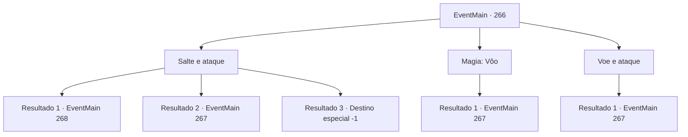

# Eventos principais · 266

[Índice da tabela](index.md) · [Índice geral](../index.md)

ID: `pt:EventMain:266` · Fonte: `EventMain4` · Versão: 1.2.47.

Mapeamento estático dos arquivos; a disponibilidade e a execução dependem do estado da run.

## Texto do evento

*Sem texto no arquivo.*

## Dados de entrada

```json
{
  "id": 266,
  "grade": 1,
  "normalGoal": "",
  "required": ""
}
```

## Mapa das escolhas



## Escolhas e resultados

### Escolha 1

Salte e ataque

Requisitos e outros campos da escolha:

```json
{
  "required": ""
}
```

#### Resultado 1.1

Você pula como prometeu, mas não consegue desviar da bola de fogo, sendo atingido na perna. Seu corpo gira algumas vezes no ar e cai de costas. O dragão solta um suspiro quase inaudível, e coloca um olhar ansioso em seu rosto. Então, a princesa pega uma das alabardas e corre para Egakin. 

 "Já chega!"

 Sua alabarda atinge a cabeça do dragão, e uma enorme iluminação é acompanhada por faíscas. <link=shake>

 "CAAAAARRGGHH!!"

</link> O dragão solta um grito que revigora a cena, balançando a cabeça. Logo, ele voa para longe. 

 "Você está bem?"

 Ela pega sua mão, puxando você para cima da prateleira. Ela então ordena os guardas para ajudá-lo ao médico. Você, agora relaxado, sente seus olhos se fecharem enquanto a fadiga o domina.  

Continuação registrada: [Evento 268](0268.md) na mesma tabela.

```json
{
  "required": "1_0_2",
  "chance": "6",
  "nextEvent": 268,
  "type": 1,
  "reward": ""
}
```

#### Resultado 1.2

Você pula como prometeu e se esquiva da bola de fogo. Você então balança sua arma e golpeia a cabeça do dragão. <link=shake>

 "GROOOAARRGH!!"

</link> Uma imensa iluminação é acompanhada de faíscas, e o dragão solta um grito que revigora a cena, balançando a cabeça. Em seguida, ele voa para longe. Os guardas aplaudem com a visão, e a princesa aparece deles.

Continuação registrada: [Evento 267](0267.md) na mesma tabela.

```json
{
  "required": "",
  "chance": "1|0_5_1",
  "nextEvent": 267,
  "type": 0,
  "reward": ""
}
```

#### Resultado 1.3

Você pula como prometeu e se esquiva da bola de fogo.  Você então balança sua arma e golpeia a cabeça do dragão. Com isso, você encontra um fim absurdo, perdendo sua vida.

Continuação registrada: [Destino especial `-1`](../destinos-especiais.md).

```json
{
  "required": "2_0_2",
  "chance": "6",
  "nextEvent": -1,
  "type": 1,
  "reward": "0_0_-1|15_3_0|25_8_1"
}
```

### Escolha 2

Magia: Vôo

Requisitos e outros campos da escolha:

```json
{
  "required": "20_0_2|1_1_2"
}
```

#### Resultado 2.1

Você evita a bola de fogo. Você então balança sua arma e golpeia a cabeça do dragão. <link=shake>

 "GROOOAARRGH!!"

</link> Uma imensa iluminação é acompanhada de faíscas, e o dragão solta um grito que revigora a cena, balançando a cabeça. Em seguida, ele voa para longe. Os guardas aplaudem com a visão, e a princesa aparece deles.

Continuação registrada: [Evento 267](0267.md) na mesma tabela.

```json
{
  "required": "",
  "chance": "1",
  "nextEvent": 267,
  "type": 2,
  "reward": "0_1_-1"
}
```

### Escolha 3

Voe e ataque

Requisitos e outros campos da escolha:

```json
{
  "required": "20_10_1"
}
```

#### Resultado 3.1

Você voa para o ar e evita a bola de fogo. Você então balança sua arma e golpeia a cabeça do dragão. <link=shake>

 "GROOOAARRGH!!"

</link> Uma imensa iluminação é acompanhada de faíscas, e o dragão solta um grito que revigora a cena, balançando a cabeça. Em seguida, ele voa para longe. Os guardas aplaudem com a visão, e a princesa aparece deles.

Continuação registrada: [Evento 267](0267.md) na mesma tabela.

```json
{
  "required": "",
  "chance": "1",
  "nextEvent": 267,
  "type": 2,
  "reward": ""
}
```

## Referências que chegam a este evento

- [Evento 265 · escolha 1 · resultado 1](0265.md#escolha-1)
- [Evento 265 · escolha 3 · resultado 2](0265.md#escolha-3)
- [Evento 265 · escolha 4 · resultado 1](0265.md#escolha-4)
