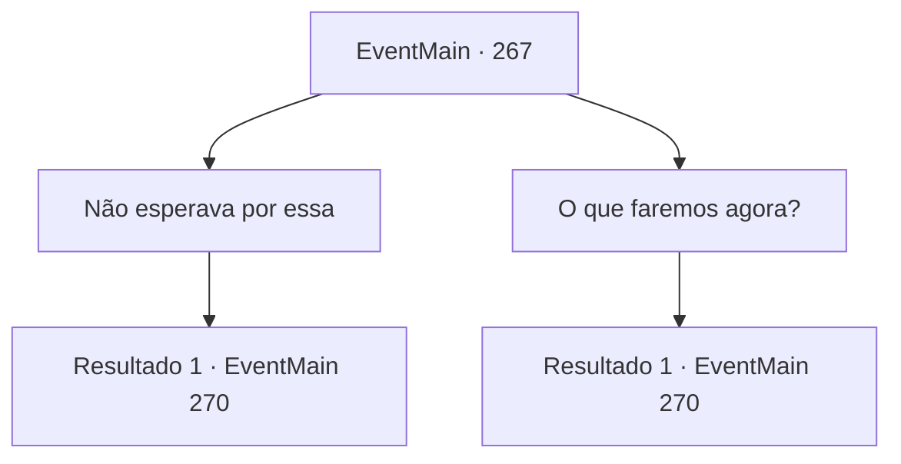

# Eventos principais · 267

[Índice da tabela](index.md) · [Índice geral](../index.md)

ID: `pt:EventMain:267` · Fonte: `EventMain4` · Versão: 1.2.47.

Mapeamento estático dos arquivos; a disponibilidade e a execução dependem do estado da run.

## Texto do evento

*Sem texto no arquivo.*

## Dados de entrada

```json
{
  "id": 267,
  "grade": 1,
  "normalGoal": "",
  "required": ""
}
```

## Mapa das escolhas



## Escolhas e resultados

### Escolha 1

Não esperava por essa

Requisitos e outros campos da escolha:

```json
{
  "required": ""
}
```

#### Resultado 1.1

Você diz que não esperava que o Imperador desmaiasse. Ela responde, concordando com a cabeça. 

 "Não é sua culpa. Nem eu e Egakin. O que importa mais é o que faremos a seguir... me dê um minuto. Devo ir e verificar Sua Majestade."

 Ela ordena que uma das empregadas o guie até o quarto de hóspedes.

Continuação registrada: [Evento 270](0270.md) na mesma tabela.

```json
{
  "required": "",
  "chance": "1",
  "nextEvent": 270,
  "type": 2,
  "reward": ""
}
```

### Escolha 2

O que faremos agora?

Requisitos e outros campos da escolha:

```json
{
  "required": ""
}
```

#### Resultado 2.1

Você pergunta à princesa o que ela vai fazer agora. 

 "Não tenho certeza... acho que vou começar a pensar nisso de agora em diante. Me dê um minuto. Devo ir e verificar Sua Majestade."

 Ela ordena que uma das empregadas o guie até o quarto de hóspedes.

Continuação registrada: [Evento 270](0270.md) na mesma tabela.

```json
{
  "required": "",
  "chance": "1",
  "nextEvent": 270,
  "type": 2,
  "reward": ""
}
```

## Referências que chegam a este evento

- [Evento 258 · escolha 1 · resultado 2](0258.md#escolha-1)
- [Evento 266 · escolha 1 · resultado 2](0266.md#escolha-1)
- [Evento 266 · escolha 2 · resultado 1](0266.md#escolha-2)
- [Evento 266 · escolha 3 · resultado 1](0266.md#escolha-3)
