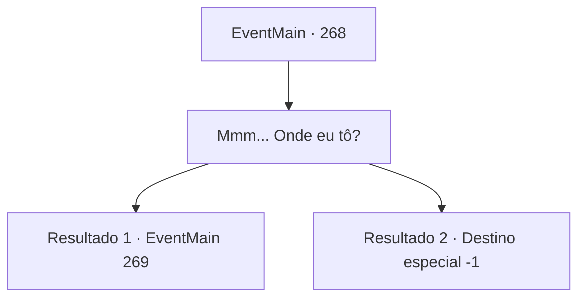

# Eventos principais · 268

[Índice da tabela](index.md) · [Índice geral](../index.md)

ID: `pt:EventMain:268` · Fonte: `EventMain4` · Versão: 1.2.47.

Mapeamento estático dos arquivos; a disponibilidade e a execução dependem do estado da run.

## Texto do evento

*Sem texto no arquivo.*

## Dados de entrada

```json
{
  "id": 268,
  "grade": 1,
  "normalGoal": "",
  "required": ""
}
```

## Mapa das escolhas



## Escolhas e resultados

### Escolha 1

Mmm... Onde eu tô?

Requisitos e outros campos da escolha:

```json
{
  "required": ""
}
```

#### Resultado 1.1

Você acorda com uma dor excruciante em todo o seu corpo, com um profundo arrependimento pensando no motivo de não ter agido de acordo com o plano. A primeira coisa que vem à sua vista é o teto branco, e então você sente o olhar de alguém. Quando você volta sua visão para onde você sente que o olhar está vindo, alguém que parece uma princesa está sentado na cama. 

 "Você está acordado."

 Uma voz profunda e baixa que quebra sua expectativa é ouvida, e você lava os olhos. Quando você olha para trás, o dono da voz é Egakin. 

 "Acho que expliquei o plano várias vezes... Bem... a princesa está com o Imperador agora. Ela me pediu para entregar isso a você."

 Ele hesita um pouco antes de pegar uma pequena caixa e entregá-la a você. Dentro da caixa há um anel de ouro, decorado com um rubi. 

 "Sua chamada. Suponho que você esteja ciente do significado de dar um anel, então decida. Se você vai aceitar ou não."


Continuação registrada: [Evento 269](0269.md) na mesma tabela.

```json
{
  "required": "11_0_0",
  "chance": "1",
  "nextEvent": 269,
  "type": 2,
  "reward": ""
}
```

#### Resultado 1.2

Você acorda com uma dor excruciante em todo o seu corpo, com um profundo arrependimento pensando no motivo de não ter agido de acordo com o plano. A primeira coisa que vem à sua vista é o teto branco, e então você sente o olhar de alguém. Quando você volta sua visão para onde você sente que o olhar está vindo, alguém que parece uma princesa está sentado na cama. 

 "Você está acordado."

 Uma voz profunda e baixa que quebra sua expectativa é ouvida, e você lava os olhos. Quando você olha para trás, o dono da voz é Egakin. 

 "Acho que expliquei o plano várias vezes... Bem... a princesa está com o Imperador agora. Ela me pediu para entregar isso a você."

 Ele hesita um pouco antes de pegar uma pequena caixa e entregá-la a você. Dentro da caixa há um broche de platina, decorado com um peridoto. 

 "Esit quer que você fique ao lado dela para sempre. Este é um presente, considerando tudo o que você fez por ela até agora."

 Depois de terminar, Egakin lhe entrega o broche e sai.  

Continuação registrada: [Destino especial `-1`](../destinos-especiais.md).

```json
{
  "required": "11_0_1",
  "chance": "1",
  "nextEvent": -1,
  "type": 2,
  "reward": "15_3_8|3_194_1"
}
```

## Referências que chegam a este evento

- [Evento 265 · escolha 2 · resultado 1](0265.md#escolha-2)
- [Evento 265 · escolha 3 · resultado 3](0265.md#escolha-3)
- [Evento 266 · escolha 1 · resultado 1](0266.md#escolha-1)
