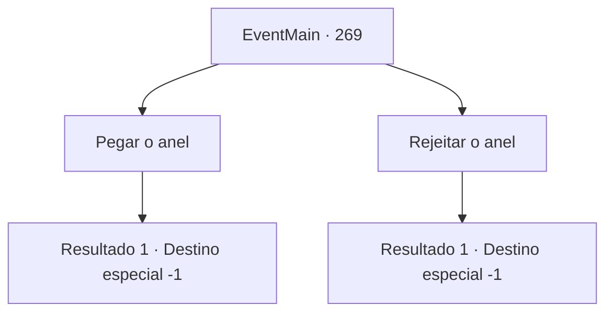

# Eventos principais · 269

[Índice da tabela](index.md) · [Índice geral](../index.md)

ID: `pt:EventMain:269` · Fonte: `EventMain4` · Versão: 1.2.47.

Mapeamento estático dos arquivos; a disponibilidade e a execução dependem do estado da run.

## Texto do evento

*Sem texto no arquivo.*

## Dados de entrada

```json
{
  "id": 269,
  "grade": 1,
  "normalGoal": "",
  "required": ""
}
```

## Mapa das escolhas



## Escolhas e resultados

### Escolha 1

Pegar o anel

Requisitos e outros campos da escolha:

```json
{
  "required": ""
}
```

#### Resultado 1.1

Você decide pegar o anel da princesa. Ao pegar a pequena caixa com a mão, você sente o aperto de Egakin cada vez mais forte. Você consegue tirar a caixa do anel das mãos dele. Isso faz com que o rosto de Egakin fique rígido. Ele mesmo não parece estar se sentindo seguro sobre qual emoção está experimentando agora. 

 "Isso é... não sei como explicar..."

 Ele murmura para si mesmo, e se levanta da cadeira. Você brinca com o anel em suas mãos, sinalizando o fim da longa jornada para salvar a princesa e o início de uma nova vida.

Continuação registrada: [Destino especial `-1`](../destinos-especiais.md).

```json
{
  "required": "",
  "chance": "1",
  "nextEvent": -1,
  "type": 2,
  "reward": "15_3_6|3_193_1"
}
```

### Escolha 2

Rejeitar o anel

Requisitos e outros campos da escolha:

```json
{
  "required": ""
}
```

#### Resultado 2.1

Você rejeita a proposta da princesa. Isso faz com que o rosto de Egakin fique rígido. Ele mesmo não parece estar se sentindo seguro sobre qual emoção está experimentando agora. 

 "Isto é... não sei como devo explicar... vou deixar a princesa saber o que você disse."

 Com isso, ele sai da sala médica.

Continuação registrada: [Destino especial `-1`](../destinos-especiais.md).

```json
{
  "required": "",
  "chance": "1",
  "nextEvent": -1,
  "type": 2,
  "reward": "15_3_4"
}
```

## Referências que chegam a este evento

- [Evento 268 · escolha 1 · resultado 1](0268.md#escolha-1)
- [Evento 270 · escolha 1 · resultado 1](0270.md#escolha-1)
