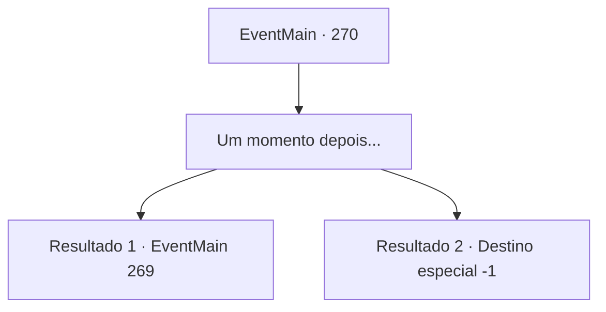

# Eventos principais · 270

[Índice da tabela](index.md) · [Índice geral](../index.md)

ID: `pt:EventMain:270` · Fonte: `EventMain4` · Versão: 1.2.47.

Mapeamento estático dos arquivos; a disponibilidade e a execução dependem do estado da run.

## Texto do evento

*Sem texto no arquivo.*

## Dados de entrada

```json
{
  "id": 270,
  "grade": 1,
  "normalGoal": "",
  "required": ""
}
```

## Mapa das escolhas



## Escolhas e resultados

### Escolha 1

Um momento depois...

Requisitos e outros campos da escolha:

```json
{
  "required": ""
}
```

#### Resultado 1.1

Depois de alguns minutos, a porta do quarto de hóspedes se abre e Egakin entra. 

 "Seu rosto mostra que você não estava me esperando."

 Você tateia seu rosto depois de ouvir o que ele disse. Ele se senta lentamente em uma mesa próxima. Ele tira uma pequena caixa de seus bolsos. 

 "A princesa está com o Imperador agora. Ela me pediu para entregar isso a você."

 Você pega a pequena caixa e a abre. Dentro da caixa há um anel de ouro, decorado com um rubi. 

 "Sua chamada. Suponho que você esteja ciente do significado de dar um anel, então decida. Se você vai aceitar ou não."


Continuação registrada: [Evento 269](0269.md) na mesma tabela.

```json
{
  "required": "11_0_0",
  "chance": "1",
  "nextEvent": 269,
  "type": 2,
  "reward": ""
}
```

#### Resultado 1.2

Depois de alguns minutos, a porta do quarto de hóspedes se abre e Egakin entra. 

 "Seu rosto mostra que você não estava me esperando."

 Você tateia seu rosto depois de ouvir o que ele disse. Ele se senta lentamente em uma mesa próxima. Ele tira uma pequena caixa de seus bolsos. 

 "A princesa está com o Imperador agora. Ela me pediu para entregar isso a você."

 Você pega a pequena caixa e a abre. Dentro da caixa há um broche de platina, decorado com um peridoto. 

 "Esit quer que você fique ao lado dela para sempre. Este é um presente, considerando tudo o que você fez por ela até agora."

 Depois de terminar, Egakin lhe entrega o broche e sai. 

Continuação registrada: [Destino especial `-1`](../destinos-especiais.md).

```json
{
  "required": "11_0_1",
  "chance": "1",
  "nextEvent": -1,
  "type": 2,
  "reward": "15_3_8|3_194_1"
}
```

## Referências que chegam a este evento

- [Evento 267 · escolha 1 · resultado 1](0267.md#escolha-1)
- [Evento 267 · escolha 2 · resultado 1](0267.md#escolha-2)
