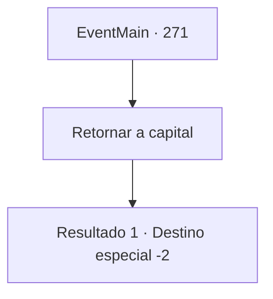

# Eventos principais · 271

[Índice da tabela](index.md) · [Índice geral](../index.md)

ID: `pt:EventMain:271` · Fonte: `EventMain4` · Versão: 1.2.47.

Mapeamento estático dos arquivos; a disponibilidade e a execução dependem do estado da run.

## Texto do evento

Um papagaio branco rodeia a sua cabeça antes de se sentar cuidadosamente no seu ombro. Limpa a sua garganta e abre o seu bico. 

 "A princesa decidiu regressar ao palácio real. Estaremos à espera em 'Zapen'."

 Você assume que a mensagem seja de Egákin. 

## Dados de entrada

```json
{
  "id": 271,
  "grade": 1,
  "normalGoal": "",
  "required": "13_2_5|1_2_65|5_135_3"
}
```

## Mapa das escolhas



## Escolhas e resultados

### Escolha 1

Retornar a capital

Requisitos e outros campos da escolha:

```json
{
  "required": ""
}
```

#### Resultado 1.1

Você gentilmente acaricia o papagaio. Ele sorri com os olhos, como se estivesse feliz, e pula do seu ombro, voando para o céu. Você segue o papagaio em direção à capital 'Zapen', onde todas as suas aventuras começaram.

Continuação registrada: [Destino especial `-2`](../destinos-especiais.md).

```json
{
  "required": "",
  "chance": "1",
  "nextEvent": -2,
  "type": 2,
  "reward": "13_2_8"
}
```

## Referências que chegam a este evento

Nenhum `nextEvent` positivo da mesma tabela aponta para este nó. Isso não prova que seja inacessível: sorteio e estado de história podem selecioná-lo.

