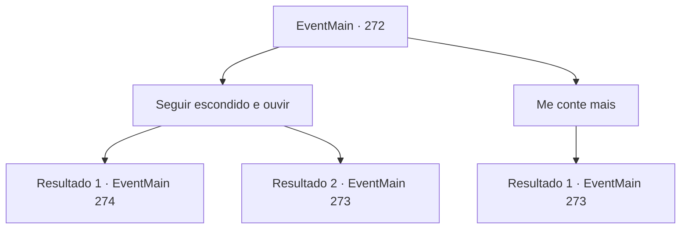

# Eventos principais · 272

[Índice da tabela](index.md) · [Índice geral](../index.md)

ID: `pt:EventMain:272` · Fonte: `EventMain4` · Versão: 1.2.47.

Mapeamento estático dos arquivos; a disponibilidade e a execução dependem do estado da run.

## Texto do evento

Vagando pelas montanhas de Latnagar, você tenta ouvir todos os rumores sobre o dragão cinzento, algumas crianças passam do seu lado, em uma cidade chamada 'Undvar', falando sobre a história do dragão cinzento. |drawing_backstreet| Há cerca de quatro á cinco crianças reunidas nos fundos de uma rua, e a maior criança bate em seu peito e fala. 

 "Foi definitivamente um dragão. A escala cinzenta, e as enormes asas. Corri com tudo que pude, vocês teriam morrido só de ver!"

 As outras crianças ouvem atentamente,os olhos bem abertos oscilam entre medo e admiração.

## Dados de entrada

```json
{
  "id": 272,
  "grade": 1,
  "normalGoal": "",
  "required": "13_2_9|1_2_75"
}
```

## Mapa das escolhas



## Escolhas e resultados

### Escolha 1

Seguir escondido e ouvir

Requisitos e outros campos da escolha:

```json
{
  "required": ""
}
```

#### Resultado 1.1

Você prende a respiração para que as crianças não percebam sua presença. O garotão, sem saber da sua presença, continua a testemunhar o dragão. Olhos de serpente, escamas com brilho cinza e dois chifres e asas gigantes. 

 "Até seus dentes eram aterrorizantes!"

 Uma das crianças aborda o grandalhão com uma pergunta. 

 "Vamos... se fosse mesmo um dragão de verdade, teria engolido você inteiro. Você não poderia ter fugido em primeiro lugar."

 O garotão, um pouco enfurecido, grita. 

 "Ei! Acho que vou ter que te mostrar então! Porque eu sei onde fica o ninho do dragão!"

 Então as crianças seguem o grandão até o ninho do dragão.

Continuação registrada: [Evento 274](0274.md) na mesma tabela.

```json
{
  "required": "20_5_2",
  "chance": "1",
  "nextEvent": 274,
  "type": 2,
  "reward": ""
}
```

#### Resultado 1.2

Você prende a respiração para que as crianças não percebam sua presença. Mas uma das crianças encontra você e grita. 

 "Wha..! Por que você está nos espionando?"

 O grandalhão abre um sorriso confiante e fala. 

 "Heehee. Vejo que está interessado na minha história? Mas não posso contar de graça para alguém que não é meu amigo..."


Continuação registrada: [Evento 273](0273.md) na mesma tabela.

```json
{
  "required": "21_5_2",
  "chance": "1",
  "nextEvent": 273,
  "type": 2,
  "reward": ""
}
```

### Escolha 2

Me conte mais

Requisitos e outros campos da escolha:

```json
{
  "required": ""
}
```

#### Resultado 2.1

Você se aproxima das crianças e pede para contar uma história mais descritiva sobre o 'dragão cinza'. O grandalhão abre um sorriso confiante e fala. 

 "Heehee. Vejo que está interessado na minha história? Mas não posso contar de graça para alguém que não é meu amigo..."


Continuação registrada: [Evento 273](0273.md) na mesma tabela.

```json
{
  "required": "",
  "chance": "1",
  "nextEvent": 273,
  "type": 2,
  "reward": ""
}
```

## Referências que chegam a este evento

Nenhum `nextEvent` positivo da mesma tabela aponta para este nó. Isso não prova que seja inacessível: sorteio e estado de história podem selecioná-lo.

