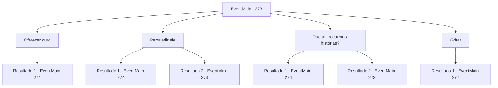

# Eventos principais · 273

[Índice da tabela](index.md) · [Índice geral](../index.md)

ID: `pt:EventMain:273` · Fonte: `EventMain4` · Versão: 1.2.47.

Mapeamento estático dos arquivos; a disponibilidade e a execução dependem do estado da run.

## Texto do evento

*Sem texto no arquivo.*

## Dados de entrada

```json
{
  "id": 273,
  "grade": 1,
  "normalGoal": "",
  "required": ""
}
```

## Mapa das escolhas



## Escolhas e resultados

### Escolha 1

Oferecer ouro

Requisitos e outros campos da escolha:

```json
{
  "required": "1_4_10"
}
```

#### Resultado 1.1

Quando você dá a ele uma pequena taxa, as bochechas do garoto grande se transformam em um grande sorriso. Ele então continua a descrever o 'dragão' que aparentemente viu em detalhes. Olhos de serpente, escamas com brilho cinza e dois chifres e asas gigantes. 

 "Até seus dentes eram aterrorizantes!"

 Uma das crianças aborda o grandalhão com uma pergunta. 

 "Vamos... se fosse mesmo um dragão de verdade, teria engolido você inteiro. Você não poderia ter fugido em primeiro lugar."

 O garotão, um pouco enfurecido, grita. 

 "Ei! Acho que vou ter que te mostrar então! Porque eu sei onde fica o ninho do dragão! Você vem com a gente, certo?"

 As crianças esperam sua resposta, olhando para você.

Continuação registrada: [Evento 274](0274.md) na mesma tabela.

```json
{
  "required": "",
  "chance": "1",
  "nextEvent": 274,
  "type": 2,
  "reward": "0_4_-10"
}
```

### Escolha 2

Persuadir ele

Requisitos e outros campos da escolha:

```json
{
  "required": "11_0_1|5_157_0"
}
```

#### Resultado 2.1

Você tira vantagem do seu gênero e age de forma fofa com o garotão. Suas bochechas se transformam em um grande sorriso incontrolável. 

 "Ok... mana..."

 Olhos de serpente, escamas com brilho cinza e dois chifres e asas gigantes... 

 "Até seus dentes eram aterrorizantes!"

 Uma das crianças aborda o grandalhão com uma pergunta. 

 "Vamos... se fosse mesmo um dragão de verdade, teria engolido você inteiro. Você não poderia ter fugido em primeiro lugar."

 O garotão, um pouco enfurecido, grita. 

 "Ei! Acho que vou ter que te mostrar então! Porque eu sei onde fica o ninho do dragão! Você vem com a gente, certo?"

 As crianças esperam sua resposta, olhando para você.

Continuação registrada: [Evento 274](0274.md) na mesma tabela.

```json
{
  "required": "",
  "chance": "1|0_12_1",
  "nextEvent": 274,
  "type": 0,
  "reward": ""
}
```

#### Resultado 2.2

Você tira vantagem do seu gênero e age de forma fofa com o garotão. 

 "Desculpe, mas você não é realmente meu tipo."

 Parece que você terá que tentar uma abordagem diferente para esse garoto arrogante. 

Continuação registrada: [Evento 273](0273.md) na mesma tabela.

```json
{
  "required": "",
  "chance": "8",
  "nextEvent": 273,
  "type": 1,
  "reward": "5_157_1"
}
```

### Escolha 3

Que tal trocarmos histórias?

Requisitos e outros campos da escolha:

```json
{
  "required": "5_158_0"
}
```

#### Resultado 3.1

Você pede a ele informações sobre o dragão, em troca de suas próprias histórias de sua aventura. O garotão balança a cabeça e responde. 

 "Mas apenas se a história que você conta for interessante!"

 Você desencadeia uma cadeia de contos de aventura glorificados, com algumas especiarias adicionadas aqui e ali por causa da história. Logo, as crianças estão imersas em sua história, com os olhos brilhando. 

 "Uau... agora eu quero ser um aventureiro!"

 Algumas crianças até fazem de você seu modelo. O garotão, em resposta ao seu interessante conto, descreve o dragão em detalhes. Olhos de serpente, escamas com brilho cinza e dois chifres e asas gigantes... 

 "Até seus dentes eram aterrorizantes!"

 Uma das crianças aborda o grandalhão com uma pergunta. 

 "Vamos... se fosse mesmo um dragão de verdade, teria engolido você inteiro. Você não poderia ter fugido em primeiro lugar."

 O garotão, um pouco enfurecido, grita. 

 "Ei! Acho que vou ter que te mostrar então! Porque eu sei onde fica o ninho do dragão! Você vem com a gente, certo?"

 As crianças esperam sua resposta, olhando para você.

Continuação registrada: [Evento 274](0274.md) na mesma tabela.

```json
{
  "required": "",
  "chance": "1|0_7_1",
  "nextEvent": 274,
  "type": 0,
  "reward": ""
}
```

#### Resultado 3.2

Você pede a ele informações sobre o dragão, em troca de suas próprias histórias de sua aventura. O garotão balança a cabeça e responde. 

 "Mas apenas se a história que você conta for interessante!"

 Você explica a eles sobre as histórias do passado, mas não consegue fazer com que as crianças se interessem. Parece que você terá que tentar uma abordagem diferente.

Continuação registrada: [Evento 273](0273.md) na mesma tabela.

```json
{
  "required": "",
  "chance": "11",
  "nextEvent": 273,
  "type": 1,
  "reward": "5_158_1"
}
```

### Escolha 4

Gritar

Requisitos e outros campos da escolha:

```json
{
  "required": ""
}
```

#### Resultado 4.1

Você grita com o garotão para falar sobre o que ele sabe. Ele começa a chorar e fala sobre o 'dragão' que viu. Olhos de serpente, escamas com brilho cinza e dois chifres e asas gigantes... <link=shake>

 "ele...Seu ninho está lá em cima no... huff... pico da montanha..."

</link> O garotão e as outras crianças ao redor dele correm de volta, assustados.

Continuação registrada: [Evento 277](0277.md) na mesma tabela.

```json
{
  "required": "",
  "chance": "1",
  "nextEvent": 277,
  "type": 2,
  "reward": "0_3_-1|5_159_1"
}
```

## Referências que chegam a este evento

- [Evento 272 · escolha 1 · resultado 2](0272.md#escolha-1)
- [Evento 272 · escolha 2 · resultado 1](0272.md#escolha-2)
- [Evento 273 · escolha 2 · resultado 2](0273.md#escolha-2)
- [Evento 273 · escolha 3 · resultado 2](0273.md#escolha-3)
