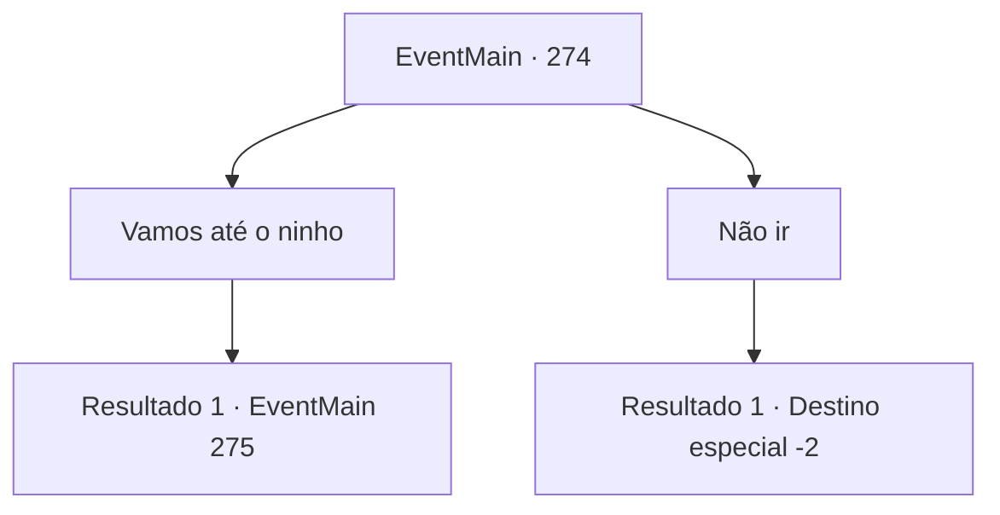

# Eventos principais · 274

[Índice da tabela](index.md) · [Índice geral](../index.md)

ID: `pt:EventMain:274` · Fonte: `EventMain4` · Versão: 1.2.47.

Mapeamento estático dos arquivos; a disponibilidade e a execução dependem do estado da run.

## Texto do evento

*Sem texto no arquivo.*

## Dados de entrada

```json
{
  "id": 274,
  "grade": 1,
  "normalGoal": "",
  "required": ""
}
```

## Mapa das escolhas



## Escolhas e resultados

### Escolha 1

Vamos até o ninho

Requisitos e outros campos da escolha:

```json
{
  "required": ""
}
```

#### Resultado 1.1

Você segue o garoto que aparentemente viu o 'dragão' até uma montanha próxima. No seu pico, você encontra um enorme ninho, e ossos de animais espalhados ao redor dele. O garotão exclama, dizendo a todos para olharem para ele. 

 "Ver! Aqui está o ninho! O dragão aparecerá em breve se esperarmos."

 As crianças decidem se esconder em um arbusto próximo e esperar que o dragão apareça. Após cerca de 10 minutos, o grandalhão perde a paciência e sai correndo do mato. Ele então pega um osso próximo do chão. 

 "Ah... por que não aparece? Isso vai fazer isso?"

 Ele balança o osso desajeitadamente, atingindo um dos ovos no ninho. O ovo gigante não racha, mas faz um som baixo. 

 "Ei! Pare! E se realmente aparecer!"

 Ignorando a preocupação do amigo, o garotão balança o osso mais uma vez.
 'CRACK--!'
 Por fim, o ovo racha e logo uma grande sombra cobre o céu. <link=shake>

 "CWAAAAAAR!!!"

</link> Então, com um rugido ensurdecedor, um wyvern desce.

Continuação registrada: [Evento 275](0275.md) na mesma tabela.

```json
{
  "required": "",
  "chance": "1",
  "nextEvent": 275,
  "type": 2,
  "reward": ""
}
```

### Escolha 2

Não ir

Requisitos e outros campos da escolha:

```json
{
  "required": ""
}
```

#### Resultado 2.1

Você não segue o garoto que aparentemente viu o 'dragão'.

Continuação registrada: [Destino especial `-2`](../destinos-especiais.md).

```json
{
  "required": "",
  "chance": "1",
  "nextEvent": -2,
  "type": 2,
  "reward": "13_2_10|5_159_1"
}
```

## Referências que chegam a este evento

- [Evento 272 · escolha 1 · resultado 1](0272.md#escolha-1)
- [Evento 273 · escolha 1 · resultado 1](0273.md#escolha-1)
- [Evento 273 · escolha 2 · resultado 1](0273.md#escolha-2)
- [Evento 273 · escolha 3 · resultado 1](0273.md#escolha-3)
