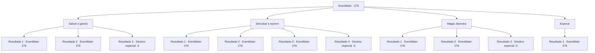

# Eventos principais · 275

[Índice da tabela](index.md) · [Índice geral](../index.md)

ID: `pt:EventMain:275` · Fonte: `EventMain4` · Versão: 1.2.47.

Mapeamento estático dos arquivos; a disponibilidade e a execução dependem do estado da run.

## Texto do evento

*Sem texto no arquivo.*

## Dados de entrada

```json
{
  "id": 275,
  "grade": 1,
  "normalGoal": "",
  "required": ""
}
```

## Mapa das escolhas



## Escolhas e resultados

### Escolha 1

Salvar o garoto

Requisitos e outros campos da escolha:

```json
{
  "required": ""
}
```

#### Resultado 1.1

Você pula rapidamente no garoto, salvando-o das garras do wyvern. 

 "CAAAAARRR!!!"

 O wyvern, tendo perdido sua presa, grita de raiva. Logo, outra sombra maior aparece no céu. Quando você olha para cima, você vê um enorme dragão acinzentado, seu tamanho incomparável ao do wyvern. O dragão bate o pescoço do wyvern no chão. |drawing_dragonKillwyvern| Assim que você vê, você tem certeza de que deve ser o dragão que sequestrou a princesa. O dragão olha para você e para as crianças. 

 "Não entre nas montanhas profundas. Especialmente vocês humanos mais jovens."

 As crianças acenam com a cabeça, estupefatas, e fogem.

Continuação registrada: [Evento 276](0276.md) na mesma tabela.

```json
{
  "required": "",
  "chance": "1|0_6_1",
  "nextEvent": 276,
  "type": 0,
  "reward": "0_2_1|0_3_5"
}
```

#### Resultado 1.2

Você pula no garoto, empurrando-o para fora do caminho do wyvern. Como resultado, as garras do wyvern rasgam uma parte de sua carne. 

 "CAAAAARRR!!!"

 O wyvern, tendo perdido sua presa, grita de raiva. Logo, outra sombra maior aparece no céu. Quando você olha para cima, você vê um enorme dragão acinzentado, seu tamanho incomparável ao do wyvern. O dragão bate o pescoço do wyvern no chão. |drawing_dragonKillwyvern| Assim que você vê, você tem certeza de que deve ser o dragão que sequestrou a princesa. O dragão olha para você e para as crianças. 

 "Não entre nas montanhas profundas. Especialmente vocês humanos mais jovens."

 As crianças acenam com a cabeça, estupefatas, e fogem.

Continuação registrada: [Evento 276](0276.md) na mesma tabela.

```json
{
  "required": "1_0_2",
  "chance": "15",
  "nextEvent": 276,
  "type": 1,
  "reward": "0_2_1|0_3_5|0_0_-1"
}
```

#### Resultado 1.3

Você é pisoteado pelo wyvern. Graças a você o garoto não sofreu nenhum mal, mas a dor ecoa por todo o corpo e você sente vômito saindo da garganta. Com um som doloroso, você tosse sangue e cai no chão.

Continuação registrada: [Destino especial `-3`](../destinos-especiais.md).

```json
{
  "required": "2_0_2",
  "chance": "20",
  "nextEvent": -3,
  "type": 1,
  "reward": "0_0_-1"
}
```

### Escolha 2

Derrubar a wyvern

Requisitos e outros campos da escolha:

```json
{
  "required": ""
}
```

#### Resultado 2.1

Você agarra o pé do wyvern com as mãos nuas. Você então bate o wyvern no chão com sua força incrível. 

 "CAAAAARRR!!!"

 O wyvern, tendo perdido sua presa, grita de raiva. Logo, outra sombra maior aparece no céu. Quando você olha para cima, você vê um enorme dragão acinzentado, seu tamanho incomparável ao do wyvern. O dragão bate o pescoço do wyvern no chão. |drawing_dragonKillwyvern| Assim que você vê, você tem certeza de que deve ser o dragão que sequestrou a princesa. O dragão olha para você e para as crianças. 

 "Não entre nas montanhas profundas. Especialmente vocês humanos mais jovens."

 As crianças acenam com a cabeça, estupefatas, e fogem.

Continuação registrada: [Evento 276](0276.md) na mesma tabela.

```json
{
  "required": "10_39_1",
  "chance": "1|0_5_1",
  "nextEvent": 276,
  "type": 0,
  "reward": "0_2_1|0_3_5"
}
```

#### Resultado 2.2

Você joga a corda no pé do wyvern em investida. Você então bate o wyvern no chão com sua força incrível. 

 "CAAAAARRR!!!"

 O wyvern, tendo perdido sua presa, grita de raiva. Logo, outra sombra maior aparece no céu. Quando você olha para cima, você vê um enorme dragão acinzentado, seu tamanho incomparável ao do wyvern. O dragão bate o pescoço do wyvern no chão. |drawing_dragonKillwyvern| Assim que você vê, você tem certeza de que deve ser o dragão que sequestrou a princesa. O dragão olha para você e para as crianças. 

 "Não entre nas montanhas profundas. Especialmente vocês humanos mais jovens."

 As crianças acenam com a cabeça, estupefatas, e fogem.

Continuação registrada: [Evento 276](0276.md) na mesma tabela.

```json
{
  "required": "8_39_1",
  "chance": "1|0_5_2",
  "nextEvent": 276,
  "type": 0,
  "reward": "4_39_1|0_2_1|0_3_5"
}
```

#### Resultado 2.3

Você é pisoteado pelo wyvern. Graças a você o garoto não sofreu nenhum mal, mas a dor ecoa por todo o corpo e você sente vômito saindo da garganta. 

 "CAAAAARRR!!!"

 O wyvern, tendo perdido sua presa, grita de raiva. Logo, outra sombra maior aparece no céu. Quando você olha para cima, você vê um enorme dragão acinzentado, seu tamanho incomparável ao do wyvern. O dragão bate o pescoço do wyvern no chão. |drawing_dragonKillwyvern| Assim que você vê, você tem certeza de que deve ser o dragão que sequestrou a princesa. O dragão olha para você e para as crianças. 

 "Não entre nas montanhas profundas. Especialmente vocês humanos mais jovens."

 As crianças acenam com a cabeça, estupefatas, e fogem.

Continuação registrada: [Evento 276](0276.md) na mesma tabela.

```json
{
  "required": "1_0_2",
  "chance": "20",
  "nextEvent": 276,
  "type": 1,
  "reward": "4_39_1|0_0_-1"
}
```

#### Resultado 2.4

Você é pisoteado pelo wyvern. Graças a você o garoto não sofreu nenhum mal, mas a dor ecoa por todo o corpo e você sente vômito saindo da garganta. Com um som doloroso, você tosse sangue e cai no chão.

Continuação registrada: [Destino especial `-3`](../destinos-especiais.md).

```json
{
  "required": "2_0_2",
  "chance": "20",
  "nextEvent": -3,
  "type": 1,
  "reward": "0_0_-1"
}
```

### Escolha 3

Magia: Barreira

Requisitos e outros campos da escolha:

```json
{
  "required": "20_0_2|1_1_2"
}
```

#### Resultado 3.1


 "CAAAAARRR!!!"

 O wyvern, tendo perdido sua presa, grita de raiva. Logo, outra sombra maior aparece no céu. Quando você olha para cima, você vê um enorme dragão acinzentado, seu tamanho incomparável ao do wyvern. O dragão bate o pescoço do wyvern no chão. |drawing_dragonKillwyvern| Assim que você vê, você tem certeza de que deve ser o dragão que sequestrou a princesa. O dragão olha para você e para as crianças. 

 "Não entre nas montanhas profundas. Especialmente vocês humanos mais jovens."

 As crianças acenam com a cabeça, estupefatas, e fogem.

Continuação registrada: [Evento 276](0276.md) na mesma tabela.

```json
{
  "required": "",
  "chance": "1|0_14_1",
  "nextEvent": 276,
  "type": 0,
  "reward": "0_1_-1|0_2_1|0_3_5"
}
```

#### Resultado 3.2

Você lança um feitiço na frente do garoto, mas o wyvern é mais rápido. Graças a você o garoto não sofreu nenhum mal, mas a dor ecoa por todo o corpo e você sente vômito saindo da garganta. 

 "CAAAAARRR!!!"

 O wyvern, tendo perdido sua presa, grita de raiva. Logo, outra sombra maior aparece no céu. Quando você olha para cima, você vê um enorme dragão acinzentado, seu tamanho incomparável ao do wyvern. O dragão bate o pescoço do wyvern no chão. |drawing_dragonKillwyvern| Assim que você vê, você tem certeza de que deve ser o dragão que sequestrou a princesa. O dragão olha para você e para as crianças. 

 "Não entre nas montanhas profundas. Especialmente vocês humanos mais jovens."

 As crianças acenam com a cabeça, estupefatas, e fogem. Você é pisoteado pelo wyvern. 

Continuação registrada: [Evento 276](0276.md) na mesma tabela.

```json
{
  "required": "1_0_2",
  "chance": "17",
  "nextEvent": 276,
  "type": 1,
  "reward": "0_0_-1|0_2_1|0_3_5|0_1_-1"
}
```

#### Resultado 3.3

Você é pisoteado pelo wyvern. Graças a você o garoto não sofreu nenhum mal, mas a dor ecoa por todo o corpo e você sente vômito saindo da garganta. Com um som doloroso, você tosse sangue e cai no chão.

Continuação registrada: [Destino especial `-3`](../destinos-especiais.md).

```json
{
  "required": "2_0_2",
  "chance": "17",
  "nextEvent": -3,
  "type": 1,
  "reward": "0_0_-1"
}
```

### Escolha 4

Esperar

Requisitos e outros campos da escolha:

```json
{
  "required": ""
}
```

#### Resultado 4.1

Você se esconde no mato próximo e assiste em silêncio enquanto a cena se desenrola. Antes que as garras do wyvern alcancem o garoto, uma sombra maior aparece no céu. Quando você olha para cima, você vê um enorme dragão acinzentado, seu tamanho incomparável ao do wyvern. O dragão bate o pescoço do wyvern no chão. |drawing_dragonKillwyvern| Assim que você vê, você tem certeza de que deve ser o dragão que sequestrou a princesa. O dragão olha para você e para as crianças. 

 "Não entre nas montanhas profundas. Especialmente vocês humanos mais jovens."

 As crianças acenam com a cabeça, estupefatas, e fogem. Você é pisoteado pelo wyvern.

Continuação registrada: [Evento 276](0276.md) na mesma tabela.

```json
{
  "required": "",
  "chance": "1",
  "nextEvent": 276,
  "type": 2,
  "reward": "0_3_-5|5_159_1"
}
```

## Referências que chegam a este evento

- [Evento 274 · escolha 1 · resultado 1](0274.md#escolha-1)
