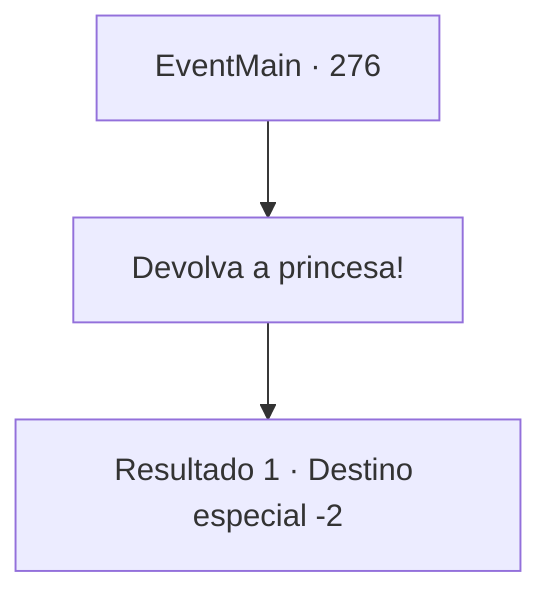

# Eventos principais · 276

[Índice da tabela](index.md) · [Índice geral](../index.md)

ID: `pt:EventMain:276` · Fonte: `EventMain4` · Versão: 1.2.47.

Mapeamento estático dos arquivos; a disponibilidade e a execução dependem do estado da run.

## Texto do evento

*Sem texto no arquivo.*

## Dados de entrada

```json
{
  "id": 276,
  "grade": 1,
  "normalGoal": "",
  "required": ""
}
```

## Mapa das escolhas



## Escolhas e resultados

### Escolha 1

Devolva a princesa!

Requisitos e outros campos da escolha:

```json
{
  "required": ""
}
```

#### Resultado 1.1

Você saca sua arma e grita imprudentemente com o dragão. O dragão com escamas de aço olha para você e responde. 

 "Impossível. Se você realmente se importa com a princesa, respeitará suas decisões."

 Depois de terminar suas palavras, o dragão bate as asas e sobe para o céu. Em seguida, desaparece nas nuvens.

Continuação registrada: [Destino especial `-2`](../destinos-especiais.md).

```json
{
  "required": "",
  "chance": "1",
  "nextEvent": -2,
  "type": 2,
  "reward": "13_2_10"
}
```

## Referências que chegam a este evento

- [Evento 275 · escolha 1 · resultado 1](0275.md#escolha-1)
- [Evento 275 · escolha 1 · resultado 2](0275.md#escolha-1)
- [Evento 275 · escolha 2 · resultado 1](0275.md#escolha-2)
- [Evento 275 · escolha 2 · resultado 2](0275.md#escolha-2)
- [Evento 275 · escolha 2 · resultado 3](0275.md#escolha-2)
- [Evento 275 · escolha 3 · resultado 1](0275.md#escolha-3)
- [Evento 275 · escolha 3 · resultado 2](0275.md#escolha-3)
- [Evento 275 · escolha 4 · resultado 1](0275.md#escolha-4)
