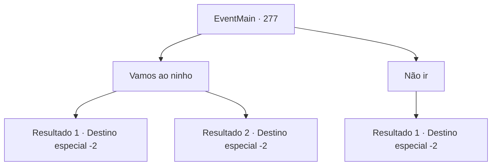

# Eventos principais · 277

[Índice da tabela](index.md) · [Índice geral](../index.md)

ID: `pt:EventMain:277` · Fonte: `EventMain4` · Versão: 1.2.47.

Mapeamento estático dos arquivos; a disponibilidade e a execução dependem do estado da run.

## Texto do evento

*Sem texto no arquivo.*

## Dados de entrada

```json
{
  "id": 277,
  "grade": 1,
  "normalGoal": "",
  "required": ""
}
```

## Mapa das escolhas



## Escolhas e resultados

### Escolha 1

Vamos ao ninho

Requisitos e outros campos da escolha:

```json
{
  "required": ""
}
```

#### Resultado 1.1

Você vai para uma montanha perto da aldeia. E no seu pico, você encontra um enorme ninho e ossos de animais espalhados ao redor dele. No ninho estão alguns ovos gigantes, seu dono desconhecido. Sem nada de interesse, você desce a montanha. 

Continuação registrada: [Destino especial `-2`](../destinos-especiais.md).

```json
{
  "required": "",
  "chance": "13",
  "nextEvent": -2,
  "type": 2,
  "reward": "13_2_10|5_159_1"
}
```

#### Resultado 1.2

Você vai para uma montanha perto da aldeia. E no seu pico, você encontra um enorme ninho e ossos de animais espalhados ao redor dele. No ninho estão alguns ovos gigantes, seu dono desconhecido. Sem nada de interesse, você desce a montanha. 

Continuação registrada: [Destino especial `-2`](../destinos-especiais.md).

```json
{
  "required": "",
  "chance": "1|0_7_1",
  "nextEvent": -2,
  "type": 2,
  "reward": "13_2_10|5_159_1"
}
```

### Escolha 2

Não ir

Requisitos e outros campos da escolha:

```json
{
  "required": ""
}
```

#### Resultado 2.1

Você decide não ir ao ninho do 'dragão'.

Continuação registrada: [Destino especial `-2`](../destinos-especiais.md).

```json
{
  "required": "",
  "chance": "1",
  "nextEvent": -2,
  "type": 2,
  "reward": "13_2_10|5_159_1"
}
```

## Referências que chegam a este evento

- [Evento 273 · escolha 4 · resultado 1](0273.md#escolha-4)
