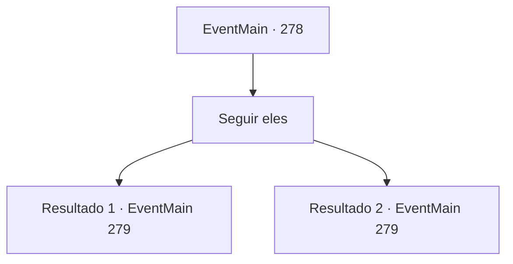

# Eventos principais · 278

[Índice da tabela](index.md) · [Índice geral](../index.md)

ID: `pt:EventMain:278` · Fonte: `EventMain4` · Versão: 1.2.47.

Mapeamento estático dos arquivos; a disponibilidade e a execução dependem do estado da run.

## Texto do evento

Um soldado com uma bandeira nas costas se aproxima de repente. 

 "Que achado, {1}. Temos procurado aventureiros habilidosos como você."

 Ela apresenta-se como mensageira do General Darius, dizendo que ele está tentando abrir a misteriosa porta no pico da Mountain Gar e, enfim, derrotar o dragão, e que, se o ajudar, será recompensando com seu peso em ouro.

## Dados de entrada

```json
{
  "id": 278,
  "grade": 1,
  "normalGoal": "",
  "required": "13_2_10|1_2_90"
}
```

## Mapa das escolhas



## Escolhas e resultados

### Escolha 1

Seguir eles

Requisitos e outros campos da escolha:

```json
{
  "required": ""
}
```

#### Resultado 1.1

Você segue o mensageiro até uma aldeia na montanha que costumava ser chamada de 'Descanso da Cabra da Montanha'. Lá você encontra uma cidade já reduzida a cinzas e tendas de soldados imperiais. |drawing_gipentCamp| Com a tentativa de encontrar a princesa fútil, parece que o próprio imperador desdobrou as tropas imperiais. Entre os soldados, você ainda encontra alguns magos. Você passa pelas tendas, encontrando o General Darius na maior tenda. 

 "Hm. Bem-vindo. Ouvi dizer que você salvou meu sobrinho de um wyvern. Obrigado."

 Ele estende a mão, agarrando a sua e apertando-a. Quando você olha mais de perto, você vê uma semelhança de família com o garoto grande que você viu na rua dos fundos da última vez. Darius lhe entrega uma armadura da tenda e fala. 

 "Isto é pela vida do meu sobrinho. Eu realmente sou grato. Agora vamos."

 Ele lidera suas tropas até a montanha, e você segue o general até a Montanha Gar.

Continuação registrada: [Evento 279](0279.md) na mesma tabela.

```json
{
  "required": "18_159_1",
  "chance": "1",
  "nextEvent": 279,
  "type": 2,
  "reward": "3_85_1"
}
```

#### Resultado 1.2

Você segue o mensageiro até uma aldeia na montanha que costumava ser chamada de 'Descanso da Cabra da Montanha'. Lá você encontra uma cidade já reduzida a cinzas e tendas de soldados imperiais. |drawing_gipentCamp| Com a tentativa de encontrar a princesa fútil, parece que o próprio imperador desdobrou as tropas imperiais. Entre os soldados, você ainda encontra alguns magos. Você passa pelas tendas, encontrando o General Darius na maior tenda. 

 "Hm. Bem-vindo. Ouvi dizer que você salvou meu sobrinho de um wyvern. Obrigado."

 Ele estende a mão, agarrando a sua e apertando-a. 

 "Nós até trouxemos alguns magos habilidosos, então definitivamente abriremos essa porta hoje. Vamos lá."

 Ele lidera suas tropas até a montanha, e você segue o general até a Montanha Gar.

Continuação registrada: [Evento 279](0279.md) na mesma tabela.

```json
{
  "required": "5_159_1",
  "chance": "1",
  "nextEvent": 279,
  "type": 2,
  "reward": ""
}
```

## Referências que chegam a este evento

Nenhum `nextEvent` positivo da mesma tabela aponta para este nó. Isso não prova que seja inacessível: sorteio e estado de história podem selecioná-lo.

