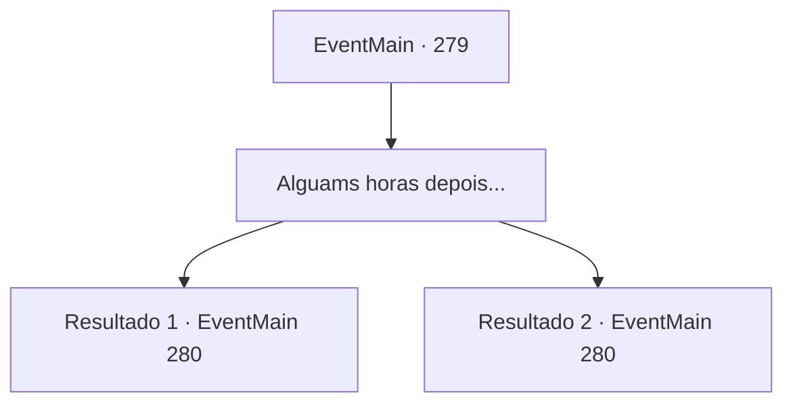

# Eventos principais · 279

[Índice da tabela](index.md) · [Índice geral](../index.md)

ID: `pt:EventMain:279` · Fonte: `EventMain4` · Versão: 1.2.47.

Mapeamento estático dos arquivos; a disponibilidade e a execução dependem do estado da run.

## Texto do evento

*Sem texto no arquivo.*

## Dados de entrada

```json
{
  "id": 279,
  "grade": 1,
  "normalGoal": "",
  "required": ""
}
```

## Mapa das escolhas



## Escolhas e resultados

### Escolha 1

Alguams horas depois...

Requisitos e outros campos da escolha:

```json
{
  "required": ""
}
```

#### Resultado 1.1

Você e as tropas de Darius escalam o perigoso caminho da montanha e finalmente chegam ao pico de Gar. Pensei que cerca de um terço das tropas foram abandonadas no caminho por dispnéia ou hipotermia. Os magos que o general trouxe olham de perto a porta para dissipar a magia nela. Então, um rosto familiar aparece com suas próprias tropas. É o príncipe de Arma, Vertino, novamente perceptível por seu simbólico cabelo ruivo. Durante o impasse entre as forças imperiais de Dario e os guardas pessoais de Vertino, Vertino fala primeiro. 

 "Não tenho intenção de entrar em conflito com o Império. Vou deixar você entrar primeiro."

 Darius então o agradece por ser atencioso. Depois de algum tempo, os magos conseguem dissipar a porta e destrancá-la. Você entra pela pequena porta com as forças imperiais. Atrás da pequena porta há um enorme buraco fora do lugar. É construído com pedra branca, com uma luz laranja fraca iluminando o interior luxuosamente. E lá você encontra um enorme dragão com um brilho cinza. |drawing_steelDragonLair|

Continuação registrada: [Evento 280](0280.md) na mesma tabela.

```json
{
  "required": "18_135_3",
  "chance": "1",
  "nextEvent": 280,
  "type": 2,
  "reward": ""
}
```

#### Resultado 1.2

Você e as tropas de Darius escalam o perigoso caminho da montanha e finalmente chegam ao pico de Gar. Pensei que cerca de um terço das tropas foram abandonadas no caminho por dispnéia ou hipotermia. Os magos que o general trouxe olham de perto a porta para dissipar a magia nela. Depois de algum tempo, os magos conseguem dissipar a porta e destrancá-la. Você entra pela pequena porta com as forças imperiais. Atrás da pequena porta há um enorme buraco fora do lugar. É construído com pedra branca, com uma luz laranja fraca iluminando o interior luxuosamente. E lá você encontra um enorme dragão com um brilho cinza. |drawing_steelDragonLair|

Continuação registrada: [Evento 280](0280.md) na mesma tabela.

```json
{
  "required": "5_135_3",
  "chance": "1",
  "nextEvent": 280,
  "type": 2,
  "reward": ""
}
```

## Referências que chegam a este evento

- [Evento 278 · escolha 1 · resultado 1](0278.md#escolha-1)
- [Evento 278 · escolha 1 · resultado 2](0278.md#escolha-1)
