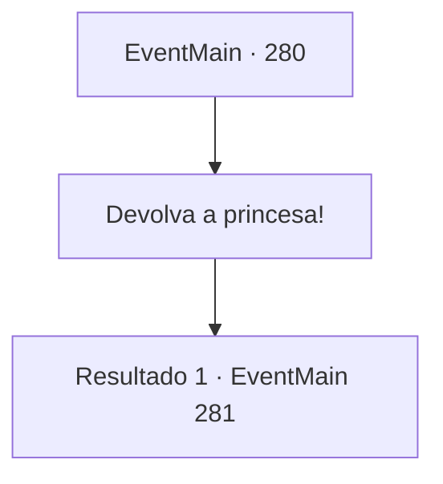

# Eventos principais · 280

[Índice da tabela](index.md) · [Índice geral](../index.md)

ID: `pt:EventMain:280` · Fonte: `EventMain4` · Versão: 1.2.47.

Mapeamento estático dos arquivos; a disponibilidade e a execução dependem do estado da run.

## Texto do evento

*Sem texto no arquivo.*

## Dados de entrada

```json
{
  "id": 280,
  "grade": 1,
  "normalGoal": "",
  "required": ""
}
```

## Mapa das escolhas



## Escolhas e resultados

### Escolha 1

Devolva a princesa!

Requisitos e outros campos da escolha:

```json
{
  "required": ""
}
```

#### Resultado 1.1

Você grita para o dragão devolver a princesa. Logo, a princesa aparece por trás do dragão. Ela se dirige a todos que entraram na cavidade. 

 "Eu não voltarei ao palácio. Então, por favor, retorne."

 Apesar das palavras da princesa, Darius balança a cabeça e ordena seus homens. 

 "O Imperador nos deu uma ordem. Mate o dragão e salve a princesa!"

 Após seu grito, ocorre uma batalha entre as forças imperiais e o dragão. 

Continuação registrada: [Evento 281](0281.md) na mesma tabela.

```json
{
  "required": "",
  "chance": "1",
  "nextEvent": 281,
  "type": 2,
  "reward": ""
}
```

## Referências que chegam a este evento

- [Evento 279 · escolha 1 · resultado 1](0279.md#escolha-1)
- [Evento 279 · escolha 1 · resultado 2](0279.md#escolha-1)
