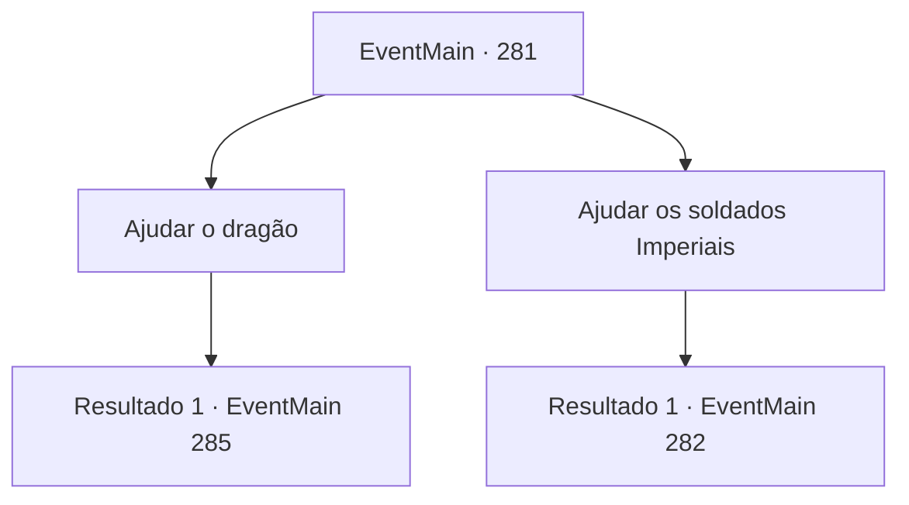

# Eventos principais · 281

[Índice da tabela](index.md) · [Índice geral](../index.md)

ID: `pt:EventMain:281` · Fonte: `EventMain4` · Versão: 1.2.47.

Mapeamento estático dos arquivos; a disponibilidade e a execução dependem do estado da run.

## Texto do evento

*Sem texto no arquivo.*

## Dados de entrada

```json
{
  "id": 281,
  "grade": 1,
  "normalGoal": "",
  "required": ""
}
```

## Mapa das escolhas



## Escolhas e resultados

### Escolha 1

Ajudar o dragão

Requisitos e outros campos da escolha:

```json
{
  "required": ""
}
```

#### Resultado 1.1

Você olha para a princesa que apareceu por trás do dragão, e o dragão que parece estar protegendo a princesa, e toma uma decisão. Você saca sua arma e enfrenta Darius. 

 "Wha...! O que você está fazendo! Você está do lado do dragão...?"

 Ele está obviamente surpreso, mas logo fortalece seu aperto em sua arma. Ele então balança a espada gigante em você.

Continuação registrada: [Evento 285](0285.md) na mesma tabela.

```json
{
  "required": "",
  "chance": "1",
  "nextEvent": 285,
  "type": 2,
  "reward": "6_0_98",
  "place": 6
}
```

### Escolha 2

Ajudar os soldados Imperiais

Requisitos e outros campos da escolha:

```json
{
  "required": ""
}
```

#### Resultado 2.1

Você decide salvar a princesa com as forças imperiais. Então você saca sua arma e ataca o dragão gigante.

Continuação registrada: [Evento 282](0282.md) na mesma tabela.

```json
{
  "required": "",
  "chance": "1",
  "nextEvent": 282,
  "type": 2,
  "reward": "6_0_93",
  "place": 6
}
```

## Referências que chegam a este evento

- [Evento 280 · escolha 1 · resultado 1](0280.md#escolha-1)
