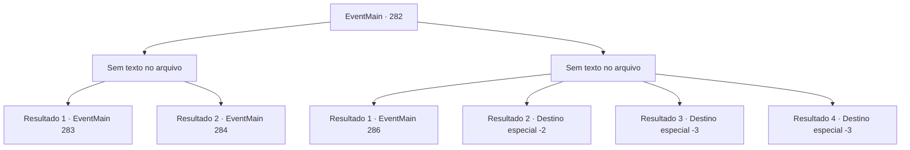

# Eventos principais · 282

[Índice da tabela](index.md) · [Índice geral](../index.md)

ID: `pt:EventMain:282` · Fonte: `EventMain4` · Versão: 1.2.47.

Mapeamento estático dos arquivos; a disponibilidade e a execução dependem do estado da run.

## Texto do evento

*Sem texto no arquivo.*

## Dados de entrada

```json
{
  "id": 282,
  "grade": 1,
  "normalGoal": "",
  "required": ""
}
```

## Mapa das escolhas



## Escolhas e resultados

### Escolha 1

*Sem texto no arquivo; o papel dessa opção depende da interface do jogo.*

Requisitos e outros campos da escolha:

```json
{
  "required": ""
}
```

#### Resultado 1.1

Após a longa e feroz batalha contra o dragão, você e as forças imperiais finalmente o derrubam. Mas quando você está prestes a dar o golpe final, a princesa intervém. 

 "Pare! Pare! Eu vou voltar para o palácio."

 Ela pede a todos que parem de prejudicar o dragão, prometendo que ela irá com eles. Então, Vertino aparece da entrada e fala, batendo palmas. 

 "Eu não esperaria menos dos soldados do grande Império de Zaipent. Muito impressionante."

 Ele então diz que seria melhor acabar com o dragão, ainda respirando.

Continuação registrada: [Evento 283](0283.md) na mesma tabela.

```json
{
  "required": "18_135_3",
  "chance": "1",
  "nextEvent": 283,
  "type": 2,
  "reward": ""
}
```

#### Resultado 1.2

Após a longa e feroz batalha contra o dragão, você e as forças imperiais finalmente o derrubam. Mas quando você está prestes a dar o golpe final, a princesa intervém. 

 "Pare! Pare! Eu vou voltar para o palácio."

 Ela pede a todos que parem de prejudicar o dragão, prometendo que ela irá com eles.

Continuação registrada: [Evento 284](0284.md) na mesma tabela.

```json
{
  "required": "5_135_3",
  "chance": "1",
  "nextEvent": 284,
  "type": 2,
  "reward": ""
}
```

### Escolha 2

*Sem texto no arquivo; o papel dessa opção depende da interface do jogo.*

Requisitos e outros campos da escolha:

```json
{
  "required": ""
}
```

#### Resultado 2.1

Você luta contra o dragão junto com as forças imperiais, mas não termina bem. Os soldados estão caídos no chão, e Dario também está ferido. 

 "Ack... Droga."

 Darius geme, limpando o sangue de sua boca. Então, Vertino aparece da entrada. Ele estalou a língua para as forças imperiais dispersas. 

 "Hmph. Este é realmente o poder total das forças imperiais... oh bem. Eu mesmo salvarei a princesa Esit."

 Ele saca sua espada e ataca o dragão.

Continuação registrada: [Evento 286](0286.md) na mesma tabela.

```json
{
  "required": "1_0_2|1_1_2|18_135_3",
  "chance": "1",
  "nextEvent": 286,
  "type": 2,
  "reward": "0_0_-1|0_1_-1"
}
```

#### Resultado 2.2

Você luta contra o dragão junto com as forças imperiais, mas não termina bem. Os soldados estão caídos no chão, e Dario também está ferido. 

 "Ack... Droga."

 Darius geme, limpando o sangue de sua boca. A princesa olha para os soldados e fala. 

 "Sinto muito a todos. Mas... não me procure mais. Não tenho intenção de voltar ao palácio."

 Depois que ela termina, o dragão dispara um sopro para o teto de seu covil, abrindo um buraco. Ele então voa e desaparece no céu com a princesa. Você desce a montanha com forças imperiais feridas. 

 "Isso não pode terminar aqui. Como eu explicaria isso ao Imperador... Vou procurar a princesa dentro das minhas habilidades, então se você encontrar alguma notícia, me diga."

 Você e Darius se despedem um do outro.

Continuação registrada: [Destino especial `-2`](../destinos-especiais.md).

```json
{
  "required": "1_0_2|1_1_2|5_135_3",
  "chance": "1",
  "nextEvent": -2,
  "type": 2,
  "reward": "0_0_-1|0_1_-1|13_2_11"
}
```

#### Resultado 2.3

Você luta contra o dragão junto com as forças imperiais, mas a cauda do dragão separa sua cabeça do corpo.

Continuação registrada: [Destino especial `-3`](../destinos-especiais.md).

```json
{
  "required": "2_0_2",
  "chance": "1",
  "nextEvent": -3,
  "type": 2,
  "reward": "0_0_-1|0_1_-1"
}
```

#### Resultado 2.4

Você luta contra o dragão junto com as forças imperiais, mas a cauda do dragão separa sua cabeça do corpo.

Continuação registrada: [Destino especial `-3`](../destinos-especiais.md).

```json
{
  "required": "2_1_2",
  "chance": "1",
  "nextEvent": -3,
  "type": 2,
  "reward": "0_0_-1|0_1_-1"
}
```

## Referências que chegam a este evento

- [Evento 281 · escolha 2 · resultado 1](0281.md#escolha-2)
