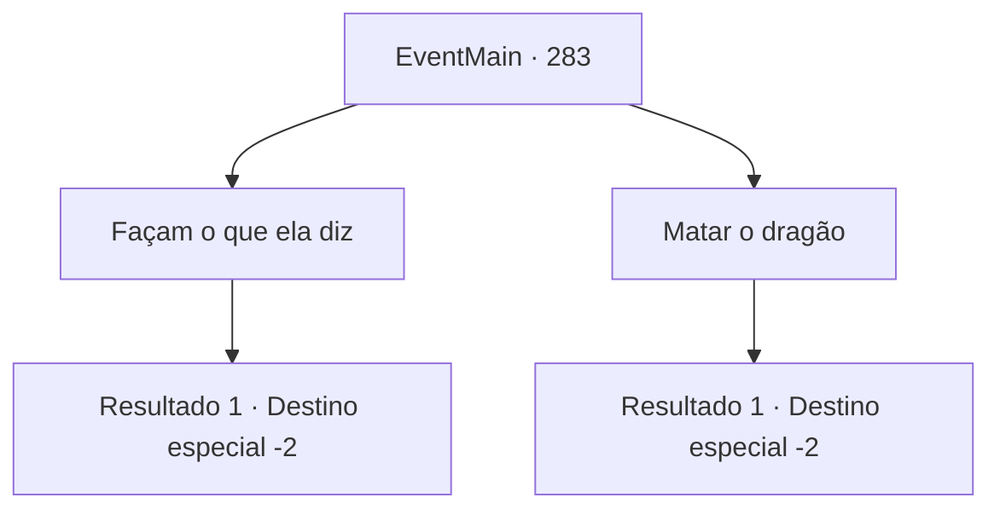

# Eventos principais · 283

[Índice da tabela](index.md) · [Índice geral](../index.md)

ID: `pt:EventMain:283` · Fonte: `EventMain4` · Versão: 1.2.47.

Mapeamento estático dos arquivos; a disponibilidade e a execução dependem do estado da run.

## Texto do evento

*Sem texto no arquivo.*

## Dados de entrada

```json
{
  "id": 283,
  "grade": 1,
  "normalGoal": "",
  "required": ""
}
```

## Mapa das escolhas



## Escolhas e resultados

### Escolha 1

Façam o que ela diz

Requisitos e outros campos da escolha:

```json
{
  "required": ""
}
```

#### Resultado 1.1

Você pede para fazer o que a princesa diz. Darius e Vertino concordam com a cabeça. 

 "Espero que você escolte a princesa com segurança até o palácio."

 Ele se curva respeitosamente e sai do covil. Darius então mostra seus agradecimentos a você. 

 "Nós não teríamos sido capazes de derrotar o dragão sem sua ajuda. Você tem minha mais sincera gratidão. Traremos a princesa de volta em segurança."

 Ele sai com seus soldados e a princesa, e você sai do covil, deixando o dragão derrotado.

Continuação registrada: [Destino especial `-2`](../destinos-especiais.md).

```json
{
  "required": "",
  "chance": "1",
  "nextEvent": -2,
  "type": 2,
  "reward": "13_2_12"
}
```

### Escolha 2

Matar o dragão

Requisitos e outros campos da escolha:

```json
{
  "required": ""
}
```

#### Resultado 2.1

Você decide que deve matar o dragão. Darius então ordena que seus homens escoltem a princesa para fora. <link=shake>

 "N...não!! Por favor!! Não!!!"

</link> Apesar das lágrimas e gritos da princesa, você pega a alabarda nas proximidades e acaba com a vida do dragão. |drawing_killDragon| A princesa, depois de testemunhar, fica inconsciente. 

 "Isso é... parece que ela realmente se deu bem com esse lagarto. A princesa."

 Vertino murmura inaudível, com algum cheiro de sarcasmo, e sai do covil com seus cavaleiros. Darius então mostra seus agradecimentos a você. 

 "Nós não teríamos sido capazes de derrotar o dragão sem sua ajuda. Você tem minha mais sincera gratidão. Traremos a princesa de volta em segurança."

 Ele sai com seus soldados e a princesa, e você sai do covil, deixando o dragão derrotado. 

Continuação registrada: [Destino especial `-2`](../destinos-especiais.md).

```json
{
  "required": "",
  "chance": "1",
  "nextEvent": -2,
  "type": 2,
  "reward": "13_2_12|5_170_1"
}
```

## Referências que chegam a este evento

- [Evento 282 · escolha 1 · resultado 1](0282.md#escolha-1)
