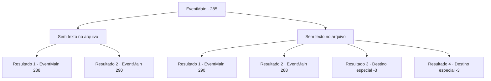

# Eventos principais · 285

[Índice da tabela](index.md) · [Índice geral](../index.md)

ID: `pt:EventMain:285` · Fonte: `EventMain4` · Versão: 1.2.47.

Mapeamento estático dos arquivos; a disponibilidade e a execução dependem do estado da run.

## Texto do evento

*Sem texto no arquivo.*

## Dados de entrada

```json
{
  "id": 285,
  "grade": 1,
  "normalGoal": "",
  "required": ""
}
```

## Mapa das escolhas



## Escolhas e resultados

### Escolha 1

*Sem texto no arquivo; o papel dessa opção depende da interface do jogo.*

Requisitos e outros campos da escolha:

```json
{
  "required": ""
}
```

#### Resultado 1.1

Você derrota Darius, e o dragão imobiliza as forças imperiais. Então, Vertino aparece da entrada com seus cavaleiros. Ele estalou a língua para as forças imperiais dispersas. 

 "Hmph. Este é realmente o poder total das forças imperiais... oh bem. Eu mesmo salvarei a princesa Esit."

 Ele puxa sua espada e ataca o dragão. 

Continuação registrada: [Evento 288](0288.md) na mesma tabela.

```json
{
  "required": "18_135_3",
  "chance": "1",
  "nextEvent": 288,
  "type": 2,
  "reward": ""
}
```

#### Resultado 1.2

Você derrota Darius, e o dragão imobiliza as forças imperiais. O dragão grita com os soldados imperiais. 

 "Saia daqui imediatamente se quiser continuar vivo!"

 Darius, rangendo os dentes, ordena que seus homens recuem. Ele olha para você uma última vez antes de sair do covil. Depois que todas as forças imperiais foram embora, o dragão olha para você e fala. 

 "Obrigado pela ajuda."

 Ele então se transforma em sua forma humana, que é o capitão dos guardas da princesa, Egakin.  

Continuação registrada: [Evento 290](0290.md) na mesma tabela.

```json
{
  "required": "5_135_3",
  "chance": "1",
  "nextEvent": 290,
  "type": 2,
  "reward": ""
}
```

### Escolha 2

*Sem texto no arquivo; o papel dessa opção depende da interface do jogo.*

Requisitos e outros campos da escolha:

```json
{
  "required": ""
}
```

#### Resultado 2.1

Você está tendo dificuldades contra os ataques ferozes de Darius, mas o dragão o ataca depois de cuidar das forças imperiais. 

 "Saia daqui imediatamente se quiser continuar vivo!"

 Darius, rangendo os dentes, ordena que seus homens recuem. Ele olha para você uma última vez antes de sair do covil. Depois que todas as forças imperiais foram embora, o dragão olha para você e fala. 

 "Obrigado pela ajuda."

 Ele então se transforma em sua forma humana, que é o capitão dos guardas da princesa, Egakin.

Continuação registrada: [Evento 290](0290.md) na mesma tabela.

```json
{
  "required": "1_0_2|1_1_2|5_135_3",
  "chance": "1",
  "nextEvent": 290,
  "type": 2,
  "reward": "0_0_-1|0_1_-1"
}
```

#### Resultado 2.2

Você está tendo dificuldades contra os ataques ferozes de Darius, mas o dragão o ataca depois de cuidar das forças imperiais. Ele é jogado no chão, atingido pela pata dianteira do dragão. Então, Vertino aparece da entrada com seus cavaleiros. Ele estalou a língua para as forças imperiais dispersas. 

 "Hmph. Este é realmente o poder total das forças imperiais... oh bem. Eu mesmo salvarei a princesa Esit."

 Ele puxa sua espada e ataca o dragão. 

Continuação registrada: [Evento 288](0288.md) na mesma tabela.

```json
{
  "required": "1_0_2|1_1_2|18_135_3",
  "chance": "1",
  "nextEvent": 288,
  "type": 2,
  "reward": "0_0_-1|0_1_-1"
}
```

#### Resultado 2.3

Você se torna um cadáver frio depois de sofrer os ataques ferozes de Darius.

Continuação registrada: [Destino especial `-3`](../destinos-especiais.md).

```json
{
  "required": "2_0_2",
  "chance": "1",
  "nextEvent": -3,
  "type": 2,
  "reward": "0_0_-1|0_1_-1"
}
```

#### Resultado 2.4

Você se torna um cadáver frio depois de sofrer os ataques ferozes de Darius.

Continuação registrada: [Destino especial `-3`](../destinos-especiais.md).

```json
{
  "required": "2_1_2",
  "chance": "1",
  "nextEvent": -3,
  "type": 2,
  "reward": "0_0_-1|0_1_-1"
}
```

## Referências que chegam a este evento

- [Evento 281 · escolha 1 · resultado 1](0281.md#escolha-1)
