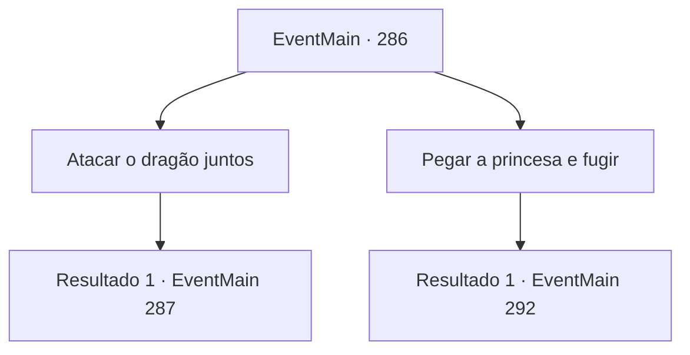

# Eventos principais · 286

[Índice da tabela](index.md) · [Índice geral](../index.md)

ID: `pt:EventMain:286` · Fonte: `EventMain4` · Versão: 1.2.47.

Mapeamento estático dos arquivos; a disponibilidade e a execução dependem do estado da run.

## Texto do evento

*Sem texto no arquivo.*

## Dados de entrada

```json
{
  "id": 286,
  "grade": 1,
  "normalGoal": "",
  "required": ""
}
```

## Mapa das escolhas



## Escolhas e resultados

### Escolha 1

Atacar o dragão juntos

Requisitos e outros campos da escolha:

```json
{
  "required": ""
}
```

#### Resultado 1.1

Você decide ajudar Vertino a lutar contra o dragão. Você está exausto, mas o dragão deve sentir o mesmo. Você mais uma vez fica de pé e aperta o punho da arma.

Continuação registrada: [Evento 287](0287.md) na mesma tabela.

```json
{
  "required": "",
  "chance": "1",
  "nextEvent": 287,
  "type": 2,
  "reward": "6_2_93",
  "place": 6
}
```

### Escolha 2

Pegar a princesa e fugir

Requisitos e outros campos da escolha:

```json
{
  "required": ""
}
```

#### Resultado 2.1

Você decide pegar a princesa e fugir, enquanto Vertino e o dragão estão ocupados lutando entre si. Ao contrário de suas expectativas, quando você se aproxima da princesa e lhe diz para fugir, ela rejeita firmemente. 

 "Não. Não tenho intenção de voltar. Por favor. Vou explicar mais tarde - ajude o dragão a lutar por enquanto."


Continuação registrada: [Evento 292](0292.md) na mesma tabela.

```json
{
  "required": "",
  "chance": "1",
  "nextEvent": 292,
  "type": 2,
  "reward": ""
}
```

## Referências que chegam a este evento

- [Evento 282 · escolha 2 · resultado 1](0282.md#escolha-2)
