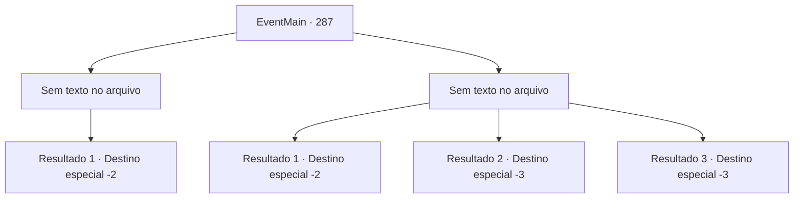

# Eventos principais · 287

[Índice da tabela](index.md) · [Índice geral](../index.md)

ID: `pt:EventMain:287` · Fonte: `EventMain4` · Versão: 1.2.47.

Mapeamento estático dos arquivos; a disponibilidade e a execução dependem do estado da run.

## Texto do evento

*Sem texto no arquivo.*

## Dados de entrada

```json
{
  "id": 287,
  "grade": 1,
  "normalGoal": "",
  "required": ""
}
```

## Mapa das escolhas



## Escolhas e resultados

### Escolha 1

*Sem texto no arquivo; o papel dessa opção depende da interface do jogo.*

Requisitos e outros campos da escolha:

```json
{
  "required": ""
}
```

#### Resultado 1.1

Você finalmente consegue derrubar o dragão. Vertino, assim como você, está respirando pesadamente, coberto de sangue e suor. Mas quando você está prestes a dar o golpe final, a princesa intervém. 

 "Pare! Pare! Eu vou voltar para o palácio."

 Ela pede a todos que parem de prejudicar o dragão, prometendo que ela irá com eles. Vertino fala com um sorriso curto. 

 "Hoo... minha querida Esit. Como você pode ser tão ingênuo... o dragão se tornou seu amigo ou algo assim?"

 Ele se aproximou da princesa. Ele então a ataca de volta com o cabo de sua espada. A princesa cai no chão inconsciente, e Darius grita de raiva. 

 "Que insolente!"

 Mas Vertino não se intimida nem um pouco com isso. 

 "Ei... geral. Espero que possa cuidar bem da princesa. Vejo que ainda tem forças para dizer alguma coisa? Todos vocês teriam sido a ceia do dragão se não fosse por mim."

 Com a observação de Vertino, Darius fica em silêncio. Ele então ordena que seus homens escoltem a princesa. Enquanto isso, Vertino acaba com a vida do dragão com sua espada. |drawing_killDragon| Ele então sai com esses cavaleiros. Darius leva a princesa e os soldados feridos para fora do covil.

Continuação registrada: [Destino especial `-2`](../destinos-especiais.md).

```json
{
  "required": "",
  "chance": "1",
  "nextEvent": -2,
  "type": 2,
  "reward": "13_2_12|5_170_1"
}
```

### Escolha 2

*Sem texto no arquivo; o papel dessa opção depende da interface do jogo.*

Requisitos e outros campos da escolha:

```json
{
  "required": ""
}
```

#### Resultado 2.1

Embora você e Vertino tenham atacado o dragão juntos, você não é capaz de derrotar o dragão. O dragão de aço parece imbatível. Em seguida, ele ruge alto e dispara uma forte respiração ácida. |drawing_dragonBreath| Você é capaz de evitar a respiração por um triz, mas Vertino e seus cavaleiros não. Sua carne derrete em um instante, e eles são transformados em uma pilha de ossos. O dragão quebra o teto do covil, sobe ao céu com a princesa e desaparece. Você desce a montanha com forças imperiais feridas. 

 "Isso não pode terminar aqui. Como eu explicaria isso ao Imperador... Vou procurar a princesa dentro das minhas habilidades, então se você encontrar alguma notícia, me diga."

 Você e Darius se despedem.

Continuação registrada: [Destino especial `-2`](../destinos-especiais.md).

```json
{
  "required": "1_0_2|1_1_2",
  "chance": "1",
  "nextEvent": -2,
  "type": 2,
  "reward": "0_0_-1|0_1_-1|13_2_11|5_135_3"
}
```

#### Resultado 2.2

Embora você e Vertino tenham atacado o dragão juntos, vocês não conseguem derrotá-lo.  O dragão de aço parece invencível.  Então ele ruge alto e dispara um poderoso sopro ácido.  |drawing_dragonBreath|  Essa é a última coisa que você vê.

Continuação registrada: [Destino especial `-3`](../destinos-especiais.md).

```json
{
  "required": "2_0_2",
  "chance": "1",
  "nextEvent": -3,
  "type": 2,
  "reward": "0_0_-1|0_1_-1"
}
```

#### Resultado 2.3

Embora você e Vertino tenham atacado o dragão juntos, você não é capaz de derrotar o dragão. O dragão de aço parece imbatível. Em seguida, ele ruge alto e dispara uma forte respiração ácida. |drawing_dragonBreath| Aquilo é a última coisa que você vê.

Continuação registrada: [Destino especial `-3`](../destinos-especiais.md).

```json
{
  "required": "2_1_2",
  "chance": "1",
  "nextEvent": -3,
  "type": 2,
  "reward": "0_0_-1|0_1_-1"
}
```

## Referências que chegam a este evento

- [Evento 286 · escolha 1 · resultado 1](0286.md#escolha-1)
