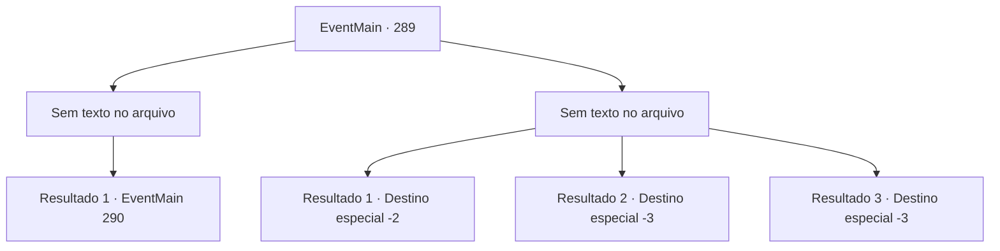

# Eventos principais · 289

[Índice da tabela](index.md) · [Índice geral](../index.md)

ID: `pt:EventMain:289` · Fonte: `EventMain4` · Versão: 1.2.47.

Mapeamento estático dos arquivos; a disponibilidade e a execução dependem do estado da run.

## Texto do evento

*Sem texto no arquivo.*

## Dados de entrada

```json
{
  "id": 289,
  "grade": 1,
  "normalGoal": "",
  "required": ""
}
```

## Mapa das escolhas



## Escolhas e resultados

### Escolha 1

*Sem texto no arquivo; o papel dessa opção depende da interface do jogo.*

Requisitos e outros campos da escolha:

```json
{
  "required": ""
}
```

#### Resultado 1.1

Os cavaleiros de Vertino caem como folhas perante seu poder. Enquanto você está lutando contra os cavaleiros, o dragão subjulga Vertino com sucesso. Como você não vê Darius e as forças imperiais, parece que eles recuaram. A princesa Esit se aproxima de você e agradece. 

 "{1}. Obrigada por ajudar. Eu não sei como te retribuir..."

 Então o dragão se transforma em sua forma humana, a qual é o Capitão da Guarda da princesa, Egakin. Ele te agradece, parecendo exausto.

Continuação registrada: [Evento 290](0290.md) na mesma tabela.

```json
{
  "required": "",
  "chance": "1",
  "nextEvent": 290,
  "type": 2,
  "reward": ""
}
```

### Escolha 2

*Sem texto no arquivo; o papel dessa opção depende da interface do jogo.*

Requisitos e outros campos da escolha:

```json
{
  "required": ""
}
```

#### Resultado 2.1

Você é seriamente espancado pelos cavaleiros de Vertino. O cavaleiro avança contra o dragão, o qual solta um rugido alto e dispara um sopro ácido nos cavaleiros. |drawing_dragonBreath| A pele deles derrete em um instante e são transformados em uma pilha de ossos. O dragão quebra o teto do covil, voa para o céu com a princesa e desaparece.

Continuação registrada: [Destino especial `-2`](../destinos-especiais.md).

```json
{
  "required": "1_0_2|1_1_2",
  "chance": "1",
  "nextEvent": -2,
  "type": 2,
  "reward": "0_0_-1|0_1_-1|13_2_11|5_135_3"
}
```

#### Resultado 2.2

Você é morto pelos cavaleiros de Vertino.

Continuação registrada: [Destino especial `-3`](../destinos-especiais.md).

```json
{
  "required": "2_0_2",
  "chance": "1",
  "nextEvent": -3,
  "type": 2,
  "reward": "0_0_-1|0_1_-1"
}
```

#### Resultado 2.3

Você é morto pelos cavaleiros de Vertino.

Continuação registrada: [Destino especial `-3`](../destinos-especiais.md).

```json
{
  "required": "2_1_2",
  "chance": "1",
  "nextEvent": -3,
  "type": 2,
  "reward": "0_0_-1|0_1_-1"
}
```

## Referências que chegam a este evento

- [Evento 288 · escolha 1 · resultado 1](0288.md#escolha-1)
- [Evento 292 · escolha 2 · resultado 1](0292.md#escolha-2)
