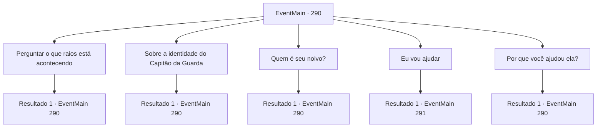

# Eventos principais · 290

[Índice da tabela](index.md) · [Índice geral](../index.md)

ID: `pt:EventMain:290` · Fonte: `EventMain4` · Versão: 1.2.47.

Mapeamento estático dos arquivos; a disponibilidade e a execução dependem do estado da run.

## Texto do evento

*Sem texto no arquivo.*

## Dados de entrada

```json
{
  "id": 290,
  "grade": 1,
  "normalGoal": "",
  "required": ""
}
```

## Mapa das escolhas



## Escolhas e resultados

### Escolha 1

Perguntar o que raios está acontecendo

Requisitos e outros campos da escolha:

```json
{
  "required": "5_136_0"
}
```

#### Resultado 1.1

A princesa responde sua pergunta com entusiasmo. De acordo com ela, ela tinha um irmã mais velha que fora prometida em casamento por rasões políticas e, no final de sua infeliz vida de casada, ela se suicidou. 

 "Vossa Majestade pretende me usar como barganha para ganhar controle da nação vizinha... mas eu me recuso a ser usada como a marionete dele. Eu vou me casar com a pessoa que eu quiser casar. Então com a ajuda do Capitão da Guarda, eu mesma fugi do castelo."

 Após terminar, a princesa suspira e adiciona que não tem intenção de voltar ao palácio real.

Continuação registrada: [Evento 290](0290.md) na mesma tabela.

```json
{
  "required": "",
  "chance": "1",
  "nextEvent": 290,
  "type": 2,
  "reward": "5_136_1"
}
```

### Escolha 2

Sobre a identidade do Capitão da Guarda

Requisitos e outros campos da escolha:

```json
{
  "required": "5_137_0"
}
```

#### Resultado 2.1

Você pergunta sobre a verdadeira identidade do Capitão da Guarda. O capitão, ao lado da princesa, fala depois de um suspiro. 

 "Um dragão, como você pode ver. Um Dragão de Aço. Eu tenho vivido entre o seu tipo por curiosidade pela vida humana."

 Ele também diz que faz cerca de um século desde que ele se misturou, e que desta vez, ele escolheu o papel do cavaleiro real porque estava curioso sobre a vida da realeza. Com suas habilidades, seria uma questão de tempo até que ele fosse promovido a capitão.

Continuação registrada: [Evento 290](0290.md) na mesma tabela.

```json
{
  "required": "",
  "chance": "1",
  "nextEvent": 290,
  "type": 2,
  "reward": "5_137_1"
}
```

### Escolha 3

Quem é seu noivo?

Requisitos e outros campos da escolha:

```json
{
  "required": "5_138_0"
}
```

#### Resultado 3.1

Você pergunta à princesa quem o Imperador pensou como seu prometido. Ela franze a testa, como se ficasse irritada só de pensar sobre isso. 

 "É o Vertino, o herdeiro ruivo do Reino de Arma. A crueldade daquele homem não tem limites - espancando uma das empregadas até a morte só porque ela não conseguia atingir a temperatura certa da sua água de banho, deixando prisioneiros de guerra empalados em lanças no campo de batalha. E aparentemente ele também é habilidoso, sendo um dos poucos matadores de dragões neste continente."

 Ela coça o lado da cabeça por um momento e continua. 

 "Ele, uma vez, me viu em um baile e tem pedido minha mão em casamento desde então. Vossa Majestade provavelmente quer conquistar Arma, mas não quer arriscar perdas demais contra um guerreiro poderoso como Vertino... então eu acho que ele está tentando me casar com ele. É uma situação de benefício mútuo. Exceto para mim."


Continuação registrada: [Evento 290](0290.md) na mesma tabela.

```json
{
  "required": "",
  "chance": "1",
  "nextEvent": 290,
  "type": 2,
  "reward": "5_138_1"
}
```

### Escolha 4

Eu vou ajudar

Requisitos e outros campos da escolha:

```json
{
  "required": "5_136_1"
}
```

#### Resultado 4.1

Você diz que irá ajudar a princesa a se casar com qualquer um que ela queira. Então o Capitão da Guarda te pergunta como você poderia ajudar.

Continuação registrada: [Evento 291](0291.md) na mesma tabela.

```json
{
  "required": "",
  "chance": "1",
  "nextEvent": 291,
  "type": 2,
  "reward": ""
}
```

### Escolha 5

Por que você ajudou ela?

Requisitos e outros campos da escolha:

```json
{
  "required": "5_143_0"
}
```

#### Resultado 5.1

Você pergunta à Egakin o porquê dele ter ajudado a princesa. Ele diz que fez o que precisava ser feito. 

 "Eu cuidei da Esit desde que ela era uma garotinha. Como uma filha. Quando esta mesma criança vem à mim e implora em prantos, não tem como eu só dizer 'não'. Então eu revelei minha identidade e tirei ela do castelo."


Continuação registrada: [Evento 290](0290.md) na mesma tabela.

```json
{
  "required": "",
  "chance": "1",
  "nextEvent": 290,
  "type": 2,
  "reward": "5_143_1"
}
```

## Referências que chegam a este evento

- [Evento 285 · escolha 1 · resultado 2](0285.md#escolha-1)
- [Evento 285 · escolha 2 · resultado 1](0285.md#escolha-2)
- [Evento 289 · escolha 1 · resultado 1](0289.md#escolha-1)
- [Evento 290 · escolha 1 · resultado 1](0290.md#escolha-1)
- [Evento 290 · escolha 2 · resultado 1](0290.md#escolha-2)
- [Evento 290 · escolha 3 · resultado 1](0290.md#escolha-3)
- [Evento 290 · escolha 5 · resultado 1](0290.md#escolha-5)
