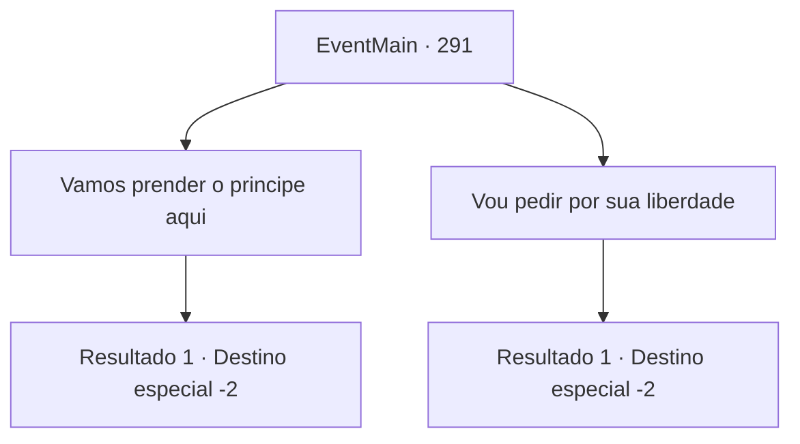

# Eventos principais · 291

[Índice da tabela](index.md) · [Índice geral](../index.md)

ID: `pt:EventMain:291` · Fonte: `EventMain4` · Versão: 1.2.47.

Mapeamento estático dos arquivos; a disponibilidade e a execução dependem do estado da run.

## Texto do evento

*Sem texto no arquivo.*

## Dados de entrada

```json
{
  "id": 291,
  "grade": 1,
  "normalGoal": "",
  "required": ""
}
```

## Mapa das escolhas



## Escolhas e resultados

### Escolha 1

Vamos prender o principe aqui

Requisitos e outros campos da escolha:

```json
{
  "required": "5_136_1|18_135_3"
}
```

#### Resultado 1.1

Você notifica a princesa sobre as condições que o Imperador colocou, e propõe que eles prendam Vertino temporariamente.  

 "Eu entendo... Sem ele o casamento diplomático será parado. Talvez se torne totalmente inválido. Me parece uma boa ideia para comprar algum tempo e persuadir o Imperador."

 O Capitão acena em concordância., e amarra Vertino e seus cavaleiros com uma corda. Enquanto isto a princesa se aproxima de você e diz, segurando suas mãos. 

 "Muito obrigada de verdade pela sua ajuda. Eu também peço descupas por não ter dito isto para você antes. {1}. Então... Eu te vejo de volta na capital 'Zapen'. Eu tenho um lugar para visitar antes de ir para o palácio."

 A princesa se despede de você, graciosamente balançando as mãos.

Continuação registrada: [Destino especial `-2`](../destinos-especiais.md).

```json
{
  "required": "",
  "chance": "1",
  "nextEvent": -2,
  "type": 2,
  "reward": "13_2_8|0_2_2|5_135_3"
}
```

### Escolha 2

Vou pedir por sua liberdade

Requisitos e outros campos da escolha:

```json
{
  "required": ""
}
```

#### Resultado 2.1

Você notifica a princesa das condições que o Imperador estabeleceu. Você diz que reivindicara a liberdade da princesa dainte do Imperador. Depois de ouvir você, ela se recosta na cadeira, com um 'Hmm..'. 

 "Agradeço sua sugestão... mas devo considerar isso por mais tempo. Dê-me algum tempo, por favor."

 Ela lhe diz que o avisará com um pombo-correio quando decidir. Então ela tira uma poção de uma gaveta, entrega para você e fala. 

 "Me desculpe por não ter avisado com antecedência... Eu só não esperava que você viesse me encontrar assim."

 A poção que ela lhe deu claramente pertence a Egakin, mas ele não diz uma palavra. Você decide esperar pela decisão da princesa e sair do covil do dragão com a poção.

Continuação registrada: [Destino especial `-2`](../destinos-especiais.md).

```json
{
  "required": "",
  "chance": "1",
  "nextEvent": -2,
  "type": 2,
  "reward": "13_2_5|0_2_2|5_135_3|3_130_1"
}
```

## Referências que chegam a este evento

- [Evento 290 · escolha 4 · resultado 1](0290.md#escolha-4)
