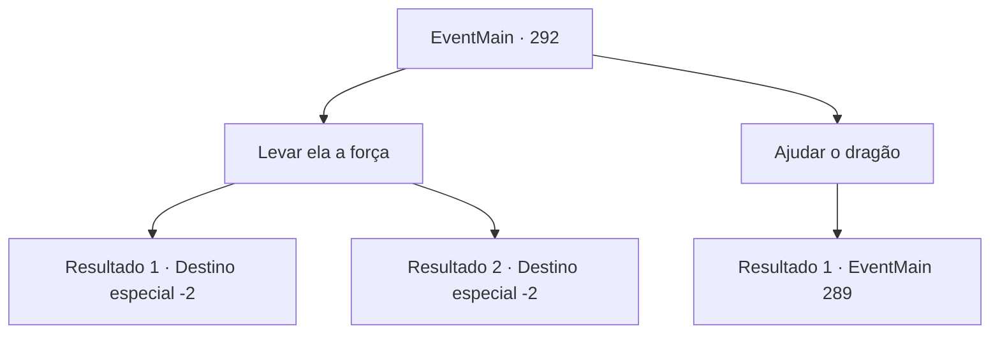

# Eventos principais · 292

[Índice da tabela](index.md) · [Índice geral](../index.md)

ID: `pt:EventMain:292` · Fonte: `EventMain4` · Versão: 1.2.47.

Mapeamento estático dos arquivos; a disponibilidade e a execução dependem do estado da run.

## Texto do evento

*Sem texto no arquivo.*

## Dados de entrada

```json
{
  "id": 292,
  "grade": 1,
  "normalGoal": "",
  "required": ""
}
```

## Mapa das escolhas



## Escolhas e resultados

### Escolha 1

Levar ela a força

Requisitos e outros campos da escolha:

```json
{
  "required": ""
}
```

#### Resultado 1.1

Você bate na nuca da princesa, deixando-a inconsciente. Você então a carrega em seu ombro e sai do covil. Quando você alcança metade do caminho adentro da montanha, o cabo em que o covil estava desmorona com um barulho alto. 

 A montanha logo fica escura, então você monta uma pequena barraca e a deita Logo depois ela recupera a consciência e grita com você, enfurecida. 

 "O que você está fazendo! Devemos voltar para o covil em .."

 Mas ela não consegue terminar suas palavras. Ela olha para a capa desmoronada e desmaia novamente. Isso facilita o seu trabalho de carregar a princesa montanha abaixo. Você prossegue em direção ao palácio real com ela.   

Continuação registrada: [Destino especial `-2`](../destinos-especiais.md).

```json
{
  "required": "",
  "chance": "1|0_5_1",
  "nextEvent": -2,
  "type": 0,
  "reward": "13_2_13|0_3_-3"
}
```

#### Resultado 1.2

Você tenta nocautear a princesa golpeando sua nuca, mas ela não desmaia, apenas geme com a dor se espalhando pela nuca. 

 "O que você está fazendo...?"

 Ela veste um semblante de nojo, confusa com a inacreditável reviravolta dos acontecimentos. Você carrega a princesa em seus ombros e sai do covil. Levar à força a princesa resistente é uma tarefa cansativa. Quando você alcança metade do caminho adentro da montanha, o cabo em que o covil estava desmorona com um barulho alto. 

 "N...não...!"

 Depois de olhar para ele, ela desmaia novamente. Isso facilita o seu trabalho de carregar a princesa montanha abaixo. Você segue em direção ao palácio real com ela.

Continuação registrada: [Destino especial `-2`](../destinos-especiais.md).

```json
{
  "required": "",
  "chance": "10",
  "nextEvent": -2,
  "type": 1,
  "reward": "13_2_13|0_3_-3"
}
```

### Escolha 2

Ajudar o dragão

Requisitos e outros campos da escolha:

```json
{
  "required": ""
}
```

#### Resultado 2.1

De acordo com o pedido da princesa, você ataca Vertino, que está lutando contra o dragão. 

 "Ah...! Que diabos está fazendo!"

 Suas veias saltam de sua testa, e ele grita para seus cavaleiros. 

 "Corte este louco em pedaços de uma vez!!"

 Os cavaleiros atacam você depois de ouvir suas ordens.

Continuação registrada: [Evento 289](0289.md) na mesma tabela.

```json
{
  "required": "",
  "chance": "1",
  "nextEvent": 289,
  "type": 2,
  "reward": "6_0_92",
  "place": 6
}
```

## Referências que chegam a este evento

- [Evento 286 · escolha 2 · resultado 1](0286.md#escolha-2)
- [Evento 288 · escolha 2 · resultado 1](0288.md#escolha-2)
