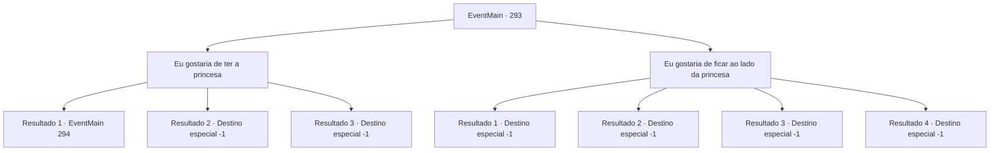

# Eventos principais · 293

[Índice da tabela](index.md) · [Índice geral](../index.md)

ID: `pt:EventMain:293` · Fonte: `EventMain4` · Versão: 1.2.47.

Mapeamento estático dos arquivos; a disponibilidade e a execução dependem do estado da run.

## Texto do evento

Regressas à capital do império, 'Zapen', onde sua aventura deu início. Você se dirige prontamente para o palácio real, e reivindica um encontro com o Imperador à guarda no portão do castelo. Sem hesitar, a guarda do Imperador te leva à sala de audiência. |drawing_emperor| Ele usa um anel em cada um dos seus nove dedos,  cada um tirado dos governantes de outras nações conquistadas. Você se curva em cumprimento. Ao seu lado estão Dario e a Princesa Esit, que está sentada sem emoção como uma boneca. 

 "Estou a ver. Fizestes um grande trabalho. Ouvi falar muito dos vossos feitos de Dario."

 O Imperador sorri. Em seguida pergunta o que você deseja.

## Dados de entrada

```json
{
  "id": 293,
  "grade": 1,
  "normalGoal": "",
  "required": "13_2_12|1_2_100"
}
```

## Mapa das escolhas



## Escolhas e resultados

### Escolha 1

Eu gostaria de ter a princesa

Requisitos e outros campos da escolha:

```json
{
  "required": "11_0_0"
}
```

#### Resultado 1.1

O Imperador cai na gargalhada depois de ouvir seu desejo. 

 "Ahahahaha!!! Você tem coragem, eu vou te dar isso!"

 Então, Vertino e seus cavaleiros entram na sala de audiências. O Imperador conta a Vertino sobre seu desejo, que você também quer a princesa. Ele anuncia que o vencedor do duelo terá a princesa. Vertino tenta ao máximo esconder sua fúria e ciúme, mas não consegue evitar que as veias saltem na testa. 

 "Ha..haha... Sua Majestade parece estar com disposição para piadas hoje."

 Ele coloca seu melhor sorriso e fala, mas depois de olhar para a expressão do Imperador, percebe que ele não está brincando. Ele puxa sua espada, murmurando para você baixinho. 

 "Eu vou fazer você se arrepender... por essa humilhação."

 Assim que ele termina, a lâmina afiada de Vertino se lança em sua direção.

Continuação registrada: [Evento 294](0294.md) na mesma tabela.

```json
{
  "required": "18_135_3",
  "chance": "1",
  "nextEvent": 294,
  "type": 2,
  "reward": "6_0_94",
  "place": 10
}
```

#### Resultado 1.2

O Imperador cai na gargalhada depois de ouvir seu desejo. 

 "Ahahahaha!!! Você tem coragem, eu vou te dar isso! Muito bem. Escute aqui. Este aventureiro terá a Princesa Esit. Faça os arranjos necessários para um casamento."

 Depois de terminar, o Imperador gesticula para você sair. Você abaixa a cabeça, agradece ao Imperador e sai da sala de audiências. Enquanto as portas se fecham, você olha para a expressão da princesa, mas não consegue entender o que ela está pensando.

Continuação registrada: [Destino especial `-1`](../destinos-especiais.md).

```json
{
  "required": "5_135_3|5_170_1",
  "chance": "1",
  "nextEvent": -1,
  "type": 2,
  "reward": "15_3_10|15_3_16"
}
```

#### Resultado 1.3

O Imperador cai na gargalhada depois de ouvir seu desejo. 

 "Ahahahaha!!! Você tem coragem, eu vou te dar isso! Muito bem. Escute aqui. Este aventureiro terá a Princesa Esit. Faça os arranjos necessários para um casamento."

 Depois de terminar, o Imperador gesticula para você sair. Você abaixa a cabeça, agradece ao Imperador e sai da sala de audiências. Enquanto as portas se fecham, você olha para a expressão da princesa, mas não consegue entender o que ela está pensando.

Continuação registrada: [Destino especial `-1`](../destinos-especiais.md).

```json
{
  "required": "5_135_3|18_170_1",
  "chance": "1",
  "nextEvent": -1,
  "type": 2,
  "reward": "15_3_10|15_3_17"
}
```

### Escolha 2

Eu gostaria de ficar ao lado da princesa

Requisitos e outros campos da escolha:

```json
{
  "required": ""
}
```

#### Resultado 2.1

Você diz que tudo o que você quer fazer é ficar ao lado da princesa para sempre. O Imperador questiona de volta depois de ouvir seu desejo, surpreso. 

 "Isso é realmente tudo que você quer de mim?"

 Você responde que sim, e o Imperador assente. Ele então fala com um de seus súditos. 

 "Eduque esse aventureiro. A princesa deve ter um bom conselheiro, afinal."

 Você abaixa a cabeça, agradece ao Imperador e sai da sala de audiências. Então Vertino passa por você, entrando na sala de audiência. Você vê o Imperador cumprimentando-o calorosamente, mas as portas logo se fecham.

Continuação registrada: [Destino especial `-1`](../destinos-especiais.md).

```json
{
  "required": "18_135_3|5_170_1",
  "chance": "1",
  "nextEvent": -1,
  "type": 2,
  "reward": "15_3_12|15_3_13|15_3_16"
}
```

#### Resultado 2.2

Você diz que tudo o que você quer fazer é ficar ao lado da princesa para sempre. O Imperador questiona de volta depois de ouvir seu desejo, surpreso. 

 "Isso é realmente tudo que você quer de mim?"

 Você responde que sim, e o Imperador assente. Ele então fala com um de seus súditos. 

 "Eduque esse aventureiro. A princesa deve ter um bom conselheiro, afinal."

 Você abaixa a cabeça, agradece ao Imperador e sai da sala de audiências. Enquanto as portas se fecham, você olha para a expressão da princesa, mas não consegue entender o que ela está pensando.

Continuação registrada: [Destino especial `-1`](../destinos-especiais.md).

```json
{
  "required": "18_135_3|18_170_1",
  "chance": "1",
  "nextEvent": -1,
  "type": 2,
  "reward": "15_3_12|15_3_13|15_3_17"
}
```

#### Resultado 2.3

Você diz que tudo o que você quer fazer é ficar ao lado da princesa para sempre. O Imperador questiona de volta depois de ouvir seu desejo, surpreso. 

 "Isso é realmente tudo que você quer de mim?"

 Você responde que sim, e o Imperador assente. Ele então fala com um de seus súditos. 

 "Eduque esse aventureiro. A princesa deve ter um bom conselheiro, afinal."

 Você abaixa a cabeça, agradece ao Imperador e sai da sala de audiências. Enquanto as portas se fecham, você olha para a expressão da princesa, mas não consegue entender o que ela está pensando.

Continuação registrada: [Destino especial `-1`](../destinos-especiais.md).

```json
{
  "required": "5_135_3|5_170_1",
  "chance": "1",
  "nextEvent": -1,
  "type": 2,
  "reward": "15_3_12"
}
```

#### Resultado 2.4

Você diz que tudo o que você quer fazer é ficar ao lado da princesa para sempre. O Imperador questiona de volta depois de ouvir seu desejo, surpreso. 

 "Isso é realmente tudo que você quer de mim?"

 Você responde que sim, e o Imperador assente. Ele então fala com um de seus súditos. 

 "Eduque esse aventureiro. A princesa deve ter um bom conselheiro, afinal."

 Você abaixa a cabeça, agradece ao Imperador e sai da sala de audiências. Enquanto as portas se fecham, você olha para a expressão da princesa, mas não consegue entender o que ela está pensando.

Continuação registrada: [Destino especial `-1`](../destinos-especiais.md).

```json
{
  "required": "5_135_3|18_170_1",
  "chance": "1",
  "nextEvent": -1,
  "type": 2,
  "reward": "15_3_12|15_3_17"
}
```

## Referências que chegam a este evento

Nenhum `nextEvent` positivo da mesma tabela aponta para este nó. Isso não prova que seja inacessível: sorteio e estado de história podem selecioná-lo.

