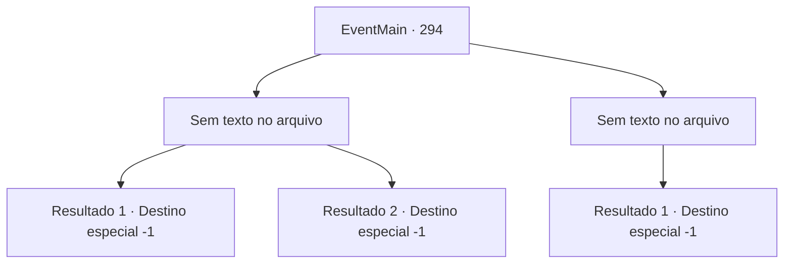

# Eventos principais · 294

[Índice da tabela](index.md) · [Índice geral](../index.md)

ID: `pt:EventMain:294` · Fonte: `EventMain4` · Versão: 1.2.47.

Mapeamento estático dos arquivos; a disponibilidade e a execução dependem do estado da run.

## Texto do evento

*Sem texto no arquivo.*

## Dados de entrada

```json
{
  "id": 294,
  "grade": 1,
  "normalGoal": "",
  "required": ""
}
```

## Mapa das escolhas



## Escolhas e resultados

### Escolha 1

*Sem texto no arquivo; o papel dessa opção depende da interface do jogo.*

Requisitos e outros campos da escolha:

```json
{
  "required": ""
}
```

#### Resultado 1.1

Depois de uma batalha feroz, você derrota Vertino.
 *clap*..*clap*..*clap*...
 Enquanto o Imperador bate palmas lentamente, outros membros da corte o seguem. Vertino franze a testa e sai da sala de audiências com seus cavaleiros. 

 "Ouçam, todos vocês. Este aventureiro terá a Princesa Esit. Faça os arranjos necessários para um casamento."

 Depois de terminar, o Imperador gesticula para você sair. Você abaixa a cabeça, agradece ao Imperador e sai da sala de audiências. Enquanto as portas se fecham, você olha para a expressão da princesa, mas não consegue entender o que ela está pensando.

Continuação registrada: [Destino especial `-1`](../destinos-especiais.md).

```json
{
  "required": "5_170_1",
  "chance": "1",
  "nextEvent": -1,
  "type": 2,
  "reward": "15_3_10|15_3_16"
}
```

#### Resultado 1.2

Depois de uma batalha feroz, você derrota Vertino.
 *clap*..*clap*..*clap*...
 Enquanto o Imperador bate palmas lentamente, outros membros da corte o seguem. Vertino franze a testa e sai da sala de audiências com seus cavaleiros. 

 "Ouçam, todos vocês. Este aventureiro terá a Princesa Esit. Faça os arranjos necessários para um casamento."

 Depois de terminar, o Imperador gesticula para você sair. Você abaixa a cabeça, agradece ao Imperador e sai da sala de audiências. Enquanto as portas se fecham, você olha para a expressão da princesa, mas não consegue entender o que ela está pensando.

Continuação registrada: [Destino especial `-1`](../destinos-especiais.md).

```json
{
  "required": "18_170_1",
  "chance": "1",
  "nextEvent": -1,
  "type": 2,
  "reward": "15_3_10|15_3_17"
}
```

### Escolha 2

*Sem texto no arquivo; o papel dessa opção depende da interface do jogo.*

Requisitos e outros campos da escolha:

```json
{
  "required": ""
}
```

#### Resultado 2.1

Depois de uma batalha feroz, você é perfurado pela lâmina de Vertino. Você cai no chão sangrando, e ele acaba com você sem hesitar.

Continuação registrada: [Destino especial `-1`](../destinos-especiais.md).

```json
{
  "required": "",
  "chance": "1",
  "nextEvent": -1,
  "type": 2,
  "reward": "15_3_11"
}
```

## Referências que chegam a este evento

- [Evento 293 · escolha 1 · resultado 1](0293.md#escolha-1)
