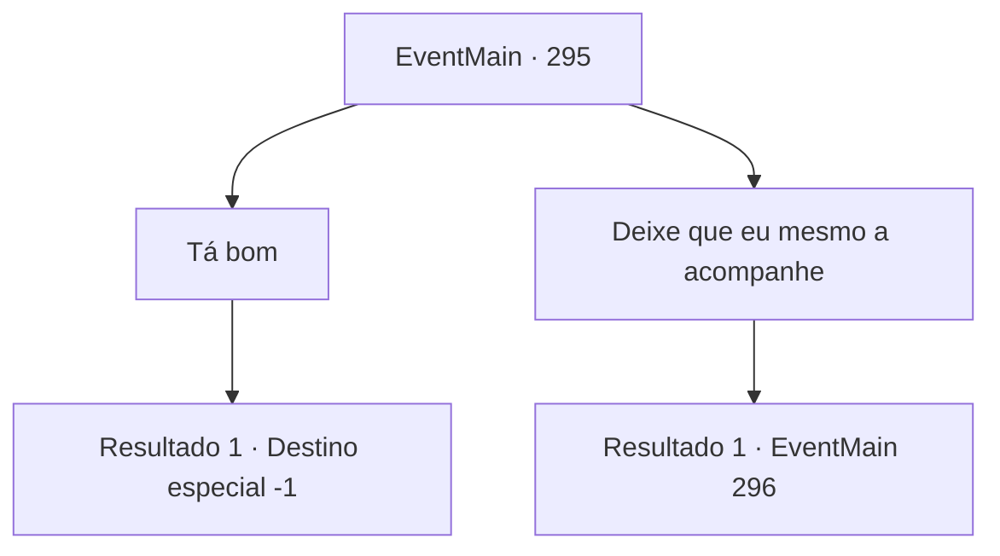

# Eventos principais · 295

[Índice da tabela](index.md) · [Índice geral](../index.md)

ID: `pt:EventMain:295` · Fonte: `EventMain4` · Versão: 1.2.47.

Mapeamento estático dos arquivos; a disponibilidade e a execução dependem do estado da run.

## Texto do evento

|drawing_egakin| Ao levar a princesa, o Capitão da Guarda, Egakin, surge montado em seu cavalo. Ele te reconhece, e salta da sela, cumprimentando-o calorosamente. 

 "Oh... Tu és o bibliotecário {1}. E tu... encontraste a princesa!"

 Parece que ele também estava a procura da princesa sob o comando do Imperador. O rosto da princesa aquece brilhantemente depois de ver Egakin. 

 "Agradeço-vos por terdes encontrado a princesa. Vou acompanhá-la até ao palácio real a partir de agora."


## Dados de entrada

```json
{
  "id": 295,
  "grade": 1,
  "normalGoal": "",
  "required": "13_2_13|1_2_100"
}
```

## Mapa das escolhas



## Escolhas e resultados

### Escolha 1

Tá bom 

Requisitos e outros campos da escolha:

```json
{
  "required": ""
}
```

#### Resultado 1.1

Você decide ouvir o Capitão da Guarda, Egakin. Egakin põe a princesa no cavalo e vai embora. Você não tem mais um objetivo de aventura, então você se dirige para a capital 'Zapen', onde você começou sua aventura.

Continuação registrada: [Destino especial `-1`](../destinos-especiais.md).

```json
{
  "required": "",
  "chance": "1",
  "nextEvent": -1,
  "type": 2,
  "reward": "15_3_14|15_3_15"
}
```

### Escolha 2

Deixe que eu mesmo a acompanhe

Requisitos e outros campos da escolha:

```json
{
  "required": ""
}
```

#### Resultado 2.1

Ele responde com um suspiro à sua resposta. 

 "Entendo. Nada pessoal, amigo."

 Ele então chuta o cavalo, na tentativa de afastá-lo. O cavalo recua para longe com um relincho. Então o corpo de Egakin começa a brilhar, e ele se transforma em um enorme dragão, afastando o ar. É o dragão de aço que você viu no covil do pico da montanha. Parece ferido e cansado, mas ainda forte.

Continuação registrada: [Evento 296](0296.md) na mesma tabela.

```json
{
  "required": "",
  "chance": "1",
  "nextEvent": 296,
  "type": 2,
  "reward": "6_2_93",
  "place": 1
}
```

## Referências que chegam a este evento

Nenhum `nextEvent` positivo da mesma tabela aponta para este nó. Isso não prova que seja inacessível: sorteio e estado de história podem selecioná-lo.

