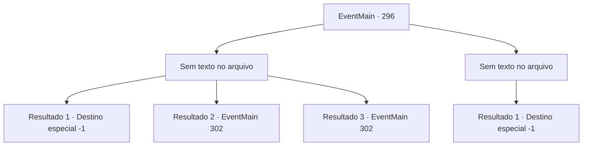

# Eventos principais · 296

[Índice da tabela](index.md) · [Índice geral](../index.md)

ID: `pt:EventMain:296` · Fonte: `EventMain4` · Versão: 1.2.47.

Mapeamento estático dos arquivos; a disponibilidade e a execução dependem do estado da run.

## Texto do evento

*Sem texto no arquivo.*

## Dados de entrada

```json
{
  "id": 296,
  "grade": 1,
  "normalGoal": "",
  "required": ""
}
```

## Mapa das escolhas



## Escolhas e resultados

### Escolha 1

*Sem texto no arquivo; o papel dessa opção depende da interface do jogo.*

Requisitos e outros campos da escolha:

```json
{
  "required": ""
}
```

#### Resultado 1.1

Você leva o dragão de aço ao limite. Quando você está prestes a dar o golpe final, você sente uma dor lascerante nas costas. 

 "D..Desculpe!"

 Atrás de você, a princesa, com uma rosto supreso deixa cair uma pedra que antes segurava nas mãos. Então você desmaia. Quando você abre os olhos, não há ninguém ao seu redor.

Continuação registrada: [Destino especial `-1`](../destinos-especiais.md).

```json
{
  "required": "21_23_1|21_11_2",
  "chance": "12",
  "nextEvent": -1,
  "type": 1,
  "reward": "15_3_14"
}
```

#### Resultado 1.2

Você leva o dragão de aço ao limite. Quando você está prestes a dar o golpe final, você sente uma dor lascerante nas costas. 

 "D..Desculpe!"

 Atrás de você, a princesa, com uma rosto supreso deixa cair uma pedra que antes segurava nas mãos. Você toca as suas costas, ainda quente do golpe, mas não sente nenhum ferimento. 

 "Eu vou voltar para o palácio. Apenas... pare de lutar. Por favor."


Continuação registrada: [Evento 302](0302.md) na mesma tabela.

```json
{
  "required": "21_23_1|21_11_2",
  "chance": "1|0_13_1",
  "nextEvent": 302,
  "type": 0,
  "reward": ""
}
```

#### Resultado 1.3

Você leva o dragão de aço ao limite. Quando você está prestes a dar o golpe final, você sente uma dor lascerante nas costas. 

 "D..Desculpe!"

 Atrás de você, a princesa, com uma rosto supreso deixa cair uma pedra que antes segurava nas mãos. Você toca as suas costas, ainda quente do golpe, mas não sente nenhum ferimento. 

 "Eu vou voltar para o palácio. Apenas... pare de lutar. Por favor."


Continuação registrada: [Evento 302](0302.md) na mesma tabela.

```json
{
  "required": "-1|20_23_1|20_11_2",
  "chance": "1",
  "nextEvent": 302,
  "type": 2,
  "reward": ""
}
```

### Escolha 2

*Sem texto no arquivo; o papel dessa opção depende da interface do jogo.*

Requisitos e outros campos da escolha:

```json
{
  "required": ""
}
```

#### Resultado 2.1

Você simplesmente não pode derrubar aquele dragão. O dragão de aço parece imbatível. Em seguida, ele solta um rugido e dispara uma forte respiração ácida. |drawing_dragonBreath| Você consegue evitar a respiração por pouco, mas o dragão voa com a princesa.

Continuação registrada: [Destino especial `-1`](../destinos-especiais.md).

```json
{
  "required": "",
  "chance": "1",
  "nextEvent": -1,
  "type": 2,
  "reward": "15_3_14"
}
```

## Referências que chegam a este evento

- [Evento 295 · escolha 2 · resultado 1](0295.md#escolha-2)
