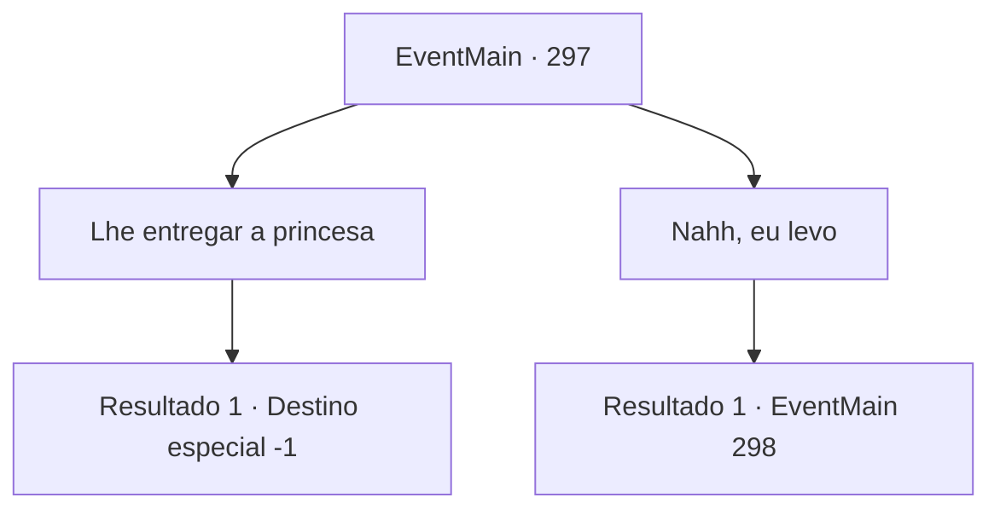

# Eventos principais · 297

[Índice da tabela](index.md) · [Índice geral](../index.md)

ID: `pt:EventMain:297` · Fonte: `EventMain4` · Versão: 1.2.47.

Mapeamento estático dos arquivos; a disponibilidade e a execução dependem do estado da run.

## Texto do evento

Ao transportar a princesa, Vertino aparece diante de você montado em seu cavalo. 

 "Vou levar a princesa Esit daqui."

 Ele fala com firmeza, como se não houvesse outra opção.

## Dados de entrada

```json
{
  "id": 297,
  "grade": 1,
  "normalGoal": "",
  "required": "13_2_13|1_2_100"
}
```

## Mapa das escolhas



## Escolhas e resultados

### Escolha 1

Lhe entregar a princesa 

Requisitos e outros campos da escolha:

```json
{
  "required": ""
}
```

#### Resultado 1.1

Você entrega a princesa para Vertino. Ele coloca a princesa no cavalo sem dizer nada. Ela não resiste, como se tivesse desistido. O cavalo de Vertino foge com a princesa, fazendo poeira em seu caminho. Você não tem mais um objetivo de aventura, então você se dirige para a capital 'Zapen', onde você começou sua aventura.

Continuação registrada: [Destino especial `-1`](../destinos-especiais.md).

```json
{
  "required": "",
  "chance": "1",
  "nextEvent": -1,
  "type": 2,
  "reward": "15_3_13|15_3_15|15_3_16"
}
```

### Escolha 2

Nahh, eu levo

Requisitos e outros campos da escolha:

```json
{
  "required": ""
}
```

#### Resultado 2.1

Depois de ouvir sua resposta, ele balança a cabeça e fala. 

 "Suas opções não incluíam uma recusa. Você está ultrapassando a linha."

 Ele puxa sua espada ensanguentada. Embora ferido e cansado, você tem a impressão de que ele não será um inimigo fácil.

Continuação registrada: [Evento 298](0298.md) na mesma tabela.

```json
{
  "required": "",
  "chance": "1",
  "nextEvent": 298,
  "type": 2,
  "reward": "6_2_94",
  "place": 1
}
```

## Referências que chegam a este evento

Nenhum `nextEvent` positivo da mesma tabela aponta para este nó. Isso não prova que seja inacessível: sorteio e estado de história podem selecioná-lo.

