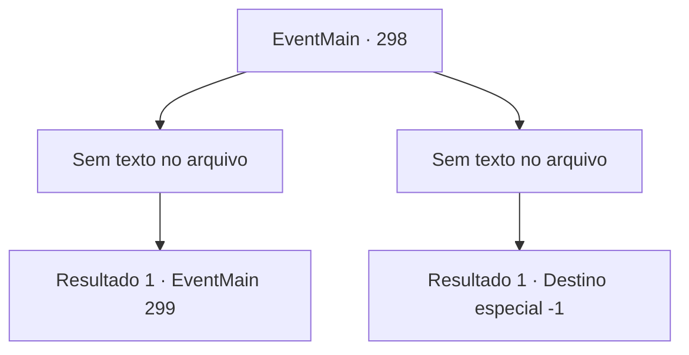

# Eventos principais · 298

[Índice da tabela](index.md) · [Índice geral](../index.md)

ID: `pt:EventMain:298` · Fonte: `EventMain4` · Versão: 1.2.47.

Mapeamento estático dos arquivos; a disponibilidade e a execução dependem do estado da run.

## Texto do evento

*Sem texto no arquivo.*

## Dados de entrada

```json
{
  "id": 298,
  "grade": 1,
  "normalGoal": "",
  "required": ""
}
```

## Mapa das escolhas



## Escolhas e resultados

### Escolha 1

*Sem texto no arquivo; o papel dessa opção depende da interface do jogo.*

Requisitos e outros campos da escolha:

```json
{
  "required": ""
}
```

#### Resultado 1.1


 "Tosse*...! Você... Você se atreve..."

 Vertino não consegue terminar sua frase. Você termina sua vida com um golpe decisivo, e toma a reluzente espada do agora morto Vertino. Então você coloca a princesa no cavalo de Vertino e segue para o palácio real. 

 Alguns momentos depois, você chega aos portões do palácio real com a princesa. O guarda reconhece a princesa e abre o portão imediatamente. Você vai direto para a sala de audiência, onde se encontra com o Imperador. |drawing_emperor| Ele está usando um anel em cada um de seus nove dedos, cada um tomado dos Imperadores de nações conquistadas. Você se ajoelha diante do Imperador e o cumprimenta. 

 "Oh.. Vejo que você trouxe a princesa. Agradeço por encontrar meu tesouro. Sim... devo insistir em ter uma conversa de pai e filha primeiro, se você não se importa."

 Enquanto o Imperador o afasta, uma empregada se aproxima de você e o leva para o quarto de hóspedes. Você decide esperar lá pelo Imperador chamá-lo de volta.

Continuação registrada: [Evento 299](0299.md) na mesma tabela.

```json
{
  "required": "",
  "chance": "1",
  "nextEvent": 299,
  "type": 2,
  "reward": "3_109_1|5_135_3"
}
```

### Escolha 2

*Sem texto no arquivo; o papel dessa opção depende da interface do jogo.*

Requisitos e outros campos da escolha:

```json
{
  "required": ""
}
```

#### Resultado 2.1

Você é forçado a fugir sangrando, levado ao seu limite. Vertino não o persegue enquanto você está fugindo. Ele simplesmente coloca a princesa no cavalo e vai embora deixando para trás poeira.

Continuação registrada: [Destino especial `-1`](../destinos-especiais.md).

```json
{
  "required": "",
  "chance": "1",
  "nextEvent": -1,
  "type": 2,
  "reward": "15_3_13|15_3_15|15_3_16"
}
```

## Referências que chegam a este evento

- [Evento 297 · escolha 2 · resultado 1](0297.md#escolha-2)
