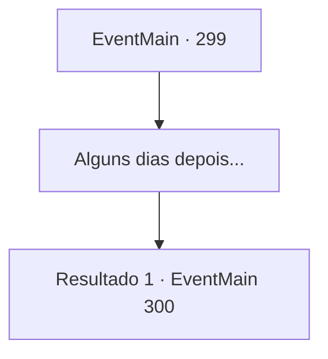

# Eventos principais · 299

[Índice da tabela](index.md) · [Índice geral](../index.md)

ID: `pt:EventMain:299` · Fonte: `EventMain4` · Versão: 1.2.47.

Mapeamento estático dos arquivos; a disponibilidade e a execução dependem do estado da run.

## Texto do evento

*Sem texto no arquivo.*

## Dados de entrada

```json
{
  "id": 299,
  "grade": 1,
  "normalGoal": "",
  "required": ""
}
```

## Mapa das escolhas



## Escolhas e resultados

### Escolha 1

Alguns dias depois...

Requisitos e outros campos da escolha:

```json
{
  "required": ""
}
```

#### Resultado 1.1

Aparentemente, o 'momento' do imperador é de alguns dias. Depois de esperar por dias para o Imperador entrar em contato com você, uma empregada entra no quarto de hóspedes. Ela então leva você ao Imperador. Ele fala enquanto toca a barba com a mão, decorada com anéis. 

 "Perguntei à princesa o que aconteceu, e ela não disse uma palavra. Não que isso importe de qualquer maneira... sim, qual é o seu desejo?"


Continuação registrada: [Evento 300](0300.md) na mesma tabela.

```json
{
  "required": "",
  "chance": "1",
  "nextEvent": 300,
  "type": 2,
  "reward": ""
}
```

## Referências que chegam a este evento

- [Evento 298 · escolha 1 · resultado 1](0298.md#escolha-1)
- [Evento 302 · escolha 1 · resultado 1](0302.md#escolha-1)
- [Evento 302 · escolha 2 · resultado 1](0302.md#escolha-2)
