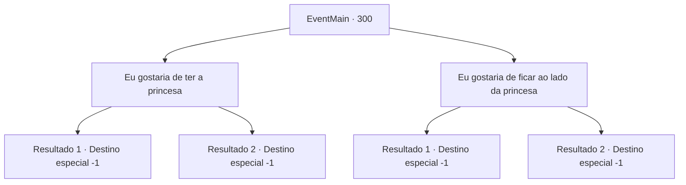

# Eventos principais · 300

[Índice da tabela](index.md) · [Índice geral](../index.md)

ID: `pt:EventMain:300` · Fonte: `EventMain4` · Versão: 1.2.47.

Mapeamento estático dos arquivos; a disponibilidade e a execução dependem do estado da run.

## Texto do evento

*Sem texto no arquivo.*

## Dados de entrada

```json
{
  "id": 300,
  "grade": 1,
  "normalGoal": "",
  "required": ""
}
```

## Mapa das escolhas



## Escolhas e resultados

### Escolha 1

Eu gostaria de ter a princesa

Requisitos e outros campos da escolha:

```json
{
  "required": "11_0_0"
}
```

#### Resultado 1.1

O Imperador cai na gargalhada depois de ouvir seu desejo. 

 "Ahahahaha!!! Você tem coragem, eu vou te dar isso! Muito bem. Escute aqui. Este aventureiro terá a Princesa Esit. Faça os arranjos necessários para um casamento."

 Depois de terminar, o Imperador gesticula para você sair. Você abaixa a cabeça, agradece ao Imperador e sai da sala de audiências. Enquanto as portas se fecham, você olha para a expressão da princesa, mas não consegue entender o que ela está pensando.

Continuação registrada: [Destino especial `-1`](../destinos-especiais.md).

```json
{
  "required": "5_170_1",
  "chance": "1",
  "nextEvent": -1,
  "type": 2,
  "reward": "15_3_10|15_3_16"
}
```

#### Resultado 1.2

O Imperador cai na gargalhada depois de ouvir seu desejo. 

 "Ahahahaha!!! Você tem coragem, eu vou te dar isso! Muito bem. Escute aqui. Este aventureiro terá a Princesa Esit. Faça os arranjos necessários para um casamento."

 Depois de terminar, o Imperador gesticula para você sair. Você abaixa a cabeça, agradece ao Imperador e sai da sala de audiências. Enquanto as portas se fecham, você olha para a expressão da princesa, mas não consegue entender o que ela está pensando.

Continuação registrada: [Destino especial `-1`](../destinos-especiais.md).

```json
{
  "required": "18_170_1",
  "chance": "1",
  "nextEvent": -1,
  "type": 2,
  "reward": "15_3_10|15_3_17"
}
```

### Escolha 2

Eu gostaria de ficar ao lado da princesa

Requisitos e outros campos da escolha:

```json
{
  "required": ""
}
```

#### Resultado 2.1

Você diz que tudo o que você quer fazer é ficar ao lado da princesa para sempre. O Imperador questiona de volta depois de ouvir seu desejo, surpreso. 

 "Isso é realmente tudo que você quer de mim?"

 Você responde que sim, e o Imperador assente. Ele então fala com um de seus súditos. 

 "Eduque esse aventureiro. A princesa deve ter um bom conselheiro, afinal."

 Você abaixa a cabeça, agradece ao Imperador e sai da sala de audiências. Enquanto as portas se fecham, você olha para a expressão da princesa, mas não consegue entender o que ela está pensando.

Continuação registrada: [Destino especial `-1`](../destinos-especiais.md).

```json
{
  "required": "5_170_1",
  "chance": "1",
  "nextEvent": -1,
  "type": 2,
  "reward": "15_3_12"
}
```

#### Resultado 2.2

Você diz que tudo o que você quer fazer é ficar ao lado da princesa para sempre. O Imperador questiona de volta depois de ouvir seu desejo, surpreso. 

 "Isso é realmente tudo que você quer de mim?"

 Você responde que sim, e o Imperador assente. Ele então fala com um de seus súditos. 

 "Eduque esse aventureiro. A princesa deve ter um bom conselheiro, afinal."

 Você abaixa a cabeça, agradece ao Imperador e sai da sala de audiências. Enquanto as portas se fecham, você olha para a expressão da princesa, mas não consegue entender o que ela está pensando.

Continuação registrada: [Destino especial `-1`](../destinos-especiais.md).

```json
{
  "required": "18_170_1",
  "chance": "1",
  "nextEvent": -1,
  "type": 2,
  "reward": "15_3_12|15_3_17"
}
```

## Referências que chegam a este evento

- [Evento 299 · escolha 1 · resultado 1](0299.md#escolha-1)
