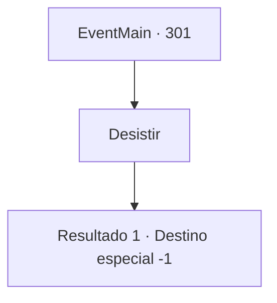

# Eventos principais · 301

[Índice da tabela](index.md) · [Índice geral](../index.md)

ID: `pt:EventMain:301` · Fonte: `EventMain4` · Versão: 1.2.47.

Mapeamento estático dos arquivos; a disponibilidade e a execução dependem do estado da run.

## Texto do evento

|drawing_sunset|  Exausto, você se dirige para um penhasco próximo, onde você possa ter uma boa visão do oceano.  Longe, o sol põe-se sob o horizonte, colorindo o mar e o céu de vermelho.  Por muito tempo e sem sucesso, você procurou a princesa.  Embora tenha procurado a princesa por Deus sabe quanto tempo, mal consegue lembrar seu rosto.  Você observa o pôr do sol em silêncio, sentado na ponta do penhasco.

## Dados de entrada

```json
{
  "id": 301,
  "grade": 1,
  "normalGoal": "",
  "required": "13_2_11|1_2_100"
}
```

## Mapa das escolhas



## Escolhas e resultados

### Escolha 1

Desistir 

Requisitos e outros campos da escolha:

```json
{
  "required": ""
}
```

#### Resultado 1.1

Você decide parar sua busca pela princesa. Você tenta se lembrar de como ela se parecia, mas a cada segundo que passa parece ser mais difícil. Você tira a sujeira da sua bunda e segue em direção à sua cidade natal.

Continuação registrada: [Destino especial `-1`](../destinos-especiais.md).

```json
{
  "required": "",
  "chance": "1",
  "nextEvent": -1,
  "type": 2,
  "reward": "15_3_14"
}
```

## Referências que chegam a este evento

Nenhum `nextEvent` positivo da mesma tabela aponta para este nó. Isso não prova que seja inacessível: sorteio e estado de história podem selecioná-lo.

