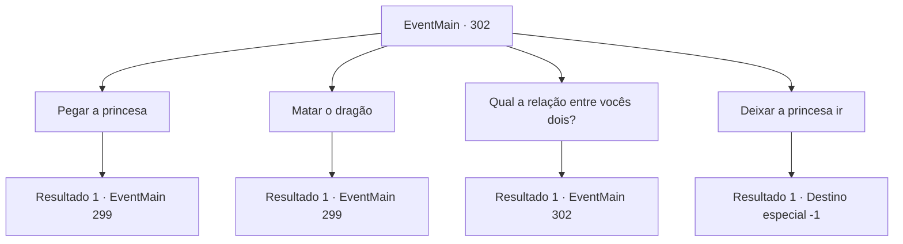

# Eventos principais · 302

[Índice da tabela](index.md) · [Índice geral](../index.md)

ID: `pt:EventMain:302` · Fonte: `EventMain4` · Versão: 1.2.47.

Mapeamento estático dos arquivos; a disponibilidade e a execução dependem do estado da run.

## Texto do evento

*Sem texto no arquivo.*

## Dados de entrada

```json
{
  "id": 302,
  "grade": 1,
  "normalGoal": "",
  "required": ""
}
```

## Mapa das escolhas



## Escolhas e resultados

### Escolha 1

Pegar a princesa

Requisitos e outros campos da escolha:

```json
{
  "required": ""
}
```

#### Resultado 1.1

O dragão está deitado no chão, respirando pesadamente. Esta é a oportunidade perfeita para tirar sua vida, mas você decide atender ao pedido da princesa. Então você a pega pela mão e vai para o palácio real. 

 Algumas horas depois, você se aproxima do guarda do portão e pede uma audiência com a Emepror. Ele reconhece a princesa e abre o portão imediatamente. Ele então leva você e a princesa para a sala de audiência. |drawing_emperor| Ele está usando um anel em cada um de seus nove dedos, cada um tomado dos Imperadores de nações conquistadas. Você se ajoelha diante do Imperador e o cumprimenta. 

 "Oh.. Vejo que você trouxe a princesa. Agradeço por encontrar meu tesouro. Sim... devo insistir em ter uma conversa de pai e filha primeiro, se você não se importa."

 Enquanto o Imperador o afasta, uma empregada se aproxima de você e o leva para o quarto de hóspedes. Você decide esperar lá pelo Imperador chamá-lo de volta.

Continuação registrada: [Evento 299](0299.md) na mesma tabela.

```json
{
  "required": "",
  "chance": "1",
  "nextEvent": 299,
  "type": 2,
  "reward": ""
}
```

### Escolha 2

Matar o dragão

Requisitos e outros campos da escolha:

```json
{
  "required": "5_142_0"
}
```

#### Resultado 2.1

Você decide matar o dragão para sempre. <link=shake>

 "N...Não! Por favor!! Não!!!"

</link> Apesar do grito choroso da princesa, você tira a vida do dragão. |drawing_killDragon| A princesa perde o resto de compostura e desaba no chão. Você a pega pela mão e segue para o palácio real. 

 Algumas horas depois, você se aproxima do guarda do portão e pede uma audiência com a Emepror. Ele reconhece a princesa e abre o portão imediatamente. Ele então leva você e a princesa para a sala de audiência. |drawing_emperor| Ele está usando um anel em cada um de seus nove dedos, cada um tomado dos Imperadores de nações conquistadas. Você se ajoelha diante do Imperador e o cumprimenta. 

 "Oh.. Vejo que você trouxe a princesa. Agradeço por encontrar meu tesouro. Sim... devo insistir em ter uma conversa de pai e filha primeiro, se você não se importa."

 Enquanto o Imperador o afasta, uma empregada se aproxima de você e o leva para o quarto de hóspedes. Você decide esperar lá pelo Imperador chamá-lo de volta.

Continuação registrada: [Evento 299](0299.md) na mesma tabela.

```json
{
  "required": "",
  "chance": "1",
  "nextEvent": 299,
  "type": 2,
  "reward": "5_170_1"
}
```

### Escolha 3

Qual a relação entre vocês dois?

Requisitos e outros campos da escolha:

```json
{
  "required": "5_142_0"
}
```

#### Resultado 3.1

Respondendo à sua pergunta, ela revela que de fato fugiu do palácio real, em vez de ser sequestrada pelo dragão. Segundo a princesa, ela estava noiva do príncipe da nação vizinha de Arma, Vertino. 

 "Sua Majestade pretende me usar como moeda de troca para ganhar o controle da nação vizinha... mas eu me recuso a ser usada como seu fantoche. Vou me casar com a pessoa com quem quero me casar. Então, com a ajuda do Capitão da Guarda, eu mesmo escapei do palácio. Por mais inacreditável que pareça, este dragão é Egakin, o Capitão da Guarda."


Continuação registrada: [Evento 302](0302.md) na mesma tabela.

```json
{
  "required": "",
  "chance": "1",
  "nextEvent": 302,
  "type": 2,
  "reward": "5_142_1"
}
```

### Escolha 4

Deixar a princesa ir

Requisitos e outros campos da escolha:

```json
{
  "required": "5_142_1|1_3_0"
}
```

#### Resultado 4.1

Você decide deixar a princesa ir. Ela arregala os olhos e pergunta novamente. 

 "S... Sério? Obrigado... Eu nunca vou esquecer isso."

 Você assente e dá um passo para trás. A voz da princesa se quebra em lágrimas quando ela expressa sua gratidão, e o dragão também agradece. 

 "Agradeço por nos mostrar misericórdia. Este é um pequeno presente meu. Espero que você aceite."

 Ele corta um de seus chifres e o entrega a você. Ele então voa para o céu, desaparecendo com a princesa.

Continuação registrada: [Destino especial `-1`](../destinos-especiais.md).

```json
{
  "required": "",
  "chance": "1",
  "nextEvent": -1,
  "type": 2,
  "reward": "15_3_18|3_199_1|0_3_5"
}
```

## Referências que chegam a este evento

- [Evento 296 · escolha 1 · resultado 2](0296.md#escolha-1)
- [Evento 296 · escolha 1 · resultado 3](0296.md#escolha-1)
- [Evento 302 · escolha 3 · resultado 1](0302.md#escolha-3)
