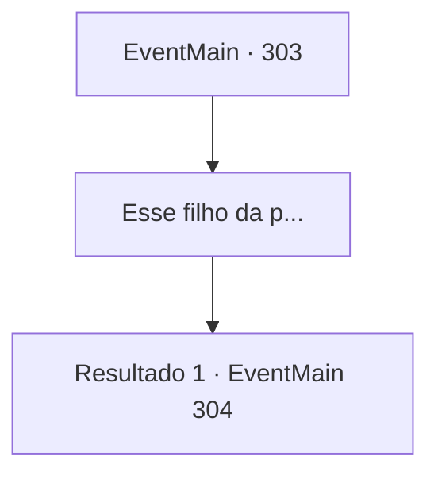

# Eventos principais · 303

[Índice da tabela](index.md) · [Índice geral](../index.md)

ID: `pt:EventMain:303` · Fonte: `EventMain4` · Versão: 1.2.47.

Mapeamento estático dos arquivos; a disponibilidade e a execução dependem do estado da run.

## Texto do evento

 Você sabe que seu irmão caçula está sendo mantido refém. Incapaz de desistir de pagar o débito, você sente seus ombros pesarem com a ansiedade.

## Dados de entrada

```json
{
  "id": 303,
  "grade": 1,
  "normalGoal": "",
  "required": "13_3_0"
}
```

## Mapa das escolhas



## Escolhas e resultados

### Escolha 1

Esse filho da p...

Requisitos e outros campos da escolha:

```json
{
  "required": ""
}
```

#### Resultado 1.1

Você evoca uma imagem de Anton e amaldiçoa.  Sua respiração entra em contato com o ar frio, dissipando-se na névoa branca.  Você ainda tem cerca de 1000 de ouro para pagar. Você não tem um segundo a perder.  Ao passar por uma cidade, você encontra um pedido escrito no quadro de avisos.  — Nossa cidade está sofrendo com morcegos sugadores de sangue. Cuide desses diabinhos e haverá pagamento.

Continuação registrada: [Evento 304](0304.md) na mesma tabela.

```json
{
  "required": "",
  "chance": "1",
  "nextEvent": 304,
  "type": 2,
  "reward": "13_3_1"
}
```

## Referências que chegam a este evento

Nenhum `nextEvent` positivo da mesma tabela aponta para este nó. Isso não prova que seja inacessível: sorteio e estado de história podem selecioná-lo.

