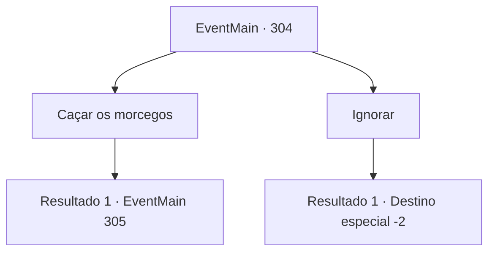

# Eventos principais · 304

[Índice da tabela](index.md) · [Índice geral](../index.md)

ID: `pt:EventMain:304` · Fonte: `EventMain4` · Versão: 1.2.47.

Mapeamento estático dos arquivos; a disponibilidade e a execução dependem do estado da run.

## Texto do evento

*Sem texto no arquivo.*

## Dados de entrada

```json
{
  "id": 304,
  "grade": 1,
  "normalGoal": "",
  "required": ""
}
```

## Mapa das escolhas



## Escolhas e resultados

### Escolha 1

Caçar os morcegos

Requisitos e outros campos da escolha:

```json
{
  "required": ""
}
```

#### Resultado 1.1

Você estica seu corpo, indo para a caverna infestada de morcegos marcada no papel do pedido. Você não é o primeiro aventureiro lá. Muitas pessoas já estão lutando contra os morcegos, com tochas nas mãos. Você rapidamente saca sua arma, atacando os morcegos vampiros.

Continuação registrada: [Evento 305](0305.md) na mesma tabela.

```json
{
  "required": "",
  "chance": "1",
  "nextEvent": 305,
  "type": 2,
  "reward": "6_0_11",
  "place": 6
}
```

### Escolha 2

Ignorar

Requisitos e outros campos da escolha:

```json
{
  "required": ""
}
```

#### Resultado 2.1

Você ignora o pedido e vai para outro lugar.

Continuação registrada: [Destino especial `-2`](../destinos-especiais.md).

```json
{
  "required": "",
  "chance": "1",
  "nextEvent": -2,
  "type": 2,
  "reward": ""
}
```

## Referências que chegam a este evento

- [Evento 303 · escolha 1 · resultado 1](0303.md#escolha-1)
