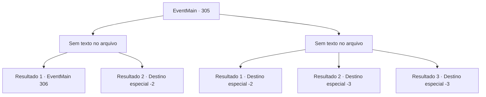

# Eventos principais · 305

[Índice da tabela](index.md) · [Índice geral](../index.md)

ID: `pt:EventMain:305` · Fonte: `EventMain4` · Versão: 1.2.47.

Mapeamento estático dos arquivos; a disponibilidade e a execução dependem do estado da run.

## Texto do evento

*Sem texto no arquivo.*

## Dados de entrada

```json
{
  "id": 305,
  "grade": 1,
  "normalGoal": "",
  "required": ""
}
```

## Mapa das escolhas



## Escolhas e resultados

### Escolha 1

*Sem texto no arquivo; o papel dessa opção depende da interface do jogo.*

Requisitos e outros campos da escolha:

```json
{
  "required": ""
}
```

#### Resultado 1.1

Você estabeleceu um recorde de matança de morcegos. Os outros não são páreo para você. Você então junta os morcegos mortos, colocando-os em sua mochila. Então, alguns dos aventureiros que estavam lutando contra os morcegos se aproximam de você. 

 "Ei. Você se importaria de... 'compartilhar' alguns de seus morcegos conosco?"


Continuação registrada: [Evento 306](0306.md) na mesma tabela.

```json
{
  "required": "",
  "chance": "1",
  "nextEvent": 306,
  "type": 2,
  "reward": ""
}
```

#### Resultado 1.2

Você estabeleceu um recorde de matança de morcegos. Os outros não são páreo para você. Você então junta os morcegos mortos, colocando-os em sua mochila. Você volta para a cidade e mostra os morcegos mortos ao prefeito. 

 "Obrigada. Você nos prestou um grande serviço. Eu não tenho ideia por que, de repente, há morcegos em todos os lugares, no entanto..."

 Ele sorri calorosamente. Você vê algumas cicatrizes ao redor de seus lábios. Ele então lhe dá o pagamento prometido. Você sai do gabinete do prefeito com uma pequena bolsa de couro cheia de ouro.

Continuação registrada: [Destino especial `-2`](../destinos-especiais.md).

```json
{
  "required": "20_1_2",
  "chance": "1",
  "nextEvent": -2,
  "type": 2,
  "reward": "0_4_40"
}
```

### Escolha 2

*Sem texto no arquivo; o papel dessa opção depende da interface do jogo.*

Requisitos e outros campos da escolha:

```json
{
  "required": ""
}
```

#### Resultado 2.1

Esqueça a luta contra os morcegos - você mal consegue sair vivo! Infelizmente, você não tem escolha a não ser assistir os outros aventureiros partirem com os morcegos mortos.

Continuação registrada: [Destino especial `-2`](../destinos-especiais.md).

```json
{
  "required": "1_0_2|1_1_2",
  "chance": "1",
  "nextEvent": -2,
  "type": 2,
  "reward": "0_0_-1|0_1_-1"
}
```

#### Resultado 2.2

Esqueça a luta contra os morcegos - você mal consegue sair vivo! No entanto, ao fugir dos morcegos, você perde a noção de sua espaço, caindo em uma parte mais profunda da caverna.

Continuação registrada: [Destino especial `-3`](../destinos-especiais.md).

```json
{
  "required": "2_0_2",
  "chance": "1",
  "nextEvent": -3,
  "type": 2,
  "reward": "0_0_-1|0_1_-1"
}
```

#### Resultado 2.3

Esqueça a luta contra os morcegos - você mal consegue sair vivo! No entanto, ao fugir dos morcegos, você perde a noção de sua espaço, caindo em uma parte mais profunda da caverna.

Continuação registrada: [Destino especial `-3`](../destinos-especiais.md).

```json
{
  "required": "2_1_2",
  "chance": "1",
  "nextEvent": -3,
  "type": 2,
  "reward": "0_0_-1|0_1_-1"
}
```

## Referências que chegam a este evento

- [Evento 304 · escolha 1 · resultado 1](0304.md#escolha-1)
